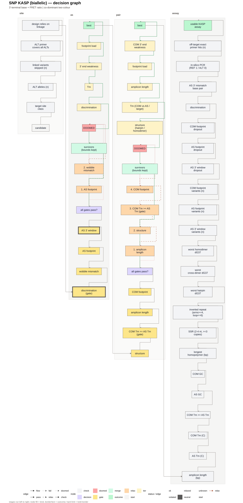
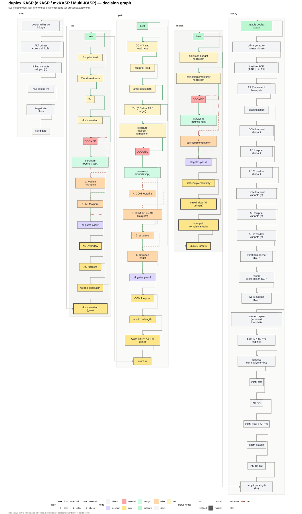

# tidymarkers

<!-- badges: start -->
[](https://github.com/Stathmin/tidymarkers/actions/workflows/R-CMD-check.yaml)
[](https://lifecycle.r-lib.org/articles/stages.html)
[](LICENSE)
<!-- badges: end -->

Design and quality control of genetic markers in pure R. `tidymarkers` is
**genome-agnostic**: give it a reference (FASTA, an indexed `marker_genome()`, a
`DNAStringSet` or a Bioconductor `BSgenome`) and variation (a VCF or the tidy
variant table), and it designs allele-specific and common primers on either
strand, scores them, and tells you which candidates survived and why the others
did not.

The same grammar covers the marker chemistries a lab actually runs: KASP,
CAPS/dCAPS, tetra-primer ARMS, HRM, Sanger, SSR, InDel-size, TaqMan/dPCR,
SNaPshot, LAMP/RPA and CRISPR-Dx. Thermodynamics come from `TmCalculator` and
OligoArrayAux, Taq-aware allelic discrimination from `DECIPHER`, and
genome-wide specificity from `Biostrings` (with an optional `rBLAST` database or
an `Rsubread` FM-index).

## Installation

`tidymarkers` is not on CRAN; install it from GitHub. `pak` also resolves the
system libraries (BLAST+, cairo):

```r
install.packages("pak")
pak::pak("Stathmin/tidymarkers", sysreqs = TRUE)
```

`DECIPHER` needs [OligoArrayAux](https://ib.berkeley.edu/labs/zucker/software/oligoarrayaux.html);
one call builds it into your user cache, so nothing has to be on `PATH`:

```r
tidymarkers::marker_install_tools()   # once; hybrid-min / hybrid-ss-min
```

**R >= 4.5** is required. The hard `Imports` are Bioconductor plus the tidyverse;
the heavy optional pieces (a `TxDb`/`BSgenome`, `Rsubread`, `ensembldb`) live in
`Suggests` and are never installed implicitly. `marker_cache_dir()` reports where
downloaded genomes, variation, indexes and the external tools are kept
(`tools::R_user_dir()`), so nothing is written inside the package or the project.

## Quick start

A self-contained run: one SNP from a gene model, one assay, one verdict.

```r
library(tidymarkers)

genome <- ath_genome()                                  # TAIR10 from Ensembl Plants, cached after first use
gene   <- ensembl_gene("AT4G00650")                     # FRI / AT4G00650
snp    <- pick_target_snp(ensembl_variants(gene$chrom, gene$start, gene$end),
                          genome, gene)

assay <- assemble_kasp_assay(genome, snp)               # both strands by default
print(assay)                                            # <marker_assay> summary

marker_design_checks(assay)                             # criterion / observed / limit / pass
passes_all(assay)                                       # one TRUE/FALSE
```

The bundled example targets every marker type, so the same call works without a
network download once a local reference is supplied:

```r
loci <- marker_example("snp")                           # inst/extdata/example_targets.csv
design_kasp_markers(genome, loci)                       # pass / warn / fail per locus
```

Two project-level knobs are arguments rather than constants: `strands` (search
the AS primer on `"+"`, `"-"` or both — the common primer flips with it) and
`tm_range` (the permitted melting window, °C).

`ath_genome()` is only a convenience downloader for the demo: it pulls one gzipped
TAIR10 FASTA from the Ensembl Plants FTP into `marker_cache_dir()` and never
touches the package repository. Any other reference is passed in directly — a
FASTA path through `marker_genome()` / `read_genome_fasta()`, a `DNAStringSet`, or
a Bioconductor `BSgenome` (see `vignette("custom-genome")`).

## How a candidate is chosen

Candidate AS x COM pairs first face **hard gates** — a known variant under the
primer, an allele the primer cannot discriminate, `Tm_COM < Tm_AS`, an amplicon
outside the window, impossible secondary structure. Survivors are ranked
**lexicographically by tier**; within a tier the bottleneck (`min`) decides, so an
assay is only as good as its weakest part. If nothing clears the gates, they are
lifted one at a time, least grave first, and the least-bad candidate is returned
with a warning naming every violated gate. A marker therefore always arrives with
a reason, never a silent `NA`.

That policy is **data, not prose**: `marker_decision_schema()` reads the same
constants as the engine (`KASP_GATES_*`, `KASP_RELAX_*`, `KASP_TIERS_*`), so the
graph cannot drift from the code. `plot_decision_tree()` draws it, and an
assembled assay carries the graph in `assay$decision` with per-node status
(green = applied, amber = relaxed, red = violated).




KASP is a family, not a single test. `marker_schemes()` declares the chemistries
and one criterion registry tags every check with the schemes it applies to, so
`plot_decision_tree(scheme = )` draws the tree for SNP/indel/multiallelic KASP,
for the **duplex** chemistries (dKASP, mxKASP, Multi-KASP: two loci per tube plus
a compatibility stage), for ASQ/PACE, and for the marker-agnostic subset "any
primer pair" (composition, structure, repeats, off-target).

## What the pipeline computes

1. `ensembl_gene()` / `ensembl_variants()` — gene model and SNPs from Ensembl
   Plants (1001 Genomes), cached and retried.
2. `pick_target_snp()` — chooses a designable substitution: prefers a clean 3'
   AS window (no other variant in the last 5 nt, best of both strands), then
   missense > splice > synonymous > UTR, and transitions.
3. `design_common_primers()` / `design_as_primers()` — a candidate scan over
   strand x length x mismatch position x base, scored with `TmCalculator`,
   `Biostrings` and `DECIPHER`.
4. `primer_thermo()` / `dimer_thermo()` — Tm, GC, hairpins, 3'-terminal
   stability, self- and cross-complementarity; `has_run()` / `find_repeats()` for
   homopolymers and SSRs; `wobble_mismatch()` flags weak G:T / A:C pairs.
5. `specificity_seed()` / `in_silico_pcr()` / `blast_primers()` — 3' seed hits,
   virtual amplification (uniqueness and product size), BLAST.
6. `assemble_kasp_assay()` — one assay for SNP/MNP/InDel;
   `design_kasp_markers()` — a batch with a `pass`/`warn`/`fail` verdict per locus.
7. `marker_design_checks()` — acceptance criteria in `KASP_LIMITS`;
   `kasp_mix_recipe()` — the primer mix and reaction recipe.

## Shipped objects

| Function | Returns |
|---|---|
| `assemble_kasp_assay()` | `<marker_assay>`: primers, amplicon, discrimination, `$decision` |
| `marker_design_checks()` | tidy table: `stage`, `criterion`, `observed`, `limit`, `status` |
| `marker_risk()` | `low` / `medium` / `high` with the reasons behind it |
| `marker_decision_text()` | the decision graph of a scheme as readable text (`evidence = TRUE` adds each check's evidence rung) |
| `write_kasp_results()` | `marker_design.csv`, `marker_primer_qc.csv`, `marker_dimer_dg.csv` |
| `marker_export()` | `markers.csv`, `attempts.csv`, `primers.csv`, `solved.rds` + the artefact |
| `marker_artefact()` | `artefact.json` (hashed inputs, provenance, overrides), `decisions.csv`, `checks.csv` |
| `marker_replay()` | re-runs a saved artefact and compares the verdict per target |
| `marker_record_outcome()` | appends a lab result (`works` / `fails` / `unknown`) to an artefact's `outcomes.csv`, bound to its `id` |
| `marker_primers()` | the oligos of any marker, as a named vector or tidy table |

## Documentation

The chemistry vignettes are the manual; each one states its biology, its gates
and its failures:

| Vignette | Schemes |
|---|---|
| `vignette("kasp-intro")` | the full workflow, start to finish |
| `vignette("markers-kasp")` | `snp`, `indel`, `multi`, `duplex`, `lax`, `asq`, `primer` |
| `vignette("markers-gel")` | `caps`, `arms`, `hrm`, `ssr`, `indel_size` |
| `vignette("markers-probe")` | `taqman`, `dpcr`, `snapshot`, `castpcr` |
| `vignette("markers-isothermal")` | `lamp`, `rpa` |
| `vignette("markers-crispr-sequencing")` | `crispr`, `sanger` |
| `vignette("custom-genome")` | your own FASTA / VCF |
| `vignette("reading-results")` | export a solved plan, audit a candidate, read a rejection |

Repository-level documents: [`ROADMAP.md`](ROADMAP.md) (open work and design
decisions), [`NEWS.md`](NEWS.md) (changelog), [`VALIDATION.md`](VALIDATION.md)
(what is checked against the literature and what is not),
[`CONTRIBUTING.md`](CONTRIBUTING.md) (conventions and the merge gate) and
[`docs/INDEX.md`](docs/INDEX.md) (the index of every document and every
committed figure).

## Reproducibility

`renv.lock` pins the exact versions used in development. It is deliberately not
activated by an `.Rprofile` or a `renv/` directory, because activation makes
`R CMD build` / `R CMD check` on a fresh clone resolve against an empty library
and fail before `renv::restore()` can run. Use `renv::init()` then
`renv::restore()` when you need the pinned snapshot; development installs use
`Rscript dev/install-deps.R`.

External data never ships with the package: the TAIR10 genome and the 1001
Genomes variation are downloaded from Ensembl Plants, and the BLAST/FM indexes
and thermodynamic binaries are built once, all inside `marker_cache_dir()`. The
download source is an FTP path on `ftp.ebi.ac.uk`, so it does not depend on this
repository's URL.

## Validation

This is a design tool, so the honest question is what its rules rest on. The
short answer is published measurements, not a bench run by the maintainers:

- **No wet-lab data was produced here.** No `tidymarkers` design has been
  validated at the bench by the authors of this package.
- **A head-to-head run against Primer3 2.6.1**, on the layer the two tools share:
  the same oligos through both engines (Tm mean offset +3.92 °C, sd 0.25,
  ρ = 0.999; heterodimer dG ρ = 1.000), and the same 20 SNP loci through both
  designers, with Primer3 constrained to this package's amplicon window. Of the
  8 loci where a Primer3 pair cleared every one of this package's seven gates,
  5 also got a designed assay. Reproduce it with
  `Rscript dev/primer3-crosscheck.R`.
- **Specificity scored against ground truth, not against PolyMarker**: on TAIR10
  the answer is enumerated (3′-seed screen 8/8 equal; exact in-silico PCR 3/3
  equal), with BLAST+ as a speed/recall baseline. `dev/specificity-oracle.R`.
- **A literature-anchored evidence layer instead**: 80 registered sources, 130
  extracted tables in `inst/extdata/`, and 196 ledger links from an extract to
  the test file that asserts it (44 distinct test files). The join is
  machine-checked, so a test cannot claim an extract it does not read.
- **Cross-engine where it is fair**: `thermo_crosscheck()` compares SantaLucia
  2004, Allawi 1998, Sugimoto 1996 and Breslauer 1986; Primer3's `oligotm` and
  `rprimer` join as external oracles when installed, and disagreement is
  reported, never averaged.
- **Measured versus predicted is stated, not smoothed**: against 4096 measured
  19-mer Tm values, `primer_tm()` ranks correctly (r = 0.958) but sits about
  16.9 °C below the measurement in that buffer; the offset is recorded and
  asserted, not corrected away.
- **Agreement between models is not evidence about a duplex.** That sentence is
  what the thermodynamic tests are written to respect.

[`VALIDATION.md`](VALIDATION.md) has the full accounting: per-family counts, the
three provenance gates, the published conversion rates (kept with their
failures and never pooled into a probability), and the known gaps.

## Limitations

- `DECIPHER` amplification efficiency is a model (hybridisation plus Taq
  extension). It is a good proxy for allelic discrimination, not a replacement
  for a wet-lab experiment; it depends on buffer and temperature.
- The ALT allele is scored in the reference context (there is one genome), which
  is symmetric enough for design but is not the real ALT template.
- Frequencies and MAF come from 1001 Genomes as published; production use needs
  your own QC (depth, MAF, Mendelian errors).
- Hairpins and dimers are real nearest-neighbour thermodynamics at 37 °C
  (OligoArrayAux); matrix secondary structure is not modelled.
- The 3' cleanliness of an AS primer is checked against the 1001 Genomes
  catalogue (`n_3p`), which is not exhaustive: rare variants in your own samples
  are invisible to it.

## License

MIT. See [`LICENSE`](LICENSE).
