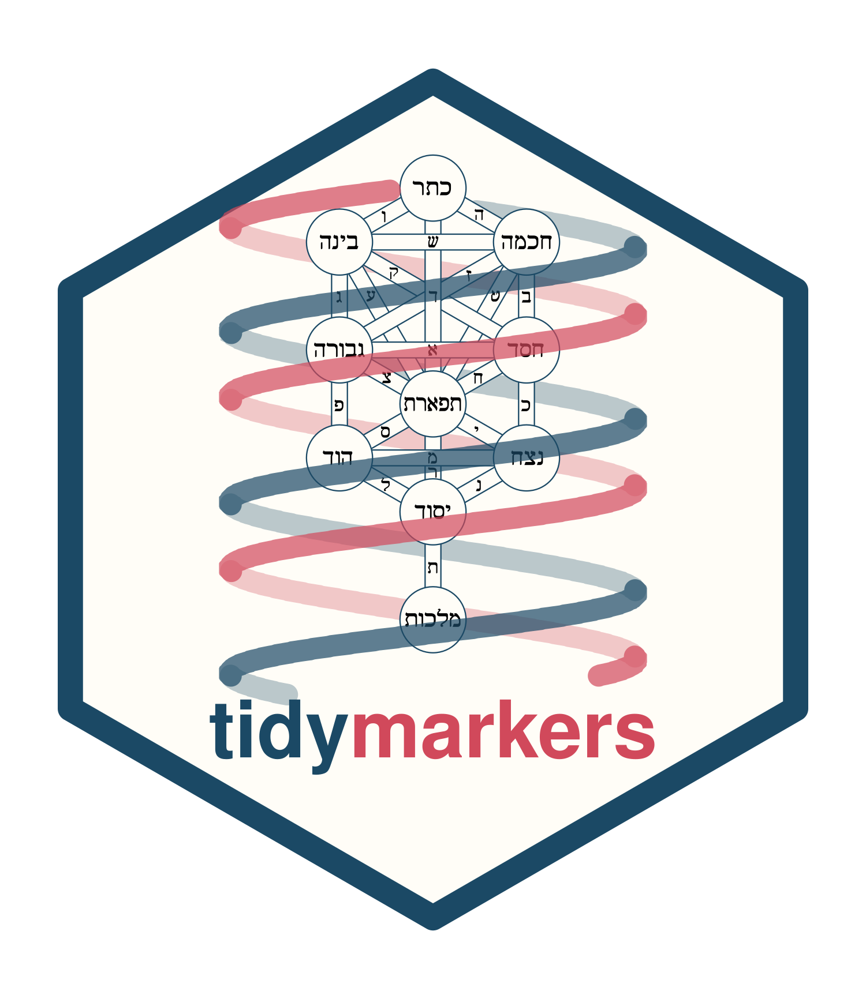
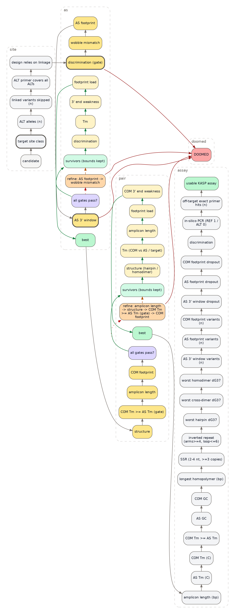
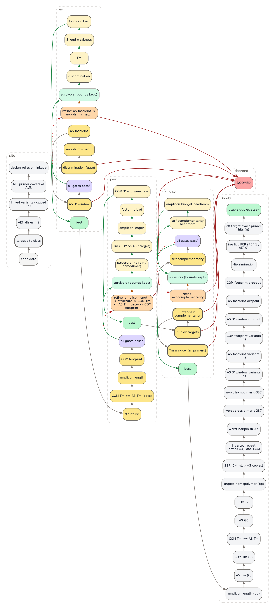

# tidymarkers — tidy-дизайн и QC KASP-маркеров

<!-- badges: start -->
[](https://github.com/Stathmin/tidymarkers/actions)
[](https://lifecycle.r-lib.org/articles/stages.html)
[](LICENSE)
<!-- badges: end -->

Воспроизводимый инструмент **на чистом R** для подбора и контроля качества
KASP-тестов. Он **геном-агностичен**: подайте референс (FASTA, индексированный
`marker_genome()`, `DNAStringSet` или Bioconductor `BSgenome`) и варианты (VCF или
tidy-таблицу) — инструмент проектирует аллель-специфичные и общий праймеры на
обеих цепях и оценивает их.

В комплекте — воспроизводимое **демо** на *Arabidopsis thaliana*: локус времени
цветения **FRI / AT4G00650**, реальные SNP из проекта *1001 Genomes*, геном TAIR10
(Ensembl Plants). Другой референс/вариация — так же, обёртками
`marker_genome()`/`read_variants_vcf()` (см. `vignette("custom-genome")`).

Никаких прыжков между Python и R: вся логика — R, а тяжёлая физика делегирована
пакетам.

## 0. Установка

```r
# быстрый путь (2026): pak берёт бинарники CRAN на Windows/macOS и
# Posit Package Manager на поддерживаемом Linux; renv для пользователя не нужен
install.packages("pak")
pak::pak("Stathmin/tidymarkers", sysreqs = TRUE)
```

Требуется **R ≥ 4.5** и внешний **OligoArrayAux** (`hybrid-min`) — термодинамика
для `DECIPHER`; опционально **NCBI BLAST+**. Пакет тянет только `Imports`
(Bioconductor + tidyverse); тяжёлые опции (`TxDb`/`BSgenome`, `Rsubread`,
`ensembldb`) — в `Suggests` и не ставятся сами. Подробности — в разделе 2.

---

## 1. Что отдано каким библиотекам

| Шаг | Библиотека | Что делает |
|-----|-----------|------------|
| Геном TAIR10 | `Biostrings` (+ FASTA Ensembl Plants) | `DNAStringSet`, подстроки, revcomp |
| Вариация / ген-модель | `httr2`, `jsonlite` | Ensembl Plants REST (1001 Genomes) |
| Tm праймеров | **`TmCalculator`** | nearest-neighbour Tm (SantaLucia 2004 и др.) с солевой/DMSO-коррекцией |
| **Аллельная дискриминация** | **`DECIPHER`** | `CalculateEfficiencyPCR` — эффективность амплификации с учётом гибридизации и **эффективности достройки Taq** от 3'-конца (физическая основа KASP) |
| Шпильки | **`OligoArrayAux`** (`hybrid-ss-min`) | свободная энергия сворачивания (hairpin ΔG37), ДНК |
| Димеры | **`OligoArrayAux`** (`hybrid-min`) | ΔG37 дуплекса для всех пар (гомо- и гетеро-) |
| Специфичность (быстро) | `Biostrings` | `PDict`/`vcountPDict` (точный путь) и `vcountPattern` (с мисматчами), 3'-сид по обеим цепям всего генома; `BiocParallel`-хук для масштаба |
| Специфичность (полно) | **`rBLAST`** | `blastn-short` по локальной БД (опция) |
| Типы вариантов | свои примитивы + `DECIPHER` | SNP, MNP (замена блока) и InDel (аллельные шаблоны + скан стыка) |
| Рецепт реакции | `kasp_mix_recipe()` | tidy-рецепт смеси праймеров (AS:AS:COM = 2:2:5) и сборки реакции |
| Визуализация | `gggenes`, `ggrepel`, `patchwork`, `ggforce` | карта праймеров и ген, подписи без наложений, зум-панели, композиция |
| Заказ олиго | `export_primers()` + `readr` | tidy-таблица + sheets для IDT (bulk) и LGC/KASP |
| Воспроизводимость | `renv` (лок) / `pak` (быстрая установка) | `renv.lock` для пиннинга; `pak` — бинарники/параллель для пользователей |

Своих строк — минимум: только то, что специфично для KASP (3'-концевое
«прикалывание» AS-праймера к SNP и скан кандидатов для общего праймера).
Готового поддерживаемого R-пакета под KASP нет: `primeR` снят с Bioconductor,
`openPrimeR` требует MAFFT/ViennaRNA/MELTING/OligoArrayAux, в CRAN нет `primer3`.

---

## 2. Установка и запуск

Нужны: **R ≥ 4.5** и **OligoArrayAux** (`hybrid-min` — термодинамика для
`DECIPHER`); **cairo** — опционально (для cairo-устройства PNG в примерах/виньетках).
Опционально **NCBI BLAST+** для полного BLAST-шага.

**Пользователю — одна строка** (ставит пакет и системные зависимости, потом одним
вызовом собирает внешние тулы в кэш):

```r
pak::pak("Stathmin/tidymarkers", sysreqs = TRUE)   # BLAST+/cairo системно
tidymarkers::marker_install_tools()                  # OligoArrayAux в кэш, один раз
```

Первый вызов функции без тула не молчит: `assemble_kasp_assay()` подсказывает
`marker_install_tools()`, а не отдаёт тихий `NA`.

```bash
# 1. внешние инструменты
#    a) OligoArrayAux для DECIPHER (термодинамика). Для разработки — из исходников,
#       чистым R, в .tools/ (без conda):
Rscript data-raw/install-oligoarrayaux.R
#       Пользователю достаточно установить пакет и запустить один раз:
#       Rscript -e 'tidymarkers::marker_install_tools()'   # соберёт в пользовательский кэш
#    b) cairo для gdtools/ggmsa
#       Linux:  sudo apt-get update && sudo apt-get install -y libcairo2-dev pkg-config libfreetype6-dev
#       macOS:  brew install cairo pkg-config freetype
#       Windows: cairo идёт с Rtools; либо pak::pak("tidymarkers", sysreqs = TRUE)
#       (кроссплатформенно: pak сам ставит системные библиотеки)

# 2. R-окружение: pak читает DESCRIPTION и ставит только нужное
#    (бинарники, где платформа их даёт; без 262-пакетного dev-лока)
Rscript -e 'if (!requireNamespace("pak")) install.packages("pak")'
Rscript dev/install-deps.R   # Imports + dev/test tools + сам пакет; --with-suggests for all
# renv.lock остаётся для воспроизводимости; renv::restore() тянет весь старый
# dev-лок (262 пакета) и на порядок медленнее — для пользователей он не нужен.

# 3. пакет уже установлен шагом 2; переустановить после правок:
R CMD INSTALL .              # или: Rscript -e 'pkgload::load_all()' для разработки
# когда пакет вынесен в свой репозиторий:
#   pak::pak("Stathmin/tidymarkers", sysreqs = TRUE)   # BLAST+/cairo системно
#   remotes::install_github("Stathmin/tidymarkers")

# 4. прогон демо-пайплайна
Rscript inst/scripts/run_kasp.R

# 5. отчёт
Rscript -e 'rmarkdown::render("report/marker_report.Rmd")'

# 6. тесты (инварианты ядра дизайна)
Rscript dev/test.R                     # быстро: ядро и фикстуры
Rscript dev/test.R --full              # + BLAST/Rsubread/аннотации/SOCK

# 7. лекционный дек Quarto (reveal.js)
sh lecture/render.sh                    # ставит OligoArrayAux на PATH и рендерит
```

Результаты в `results/` (консолидировано): `marker_design.csv` (кандидаты-тесты),
`marker_primer_qc.csv` (на праймер: Tm/GC/шпилька/3'-стабильность + сид-специфичность
+ продукты in-silico PCR), `marker_dimer_dg.csv` (dG дуплексов), `marker_assay.rds`,
панели `plot_*.png` и **файлы заказа** `marker_<ген>_<chr>_<pos>_{idt,lgc,tidy}.csv`
(последние — подмножества колонок одной таблицы заказа).

> Панели рисуют библиотеки, а не ручные геомы: выравнивание и логотип — `ggmsa`
> (только ДНК, `Chemistry_NT`; РНК-инструменты вроде R4RNA/`geom_helix` не
> используются), карта праймеров и ген с вариантами — `gggenes`, матрица
> кросс-комплементарности — `geom_tile` по полной симметричной матрице энергий
> (`dimer_thermo`). Самокомплементарность (шпильки) показана как выравнивание
> праймера против своего обратного комплемента — тоже `ggmsa`.

> Геометрия праймеров задаётся **в одном месте** (`primer_interval()` /
> `as_3p_interval()` на `IRanges`): дизайн, сборка теста и графики используют одни
> и те же интервалы, а координаты спанов сохраняются в объекте теста — поэтому
> рисунок не может разойтись с дизайном.

> `DECIPHER` работает через системный вызов `hybrid-min`. Пакет сам его находит:
> `options(tidymarkers.oligoarrayaux=)` → проектный `.tools/` → пользовательский кэш
> (`marker_install_tools()`) → `PATH`; `UNAFOLDDAT` подставляется на время вызова, ручной
> `export` не нужен. Скрипт из шага 1 кладёт бинарники в `.tools/bin`, таблицы — в
> `.tools/share/oligoarrayaux`; альтернатива — `with_unafloddat(...)`.

Другой ген — поменяйте `gene_id` в `inst/scripts/run_kasp.R` (например `AT5G10140` для
`FLC`). Конкретный маркер — передайте `variant_id = "..."` в `pick_target_snp()`.
Начните с `vignette("kasp-intro")`; семейные виньетки — `markers-kasp`,
`markers-gel`, `markers-probe`, `markers-isothermal`,
`markers-crispr-sequencing` (у каждой — рисунки `plot(marker)` и ссылки на
первичные статьи).

Лекция: `lecture/kasp-slides.qmd` — живые tidyverse-чанки (рендер `sh lecture/render.sh`,
нужен `quarto` CLI); подробности в `lecture/README.md`.

---

## 3. Краткий мануал по подбору KASP (современная версия)

**KASP** (Kompetitive Allele-Specific PCR, LGC Biosearch) — гомогенный
endpoint-тест на SNP и инделы. Один тест = **три праймера**: два
аллель-специфичных форвардных (с 5'-универсальными хвостами FAM и HEX/VIC) и
один общий реверсный. Два AS-праймера **идентичны, кроме последнего 3'-го
основания — это и есть SNP**. Дискриминация держится на конкурентном отжиге и
неспособности Taq достраивать цепь с 3'-неспаренностью.

Правила дизайна (сводка практик LGC/KBioscience и работы **EasyKASP** —
Zhang, Yang & Wen, *BMC Bioinformatics* 2025, 26:292, doi:10.1186/s12859-025-06322-x,
где оптимальные диапазоны выведены из 500 валидированных KASP-тестов):

**Ампликон**
- Короткий: **50–100 п.н.** (EasyKASP: продукты < 100 п.н.). Короткий продукт
  устойчив на грубой/деградированной ДНК.

**Общий (common/reverse) праймер**
- 18–25 нт, GC **40–60 %**, низкая стабильность 3'-конца, без гомополимерных
  трактов ≥ 4.
- Tm должен быть **выше**, чем у двух AS-праймеров (EasyKASP: у COM обычно ниже
  GC, но больше длина и выше Tm, чем у AS с их 5'-хвостом).

**Аллель-специфичные праймеры (AS)**
- SNP — **терминальное 3'-основание** (в этом весь смысл).
- Целевая часть 20–28 нт, в пределах 20–30 нт от варианта; Tm «своего» аллеля
  **55–65 °C**, ниже Tm общего праймера.
- Выбирайте цепь, где в ±25 нт вокруг варианта GC ≈ 45 % и нет повторов
  (шаг 1 EasyKASP) — наш поиск по обеим цепям это и делает.
- Добавляют **вторую (дестабилизирующую) неспаренность 1–3 основания от 3'-конца**
  (обычно позиция −2 или −3): она сильнее дестабилизирует «чужой» аллель. Здесь
  мы подбираем это основание, максимизируя дискриминацию.
- Последние ~5 оснований не должны накрывать другой частый SNP/индел.

**Дискриминация**
- Оцениваем напрямую **эффективность амплификации** каждого AS-праймера на
  «своём» и «чужом» аллеле (`DECIPHER::CalculateEfficiencyPCR`), которая
  учитывает и гибридизацию, и 3'-концевую достройку Taq. Хотим высокую
  on-target и близкую к нулю off-target.
- Если строить на противоположной цепи — другие типы мисматчей; G:T и C:A
  («wobble») самые стабильные и дают худшую дискриминацию.

**Вторичная структура и комплементарность**
- Шпильки и димеры считаем термодинамически (OligoArrayAux, ДНК):
  `hybrid-ss-min` даёт ΔG сворачивания, `hybrid-min` — ΔG дуплекса для каждой
  пары праймеров (гомо- и гетеро-). Смотрим на ΔG37 (ккал/моль): сильнее
  отрицательное — хуже.
- Отбраковываем сильные димеры любой пары (AS1–COM, AS2–COM, AS1–AS2, само-CM).
  Пара AS1–AS2 ожидаемо сильнее: праймеры почти идентичны и конкурируют за
  один сайт — это норма KASP.

**Специфичность**
- Полный тест должен давать **ровно один продукт** по геному (праймеры
  single-copy; EasyKASP). Нетаргетные варианты во фланках тоже учитываем.
- Быстрый пре-скрининг: `Biostrings::vcountPattern` 3'-«сида» (обе цепи) по
  всему геному (секунды). Полная проверка — **in-silico PCR**
  (`Biostrings::matchProbePair`): пара должна давать ровно один продукт
  ожидаемого размера; на референсе REF-праймер даёт 1 продукт, ALT-праймер — 0.
  `rBLAST` (`blastn-short`) — опционально. Офф-таргет с целым 3'-концом — фатален.

**Валидация**
- Всегда генотипируйте три контроля: гомозигота REF, гомозигота ALT и
  гетерозигота, плюс NTC (без матрицы). Образцы кластеризуют по конечной
  флуоресценции FAM vs HEX относительно контролей.

**Критерии приёмки → код.** Сводка выше превращена в проверяемую таблицу
`marker_design_checks()` с порогами `KASP_LIMITS` (ампликон 50–100, Tm-окна,
`COM Tm ≥ AS Tm`, GC, гомополимеры, шпильки/димеры, дискриминация). Так «хороший»
и «плохой» тест оцениваются одинаково и это покрыто тестами.

---

## 4. Что считает пайплайн

1. `ensembl_gene()` / `ensembl_variants()` — ген-модель и SNP из 1001 Genomes
   (Ensembl Plants REST, с кэшем в пользовательском кэше `marker_cache_dir()` и retry).
2. `pick_target_snp()` — отбор пригодной замены (SNP/MNP): референс из генома; сначала
   предпочитаем «чистую» 3'-зону AS (нет других вариантов в последних 5 нт,
   метрика `n_3p`, лучшая из двух цепей), затем missense > splice > synonymous >
   UTR и транзиции. Если чистого SNP нет, выдаётся предупреждение.
3. `design_common_primers(strand = ...)` — скан кандидатов общего праймера
   (метрики — из `TmCalculator`/`Biostrings`); `strand` задаёт ориентацию теста,
   т. к. общий праймер обязан смотреть на SNP с противоположной стороны.
4. `design_as_primers(strands = c("+", "-"))` — сетка AS-праймеров
   (цепь × длина 20–27 нт × позиция мисматча −/−2/−3 × основание) с подбором
   дестабилизирующего мисматча по дискриминации (`DECIPHER`).
5. `primer_thermo()` / `dimer_thermo()` — Tm, GC, шпильки, 3'-концевая
   стабильность (`terminal_dg()`), само- и кросс-комплементарность;
   `has_run()`/`find_repeats()` — гомополимеры и SSR; `wobble_mismatch()` —
   флаг слабого G:T/A:C неспаривания.
6. `specificity_seed()` / `in_silico_pcr()` / `blast_primers()` — 3'-сид,
   виртуальная амплификация (уникальность и размер продукта), BLAST.
7. `assemble_kasp_assay()` — сборка теста для SNP/MNP/InDel; `design_kasp_markers()`
   — батч по таблице локусов с вердиктом `pass`/`warn`/`fail` на локус.
8. `marker_design_checks()` — проверка теста по критериям приёмки (`KASP_LIMITS`);
   `kasp_mix_recipe()` — рецепт смеси и реакции.

Два проектных «рычага» вынесены в реальные аргументы (а не в константы):

- **`strands`** у `assemble_kasp_assay()`/`design_as_primers()` — искать
  AS-праймер на `"+"`, на `"-"` или на обеих цепях. Ориентация переключается
  целиком для всего теста (AS и COM обязаны сменить цепь вместе, иначе ампликон
  не «закроется»), поэтому в примере — `c("+", "-")`.
- **`tm_range`** — допустимое окно Tm (в °C) для AS- и общего праймеров;
  в примере — `c(58, 64)`.

```r
assay <- assemble_kasp_assay(genome, snp, variants = variants, flank = 150L,
                             strands = c("+", "-"), tm_range = c(58, 64),
                             clean_3p = 5L)
```

### Как выбирается тест: гейты, тиры, лестница

Кандидаты (пары AS×COM) сначала проходят **жёсткие гейты** (серьёзные грехи: известный
вариант под праймером, недискриминируемая аллель, `Tm_COM < Tm_AS`, ампликон вне окна,
структура), затем ранжируются **лексикографически** по тирам (внутри тира — узкое место
`min`: тест настолько хорош, насколько плоха его слабейшая часть). Если ни один кандидат
не прошёл, гейты снимаются по одному (от мягкого к серьёзному) и возвращается «наименее
плохой» с предупреждением на каждый нарушенный гейт.

Политика записана **данными**: `marker_decision_schema()` читает те же константы, что и
движок (`KASP_GATES_*`, `KASP_RELAX_*`, `KASP_TIERS_*`), поэтому граф не может разойтись
с кодом — новый гейт, тир или ступень лестницы сразу видны. `plot_decision_tree()` рисует
его (`ggraph`), а собранный тест несёт граф в `assay$decision` со статусом узлов
(зелёный — сработал, янтарный — снят, красный — нарушен).

**Схемы по химии маркера.** KASP — это семейство, а не один тест. `marker_schemes()`
объявляет химии, а единый реестр критериев помечает каждую проверку своими схемами,
так что `plot_decision_tree(scheme = )` рисует дерево для SNP/indel/мультиаллельного
KASP, **дуплексных** химий (dKASP, mxKASP, Multi-KASP: два локуса в одной пробирке +
стадия совместимости) и **ASQ/PACE**, а также голый subset **«любая пара праймеров»**
(маркер-агностичные проверки: состав, структура, повторы, off-target).




## 5. Ограничения (честно)

- Эффективность `DECIPHER` — модель (гибридизация + достройка Taq), хороший
  прокси, но **не** замена мокрого эксперимента; зависит от буфера и температуры.
- Для ALT-аллеля используем тот же референсный контекст (геном один) — для
  симметрии достаточно, но реальную матрицу ALT вы не видите.
- Частоты/MAF берём из 1001 Genomes «как есть»; для продакшена добавьте свой QC
  (глубина, MAF, менделевские ошибки).
- Шпильки/димеры — реальная NN-термодинамика OligoArrayAux (`hybrid-ss-min`
  / `hybrid-min`) при 37 °C; вторичная структура матрицы не учитывается.
- «Чистота» 3'-зоны AS проверяется по каталогу 1001 Genomes (`n_3p`); это не
  исчерпывающая панель — редкие варианты в ваших образцах не видны.

## 6. Структура

```
tidymarkers/
├── DESCRIPTION              # зависимости (читает renv)
├── renv.lock                # зафиксированные версии (в т.ч. DECIPHER, TmCalculator)
├── ROADMAP.md               # инвентарь и очередь работ
├── R/                       # ~30 файлов, по одному на слой пайплайна:
│   ├── marker_core.R          #   примитивы, геометрия, KASP_LIMITS, кэш
│   ├── marker_io.R            #   VCF (vroom) / FASTA, нормализация IUPAC
│   ├── marker_genome.R        #   индексированный источник генома (Rsamtools)
│   ├── marker_alleles.R       #   аллельные наборы, класс мультиаллельного сайта
│   ├── marker_design.R        #   дизайн AS- и общего праймера (+ индел-путь)
│   ├── marker_primer_pairs.R  #   общий скан фланкирующих/сайтовых пар
│   ├── marker_assemble.R      #   сборка и оценка одного ассея
│   ├── marker_select.R        #   гейты / тиры / лестница релаксации
│   ├── marker_criteria.R      #   единый реестр критериев
│   ├── marker_checks.R        #   приёмочные проверки
│   ├── marker_decision.R      #   схема / граф / текст дерева решения
│   ├── marker_schemes.R       #   реестр химий маркера (KASP/CAPS/ARMS/…)
│   ├── marker_risk.R          #   риск-вердикт low/medium/high
│   ├── marker_thermo.R        #   Tm, ΔG, шпильки/димеры, SSR, палиндромы
│   ├── marker_specificity.R   #   3'-сид, in-silico PCR, BLAST
│   ├── marker_target.R        #   pick_target_snp() и дизайнабельность
│   ├── marker_haplotypes.R    #   модель гаплотипов / сцепления
│   ├── marker_caps.R, marker_arms.R   #   CAPS/dCAPS и tetra-primer ARMS
│   ├── marker_annotate.R      #   аннотация вариантов (TxDb / BSgenome)
│   ├── marker_plots.R         #   графика
│   └── marker_search_anim.R   #   анимация поиска (GIF)
├── report/marker_report.Rmd   # нарративный отчёт
├── tests/testthat/          # инварианты ядра + критерии приёмки + термодинамика
├── vignettes/               # kasp-intro, custom-genome, reading-results
├── inst/extdata/            # example_targets.csv (мишени всех типов маркеров, по генам)
├── inst/scripts/            # run_kasp.R, quickstart.R (демо)
├── dev/                     # внутренние проверки/замеры (check.R, bench.R, render-*.R)
├── lecture/                 # Quarto-дек лекции (`sh lecture/render.sh`)
└── results/                 # вывод (в .gitignore)
```

Внешние данные и индексы (геном, варианты, BLAST/FM-индексы) живут в
пользовательском кэше `marker_cache_dir()` (`tools::R_user_dir`), а не в проекте.

---

## Воспроизводимость

renv.lock фиксирует точные версии зависимостей дев-окружения. Активация renv
(.Rprofile/renv/) в репозиторий намеренно не входит: иначе R CMD build / R CMD check
из свежего клона собирают изолированную (пустую) библиотеку и падают до renv::restore().
Нужны точные версии — renv::init(), затем renv::restore().
