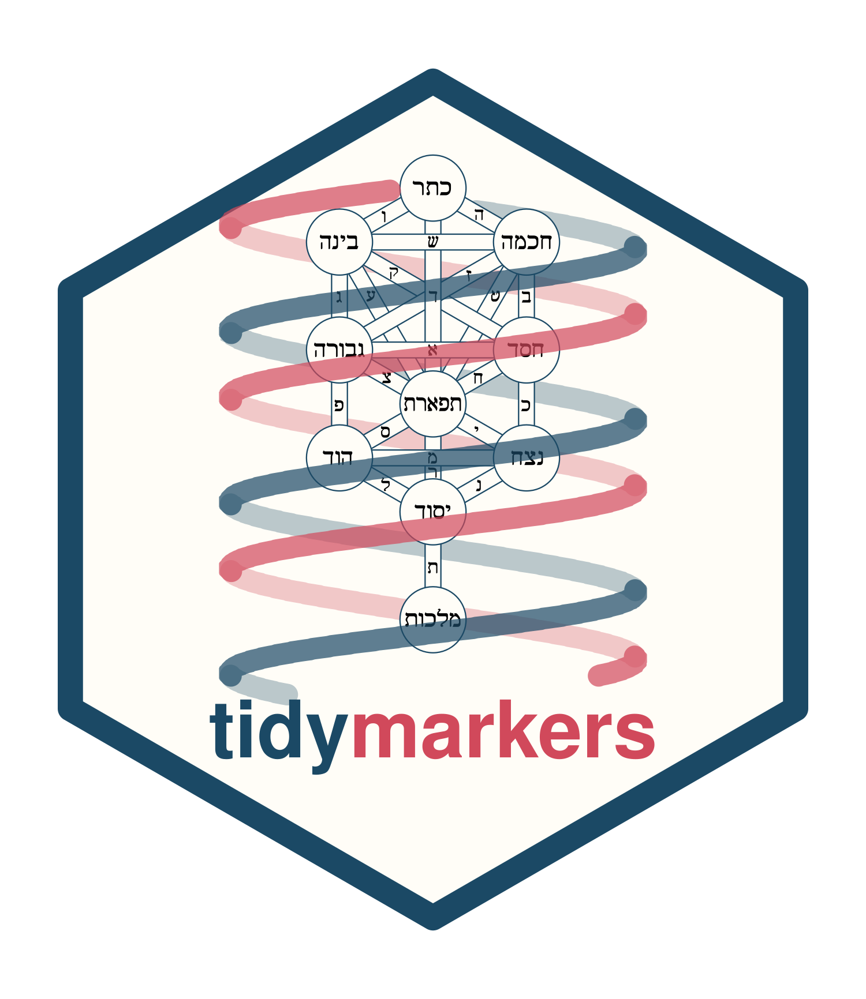
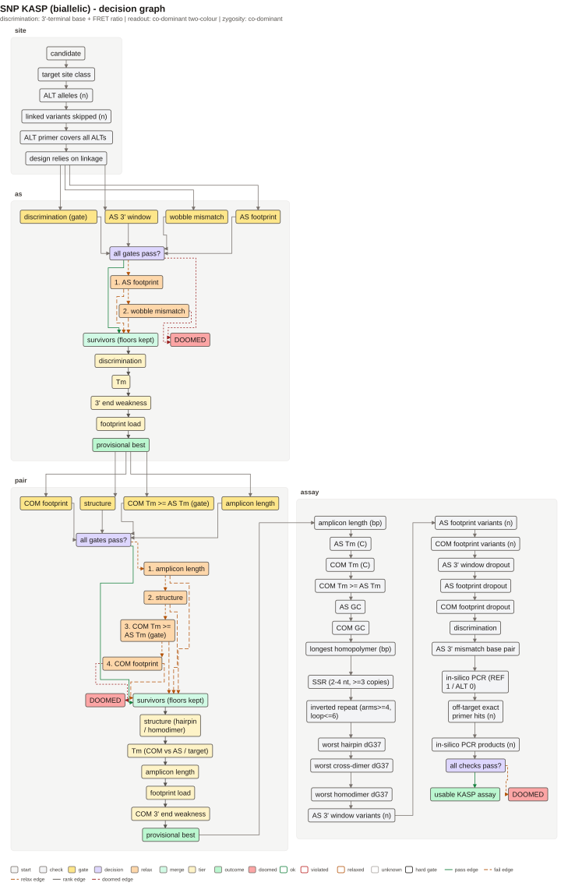
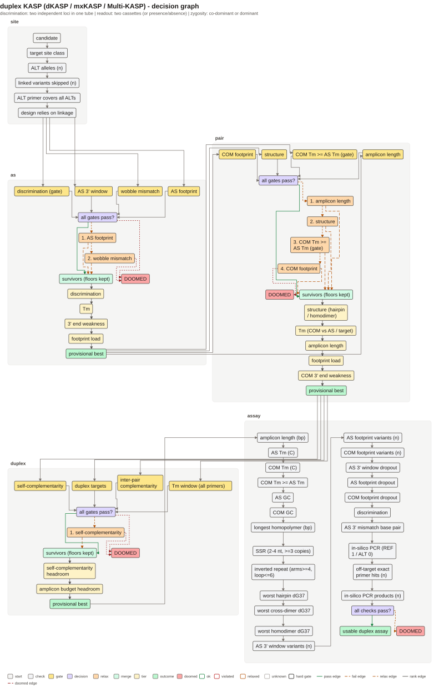

# tidymarkers

<!-- badges: start -->

[](https://github.com/Stathmin/tidymarkers/actions/workflows/R-CMD-check.yaml)
[](https://lifecycle.r-lib.org/articles/stages.html)
[](LICENSE.md)
<!-- badges: end -->

Design and quality control of genetic markers in pure R. `tidymarkers` is
**genome-agnostic**: give it a reference (FASTA, an indexed `marker_genome()`, a
`DNAStringSet` or a Bioconductor `BSgenome`) and variation (a VCF or the tidy
variant table), and it designs allele-specific and common primers on either
strand, scores them, and tells you which candidates survived and why the others
did not.

The same grammar covers the marker chemistries a lab actually runs: KASP,
CAPS/dCAPS, tetra-primer ARMS, HRM, Sanger, SSR, InDel-size, TaqMan/dPCR,
SNaPshot, LAMP/RPA and CRISPR-Dx. Thermodynamics come from `TmCalculator` and
OligoArrayAux, Taq-aware allelic discrimination from `DECIPHER`, and
genome-wide specificity from `Biostrings` (with an optional `rBLAST` database or
an `Rsubread` FM-index).

## Installation

`tidymarkers` is not on CRAN; install it from GitHub. `pak` also resolves the
system libraries (BLAST+, cairo):

```r
install.packages("pak")
pak::pak("Stathmin/tidymarkers", sysreqs = TRUE)
```

`DECIPHER` needs [OligoArrayAux](https://www.unafold.org/Dinamelt/software/oligoarrayaux.php);
one call builds it into your user cache, so nothing has to be on `PATH`:

```r
tidymarkers::marker_install_tools()   # once; hybrid-min / hybrid-ss-min
```

**R >= 4.5** is required. The hard `Imports` are Bioconductor plus the tidyverse;
the heavy optional pieces (a `TxDb`/`BSgenome`, `Rsubread`, `ensembldb`, `rBLAST`,
`Rsamtools`, `systemfonts`) live in `Suggests` and are never installed implicitly:
each is reached only through a guarded call, so a missing one degrades a single
feature instead of breaking the load. `marker_cache_dir()` reports where
downloaded genomes, variation, indexes and the external tools are kept
(`tools::R_user_dir()`), so nothing is written inside the package or the project.

## Quick start

A self-contained run: one SNP from a gene model, one assay, one verdict.

```r
library(tidymarkers)

genome <- ath_genome()                                  # TAIR10 from Ensembl Plants, cached after first use
gene   <- ensembl_gene("AT4G00650")                     # FRI / AT4G00650
snp    <- pick_target_snp(ensembl_variants(gene$chrom, gene$start, gene$end),
                          genome, gene)

assay <- assemble_kasp_assay(genome, snp)               # both strands by default
print(assay)                                            # <marker_assay> summary

marker_design_checks(assay)                             # criterion / observed / limit / pass
passes_all(assay)                                       # one TRUE/FALSE
```

The bundled example targets every marker type, so the same call works without a
network download once a local reference is supplied:

```r
loci <- marker_example("snp")                           # inst/extdata/example_targets.csv
design_kasp_markers(genome, loci)                       # pass / warn / fail per locus
```

Two project-level knobs are arguments rather than constants: `strands` (search
the AS primer on `"+"`, `"-"` or both; the common primer flips with it) and
`tm_range` (the permitted melting window, °C).

`ath_genome()` is only a convenience downloader for the demo: it pulls one gzipped
TAIR10 FASTA from the Ensembl Plants FTP into `marker_cache_dir()` and never
touches the package repository. Any other reference is passed in directly: a
FASTA path through `marker_genome()` / `read_genome_fasta()`, a `DNAStringSet`, or
a Bioconductor `BSgenome` (see `vignette("custom-genome")`).

## How a candidate is chosen

Candidate AS x COM pairs first face **hard gates**: a known variant under the
primer, an allele the primer cannot discriminate, `Tm_COM < Tm_AS`, an amplicon
outside the window, impossible secondary structure. Survivors are ranked
**lexicographically by tier**; within a tier the bottleneck (`min`) decides, so an
assay is only as good as its weakest part. If nothing clears the gates, they are
lifted one at a time, least grave first, and the least-bad candidate is returned
with a warning naming every violated gate. A marker therefore always arrives with
a reason, never a silent `NA`.

Each tier criterion carries two separate things. Its **`target`** is a printed
reference point the tier steers toward (an amplicon window, a ΔG floor, a
vendor's Tm range), and the target is what a source can be cited for. Its
**`limit`** is the package's aggregation policy: the bottleneck `min`, which
checks belong to the tier, and the order between tiers. No paper prints that
policy; it is declared once in code (`CRITERION_TIER_POLICY_EVIDENCE`) and stays
`rule_of_thumb` however well sourced the target is.

The lexicographic order is the default. The engine can also rank with a
**banded, non-compensatory Chebyshev** policy (`R/marker_bncc.R`, opt-in via
`select_with_ladder(bncc = )`): margins normalise to a regret in [0, 1], declared
priority bands are compared lexicographically, a band scores by its worst
weighted regret, and the Pareto front is reported beside the winner. That too is
a package policy and stays `rule_of_thumb`; `BNCC_CALIBRATION` is inert
(`fitted = FALSE`), so it never raises an evidence rung.

That policy is **data, not prose**: `marker_decision_schema()` reads the same
constants as the engine (`KASP_GATES_*`, `KASP_RELAX_*`, `KASP_TIERS_*`), so the
graph cannot drift from the code. `plot_decision_tree()` draws it, and an
assembled assay carries the graph in `assay$decision` with per-node status
(green = applied, amber = relaxed, red = violated).




KASP is a family, not a single test. `marker_schemes()` declares the chemistries
and one criterion registry tags every check with the schemes it applies to, so
`plot_decision_tree(scheme = )` draws the tree for SNP/indel/multiallelic KASP,
for the **duplex** chemistries (dKASP, mxKASP, Multi-KASP: two loci per tube plus
a compatibility stage), for ASQ/PACE, and for the marker-agnostic subset "any
primer pair" (composition, structure, repeats, off-target).

## What the pipeline computes

1. `ensembl_gene()` / `ensembl_variants()`: gene model and SNPs from Ensembl
   Plants (1001 Genomes), cached and retried.
2. `pick_target_snp()`: chooses a designable substitution: prefers a clean 3'
   AS window (no other variant in the last 5 nt, best of both strands), then
   missense > splice > synonymous > UTR, and transitions.
3. `design_common_primers()` / `design_as_primers()`: a candidate scan over
   strand x length x mismatch position x base, scored with `TmCalculator`,
   `Biostrings` and `DECIPHER`.
4. `primer_thermo()` / `dimer_thermo()`: Tm, GC, hairpins, 3'-terminal
   stability, self- and cross-complementarity; `has_repeat()` / `find_repeats()` for
   homopolymers and SSRs; `wobble_mismatch()` flags weak G:T / A:C pairs.
5. `specificity_seed()` / `in_silico_pcr()` / `blast_primers()`: 3' seed hits,
   virtual amplification (uniqueness and product size), BLAST.
6. `assemble_kasp_assay()`: one assay for SNP/MNP/InDel;
   `design_kasp_markers()`: a batch with a `pass`/`warn`/`fail` verdict per locus.
7. `marker_design_checks()`: acceptance criteria in `KASP_LIMITS`;
   `kasp_mix_recipe()`: the primer mix and reaction recipe.

## Shipped objects

| Function                   | Returns                                                                                                 |
| -------------------------- | ------------------------------------------------------------------------------------------------------- |
| `assemble_kasp_assay()`    | `<marker_assay>`: primers, amplicon, discrimination, `$decision`                                        |
| `marker_design_checks()`   | tidy table: `stage`, `criterion`, `observed`, `limit`, `status`                                         |
| `marker_explain()`         | the checks as ordered, readable reasons (failures first) with a one-line headline                       |
| `marker_risk()`            | `low` / `medium` / `high` with the reasons behind it                                                    |
| `marker_decision_text()`   | the decision graph of a scheme as readable text (`evidence = TRUE` adds each check's evidence rung)     |
| `write_marker_results()`   | `marker_design.csv`, `marker_primer_qc.csv`, `marker_dimer_dg.csv`                                      |
| `marker_export()`          | `markers.csv`, `attempts.csv`, `primers.csv`, `solved.rds` + the artefact                               |
| `marker_artefact()`        | `artefact.json` (hashed inputs, provenance, overrides), `decisions.csv`, `checks.csv`, `why.csv`        |
| `marker_replay()`          | re-runs a saved artefact and compares the verdict per target                                            |
| `marker_record_outcome()`  | appends a lab result (`works` / `fails` / `unknown`) to an artefact's `outcomes.csv`, bound to its `id` |
| `marker_technology()`      | composes a technology from a base scheme + `params`, `blocks` and `specificity` (returned invisibly)    |
| `marker_filter_blocks()`   | filter blocks a technology can declare: `block`, `kind`, `values`, `applies_to`, `note`                 |
| `marker_informativeness()` | per-target `pic`, `expected_heterozygosity`, `distinguishable_pairs`, `status`                          |
| `marker_pareto()`          | candidates plus `on_front` / `recommended` over cost, quality and linkage risk                          |
| `marker_primers()`         | the oligos of any marker, as a named vector or tidy table                                               |

## Documentation

The chemistry vignettes are the manual; each one states its biology, its gates
and its failures:

| Vignette                                | Schemes                                                   |
| --------------------------------------- | --------------------------------------------------------- |
| `vignette("kasp-intro")`                | the full workflow, start to finish                        |
| `vignette("markers-kasp")`              | `snp`, `indel`, `multi`, `duplex`, `lax`, `asq`, `primer` |
| `vignette("markers-gel")`               | `caps`, `arms`, `hrm`, `ssr`, `indel_size`                |
| `vignette("markers-probe")`             | `taqman`, `dpcr`, `snapshot`, `castpcr`                   |
| `vignette("markers-isothermal")`        | `lamp`, `rpa`                                             |
| `vignette("markers-crispr-sequencing")` | `crispr`, `sanger`                                        |
| `vignette("custom-genome")`             | your own FASTA / VCF                                      |
| `vignette("reading-results")`           | export a solved plan, audit a candidate, read a rejection |

Repository-level documents: [`ROADMAP.md`](ROADMAP.md) (open work and design
decisions), [`NEWS.md`](NEWS.md) (changelog), [`VALIDATION.md`](VALIDATION.md)
(what is checked against the literature and what is not),
[`CONTRIBUTING.md`](CONTRIBUTING.md) (conventions and the merge gate) and
[`docs/INDEX.md`](docs/INDEX.md) (the index of every document and every
committed figure).

## Container and MCP server

A pinned image (`rocker/r-ver:4.6.1`) builds the package with its `Imports` and
starts a stdio MCP server; see [`docker/README.md`](docker/README.md). The
container opens no port: the server reads JSON-RPC on stdin and writes it on
stdout. Mount data **read-only** (`-v /path/to/data:/data:ro`); nothing is
written into the image. The network is not needed at run time (the build fetches
packages, and the optional demo downloads its genome on first use). The
artefact's decision log carries `outcome`, `verdict`, `relaxed`, `violated` and
`risk` as typed columns, so an agent reads a field instead of parsing a sentence.

The registry (`inst/mcp/tools.R`, 37 tools) follows the vignette workflow: read
a genome/VCF, classify and screen variants, run the thermodynamics and QC
helpers, check specificity, design one marker (`design_scheme`) or a batch
(`design_markers`), and read the verdict (`marker_decision_text`,
`rescue_strategy`).

The design tools take the mounts as arguments: `genome_path` and
`variants_path` name a FASTA and a VCF under `/data`, `blast_db` names a
prebuilt BLAST index, and `oligoarrayaux_dir` points at a mounted
`OligoArrayAux` build. Plotting calls, the `marker_plan()`/`marker_solve()`
pipeline objects and the writers stay out of the registry: they return R
structures that JSON cannot carry, or they write outside the mount.

## Reproducibility

`renv.lock` pins the exact versions used in development. It is deliberately not
activated by an `.Rprofile` or a `renv/` directory, because activation makes
`R CMD build` / `R CMD check` on a fresh clone resolve against an empty library
and fail before `renv::restore()` can run. Use `renv::init()` then
`renv::restore()` when you need the pinned snapshot; development installs use
`Rscript dev/install-deps.R`.

External data never ships with the package: the TAIR10 genome and the 1001
Genomes variation are downloaded from Ensembl Plants, and the BLAST/FM indexes
and thermodynamic binaries are built once, all inside `marker_cache_dir()`. The
download source is an FTP path on `ftp.ebi.ac.uk`, so it does not depend on this
repository's URL.

## Validation

This is a design tool, so the honest question is what its rules rest on. The
short answer is published measurements, not a bench run by the maintainers:

- **No wet-lab data was produced here.** No `tidymarkers` design has been
  validated at the bench by the authors of this package.
- **A head-to-head run against Primer3 2.6.1**, on the layer the two tools share:
  the same oligos through both engines (Tm mean offset +3.92 °C, sd 0.25,
  ρ = 0.999; heterodimer dG ρ = 1.000), and the same 20 SNP loci through both
  designers, with Primer3 constrained to this package's amplicon window. Of the
  8 loci where a Primer3 pair cleared every one of this package's seven gates,
  5 also got a designed assay. Reproduce it with
  `Rscript dev/primer3-crosscheck.R`.
- **Specificity scored against ground truth, not against PolyMarker**: on TAIR10
  the answer is enumerated (3′-seed screen 8/8 equal; exact in-silico PCR 3/3
  equal), with BLAST+ as a speed/recall baseline. `dev/specificity-oracle.R`.
- **A literature-anchored evidence layer instead**: 132 registered sources, 143
  extract tables in `inst/extdata/`, and 212 ledger links from an extract to the
  test file that asserts it (46 distinct test files). The join is machine-checked,
  so a test cannot claim an extract it does not read. Across the 212 criterion
  rows the rungs are 128 `primary_literature`, 13 `vendor_guideline` and 71
  `rule_of_thumb`; `fitted_here` is **0**, so nothing is calibrated to this
  package's own measurements. Of the 54 tier rows, 36 cite a printed target; the
  other 18 rank a computed quantity (a mismatch ranking, a simulator output, a
  population metric) and stay `rule_of_thumb`. Two CAPS family rows were raised
  in phase E on a re-read full text; the other non-tier rows either name a
  source that ranks rather than prints the bar, or their anchor has no readable
  attachment in the collected library and stays `rule_of_thumb`.
- **Cross-engine where it is fair**: `thermo_crosscheck()` compares SantaLucia
  2004, Allawi 1998, Sugimoto 1996 and Breslauer 1986; Primer3's `oligotm` and
  `rprimer` join as external oracles when installed, and disagreement is
  reported, never averaged.
- **Measured versus predicted is stated, not smoothed**: against 4096 measured
  19-mer Tm values, `primer_tm()` ranks correctly (r = 0.958) but sits about
  16.9 °C below the measurement in that buffer; the offset is recorded and
  asserted, not corrected away.
- **Agreement between models is not evidence about a duplex.** That sentence is
  what the thermodynamic tests are written to respect.

[`VALIDATION.md`](VALIDATION.md) has the full accounting: per-family counts, the
three provenance gates, the published conversion rates (kept with their
failures and never pooled into a probability), and the known gaps.

## Getting help

Open an [issue](https://github.com/Stathmin/tidymarkers/issues/new/choose) and
pick the bug or feature template. Both ask for a **reprex**, a minimal
reproducible example, because a design bug cannot be debugged from a
description alone:

```r
library(tidymarkers)
# smallest input that still shows the problem
# (a short synthetic FASTA, or a fixture from inst/extdata/)
```

A good report contains runnable code, the exact output or error, and
`sessioninfo::session_info()`. Reduce the input as far as it will go; remove
anything you cannot share. If a test fails, run that one file
(`Rscript dev/test.R '<file-stem>'`), not the whole suite, and paste its block.

Two reports are not bugs:

- **A thermodynamic model disagreeing with your bench result.** That is
  expected; see [`VALIDATION.md`](VALIDATION.md) for what is measured versus
  modelled.
- **A source that does not say what a rule claims.** That is a real bug: file
  it with the DOI or PMC id and the sentence you read.

See [`CONTRIBUTING.md`](CONTRIBUTING.md) for the four kinds of change and the
merge gate, [`CODE_OF_CONDUCT.md`](CODE_OF_CONDUCT.md) for community standards,
and [`SECURITY.md`](SECURITY.md) to report a vulnerability privately.

## Limitations

- `DECIPHER` amplification efficiency is a model (hybridisation plus Taq
  extension). It is a good proxy for allelic discrimination, not a replacement
  for a wet-lab experiment; it depends on buffer and temperature.
- The ALT allele is scored in the reference context (there is one genome), which
  is symmetric enough for design but is not the real ALT template.
- Frequencies and MAF come from 1001 Genomes as published; production use needs
  your own QC (depth, MAF, Mendelian errors).
- Hairpins and dimers are real nearest-neighbour thermodynamics at 37 °C
  (OligoArrayAux); matrix secondary structure is not modelled.
- The 3' cleanliness of an AS primer is checked against the 1001 Genomes
  catalogue (`n_3p`), which is not exhaustive: rare variants in your own samples
  are invisible to it.

## How to cite

`tidymarkers` is research software by Daniil Ulyanov at the All-Russian
Research Institute of Agricultural Biotechnology ([VNIISB](http://www.vniisb.ru/ru/news/)),
Moscow. If it contributed to a publication, please cite the package and the
version you ran:

```r
citation("tidymarkers")
```

which prints, at version 0.4.0:

```bibtex
@Manual{,
  title = {tidymarkers: Tidy Design and Quality Control of Genetic Markers},
  author = {Daniil Ulyanov},
  organization = {All-Russian Research Institute of Agricultural Biotechnology (VNIISB)},
  year = {2026},
  note = {R package version 0.4.0},
  url = {https://github.com/Stathmin/tidymarkers},
}
```

Machine-readable metadata is in [`CITATION.cff`](CITATION.cff) (picked up by
GitHub and Zenodo), so a release can be cited by DOI once it is archived. The
author's ORCID is [0000-0002-5880-5931](https://orcid.org/0000-0002-5880-5931).

Beyond the package itself, `tidymarkers` rests on published measurements:
132 sources, every one with a DOI and 110 also with a PubMed Central id, in
[`inst/extdata/scientific_sources.csv`](inst/extdata/scientific_sources.csv).
Cite the primary source for any rule that shaped your design, not the package
alone; the rule-to-source mapping is in
[`VALIDATION.md`](VALIDATION.md).

## License

MIT, copyright 2026 Daniil Ulyanov. The full text is in [`LICENSE.md`](LICENSE.md);
[`LICENSE`](LICENSE) holds the `YEAR`/`COPYRIGHT HOLDER` stub that R's
`DESCRIPTION` (`MIT + file LICENSE`) requires.
