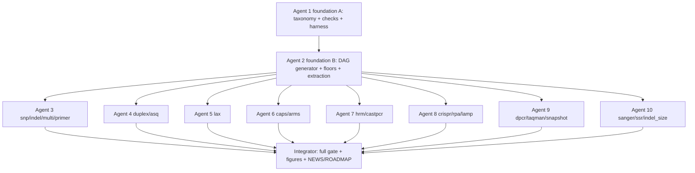

# DAG rebuild plan — 20 marker chemistries, 10 agents

This is the orchestrator's brief. It exists so ten agents can each fix one chunk of the
decision DAGs (the trees behind `results/plot-smoke/decision-<scheme>.png`) without
colliding: how they **search**, how they **report**, how they **edit**, and how they
**test only their own chunk**.

Source of the "scientific requirements" used throughout: `README.md` §3 (*Краткий
мануал по подбору KASP* — LGC/KBioscience + EasyKASP 2025), the lecture deck
`lecture/kasp-slides.qmd`, and each scheme file's own `# Design rules (researched, not
invented)` header comment. Agents must treat those as the truth and cite them.

---

## 1. What a "DAG" is here (read this first)

One decision DAG per marker chemistry. It is *generated*, never hand-drawn:

```
marker_criteria(scheme)      R/marker_criteria.R   → 5 site checks + 21 assay checks + the stage's gates/tiers
marker_decision_stages(scheme) R/marker_decision.R → the scheme's selection stages
      │
      ▼
marker_decision_schema(scheme)  R/marker_decision.R  → nodes + edges (order, x/y, hard)
      ├─ marker_decision_graph()  → tidygraph, stamps status from assay$selection / $evaluation
      ├─ plot_decision_tree()   → the PNG (dev/render-decision.R)
      └─ marker_decision_text()   → the greppable text export
```

The scheme's *stage* (its gates / relaxation ladder / tiers) comes from either the
built-in constants in `R/marker_select.R` (`KASP_GATES_*`, `KASP_RELAX_*`, `KASP_TIERS_*`)
or from a discovered `scheme_def_<scheme>()` in `R/marker_<scheme>.R`. The **checks** are
the fixed lists in `R/marker_criteria.R`, tagged with schemes by `check_schemes()` in
`R/marker_schemes.R`. Acceptance is run by `marker_design_checks()` in `R/marker_checks.R`.

Inspecting any DAG locally (needs a working R env, see §10):

```r
pkgload::load_all(".")
cat(marker_decision_text("lamp"), sep = "\n")   # the whole DAG as text
marker_decision_schema("lamp")$nodes            # the node table
```

---

## 2. The 20 schemes and their files

`marker_schemes()` has 9 built-in rows + 11 discovered (`scheme_def_*`). Every scheme has
one test file. "Kind" matters for the write scopes in §5.

| scheme | family | kind | source of the stage | test |
|---|---|---|---|---|
| `primer` | primer | built-in | none (marker-agnostic) | `test-decision.R`, `test-criteria.R` |
| `snp` | kasp | built-in | `KASP_*_AS` + `_PAIR` | `test-selection.R`, `test-decision.R` |
| `indel` | kasp | built-in | same as `snp` | `test-indel.R` |
| `multi` | kasp | built-in | same as `snp` | `test-mnp.R`, `test-alleles.R` |
| `duplex` | multiplex | built-in | `KASP_*_DUPLEX` | `test-duplex.R` |
| `asq` | asq | built-in | `KASP_*_ASQ` | `test-decision.R` |
| `caps` | caps | built-in | `KASP_*_CAPS` | `test-caps.R` |
| `arms` | arms | built-in | `KASP_*_ARMS` | `test-arms.R` |
| `hrm` | hrm | built-in | `KASP_*_HRM` | `test-hrm.R` |
| `castpcr` | castpcr | discovered | `scheme_def_castpcr` · `R/marker_castpcr.R` | `test-castpcr.R` |
| `crispr` | crispr | discovered | `scheme_def_crispr` · `R/marker_crispr.R` | `test-crispr.R` |
| `dpcr` | dpcr | discovered | `scheme_def_dpcr` · `R/marker_dpcr.R` | `test-dpcr.R` |
| `indel_size` | indel_size | discovered | `scheme_def_indel_size` · `R/marker_indel_size.R` | `test-indel-size.R` |
| `lamp` | lamp | discovered | `scheme_def_lamp` · `R/marker_lamp.R` | `test-lamp.R` |
| `lax` | kasp | discovered | `scheme_def_lax` · `R/marker_lax.R` | `test-lax.R` |
| `rpa` | rpa | discovered | `scheme_def_rpa` · `R/marker_rpa.R` | `test-rpa.R` |
| `sanger` | sanger | discovered | `scheme_def_sanger` · `R/marker_sanger.R` | `test-sanger.R` |
| `snapshot` | snapshot | discovered | `scheme_def_snapshot` · `R/marker_snapshot.R` | `test-snapshot.R` |
| `ssr` | ssr | discovered | `scheme_def_ssr` · `R/marker_ssr.R` | `test-ssr.R` |
| `taqman` | taqman | discovered | `scheme_def_taqman` · `R/marker_taqman.R` | `test-taqman.R` |

---

## 3. The contract — invariants every DAG must satisfy

These are the acceptance criteria for the whole effort. Agent 1 (foundation A) turns
them into a reusable, machine-checked helper (§7) so each scheme agent tests them for
its own scheme only. **No agent may relax an invariant to make its scheme pass.**

- **C1 — one criterion, one node.** A physical criterion is either a selection *gate*
  or an acceptance *check*, never both. Today gates restate checks (e.g. `gate_discrimination`
  ↔ `check:discrimination`; `gate_tm` ↔ `check:com_tm_as_tm`; `gate_amplicon` ↔
  `check:amplicon_length_bp`), sometimes one gate ↔ two checks (footprints). Kill the
  duplication: the graph shows the criterion once.
- **C2 — check membership is family-based.** A scheme carries only the checks that its
  chemistry obeys. Non-KASP chemistries must not carry AS/COM/discrimination/3'-window
  checks; the 5 *site* checks (`target site class`, `ALT alleles (n)`, … `design relies
  on linkage`) are KASP-selector notions and apply only where an ALT primer/linkage exists.
- **C3 — graph == evaluation.** `marker_design_checks(assay)` evaluates exactly the checks
  the scheme's DAG displays (today it ignores `scheme` entirely, `R/marker_checks.R:113`).
- **C4 — hard failure dooms.** A failed *hard* gate must have a direct path to `DOOMED`.
  A mixed hard/soft stage must not draw a hard gate as merely "relaxable" (today only
  all-hard stages emit `decision --fail--> doomed`).
- **C5 — a relaxed win still passes its check.** If the ladder relaxes a gate past the
  acceptance limit, the winner fails the corresponding check (e.g. amplicon floor `-20`
  admits 120 bp, but the check demands `[50,100]`). Floors and `KASP_LIMITS` must be
  reconciled so "relaxed" and "accepted" never contradict.
- **C6 — two declared orders.** Gate order = the order the method applies them (grave /
  cheap first); relaxation order = *least grave first*. Both are declared per scheme and
  labelled. They need not be equal.
- **C7 — no decorative gates.** Every gate the DAG shows is actually evaluated by the
  scheme's designer/selector. No declaration-only gates (today all `gate_caps_*`,
  `gate_arms_*`, `gate_asq_*`, `gate_duplex_*`, `gate_crispr_*`, … are never emitted).
- **C8 — hardness is justified.** `hard = TRUE` only when the method says the assay is
  *meaningless* without it (and give the `gate_hard_label`); otherwise soft, with a
  bounded, reachable floor.
- **C9 — no placeholders.** Limits are real, parameterised values (`KASP_LIMITS`),
  never a literal `[lo, hi]` (see `gate_caps_tm`).
- **C10 — ungated list is honest.** `KASP_UNGATED_CHECKS` must not call a criterion
  ungated while a scheme hard-gates it (off-target is hard in `ssr`/`indel_size`).
- **C11 — acyclic, strictly downward, reachable.** Every edge endpoints exists; `ord[to] >
  ord[from]`; `assay:verdict` present (already tested — keep it).
- **C12 — the runtime graph matches the scheme.** `assemble_kasp_assay()` stores its
  scheme and builds *that* scheme's `$decision` (today always `snp`), and
  `plot_decision_tree(assay)` honours it.
- **C13 — reachable or explicitly documentation-only.** A scheme is reachable through
  `marker_design_at()` / the ladder, or it is marked documentation-only with a stated
  reason (`asq`, `primer`). Same for status stamping (gate statuses are stamped only for
  `as`/`pair` today).
- **C14 — tiers are non-vacuous.** A tier must not merely restate a hard gate already
  enforced (e.g. `sanger` tier1 "unique amplicon" while uniqueness is a hard gate).

---

## 4. Phase 0 — foundation (Agents 1–2, serial, before anything else)

Everything below depends on these two, and they must land first so the scheme agents
have a stable, shared contract and non-overlapping files.

### Agent 1 — foundation A (taxonomy, checks, harness)
Files: `R/marker_schemes.R`, `R/marker_criteria.R`, `R/marker_checks.R`,
`R/marker_scheme_registry.R`, `tests/testthat/test-criteria.R`,
`tests/testthat/test-decision.R` (only the shared/generic assertions),
new `tests/testthat/helper-dag.R`, new `dev/dump-dags.R`, `NEWS.md`, `ROADMAP.md`.

1. Define the family → check-set taxonomy (C2): which of the 5 site + 21 assay checks
   each `family` serves. Rewrite `check_schemes()` so a discovered scheme gets its
   family's set, not "everything".
2. Make `marker_design_checks()` scheme-aware (C3): read the checker's `scheme` and filter
   `marker_criteria(scheme = )`, computing only the rows that scheme owns. Keep the
   REF/ALT/footprint *values* only where the chemistry has them.
3. Introduce the DAG-invariant helper `expect_dag_invariants(scheme)` in `helper-dag.R`
   covering C1–C11 as far as statically checkable, so scheme agents call it in one line.
4. `dev/dump-dags.R`: write `marker_decision_text()` for **all** schemes to a file, so an
   agent can diff its own scheme before/after.
5. Rewrite the shared tests to iterate over `marker_schemes()` reading each scheme's spec
   (scheme-agnostic), so scheme agents never edit them.

### Agent 2 — foundation B (DAG generator, graph, floors)
Files: `R/marker_decision.R`, `R/marker_select.R` (generic selector + shared floors only),
`R/marker_assemble.R` (only the `$decision` wiring), `R/marker_scheme_registry.R`,
`tests/testthat/test-selection.R`, `tests/testthat/test-decision.R` (generic),
plus the mechanical extraction in step 3.

1. Fix the generator: (a) remove the gate↔check duplicate nodes (C1); (b) route a failed
   hard gate straight to `DOOMED` even in a mixed stage (C4); (c) parameterise the
   `[lo, hi]` placeholder (C9); (d) make the site/gate/report order explicit (C6).
2. Reconcile the AS/PAIR floors with `KASP_LIMITS` (C5) so a relaxed winner still passes
   its check (or the check reads the relaxed bar) — today `gate_amplicon` floor `-20`
   and `gate_structure` floor `-3` both admit candidates the checks reject.
3. Make all 20 schemes uniform so the write scopes are disjoint: move the built-in stage
   constants (`KASP_*_DUPLEX/ASQ/CAPS/ARMS/HRM`) out of `R/marker_select.R` into
   `scheme_def_duplex/asq/caps/arms/hrm()` in their own files, leaving `marker_select.R`
   with only the generic selector + the shared AS/PAIR constants.
4. Scheme-aware graph (C12/C13): store `scheme` on the assay object and build/stamp its
   `$decision` graph; make `plot_decision_tree(assay)` honour it.
5. Update `KASP_UNGATED_CHECKS` to respect scheme-level off-target gates (C10).

**Gate:** after Phase 0, `Rscript dev/check.R --no-render` must pass and every scheme's
`marker_decision_text()` must be free of duplicate-criterion pairs, `[lo, hi]`, and
hard-gate-reachable-only-via-refine. Freeze §3 as the contract reference.

---

## 5. Phase 1 — per-scheme agents (Agents 3–10, parallel, disjoint files)

Each agent owns exactly its scheme files + its test file(s). **Hard rule:** if an agent
believes it must edit a file outside its scope (especially `marker_select.R`,
`marker_criteria.R`, `marker_decision.R`, `marker_checks.R`, `marker_primer_pairs.R`), it must
stop and request a serial slot from the orchestrator, not edit it inline and collide.

| Agent | Schemes | Owned files (write scope) |
|---|---|---|
| 3 | `snp`, `indel`, `multi`, `primer` | `R/marker_assemble.R`, `R/marker_select.R` (AS/PAIR section), `R/marker_design.R`, `R/marker_target.R` (core path), `tests/testthat/test-selection.R`, `test-indel.R`, `test-mnp.R`, `test-alleles.R` |
| 4 | `duplex`, `asq` | `R/marker_duplex.R`, new `R/marker_asq.R`, `tests/testthat/test-duplex.R`, new `test-asq.R` |
| 5 | `lax` | `R/marker_lax.R`, `tests/testthat/test-lax.R` |
| 6 | `caps`, `arms` | `R/marker_caps.R`, `R/marker_arms.R`, `tests/testthat/test-caps.R`, `test-arms.R` |
| 7 | `hrm`, `castpcr` | `R/marker_hrm.R`, `R/marker_castpcr.R`, `tests/testthat/test-hrm.R`, `test-castpcr.R` |
| 8 | `crispr`, `rpa`, `lamp` | `R/marker_crispr.R`, `R/marker_rpa.R`, `R/marker_lamp.R`, `tests/testthat/test-crispr.R`, `test-rpa.R`, `test-lamp.R` |
| 9 | `dpcr`, `taqman`, `snapshot` | `R/marker_dpcr.R`, `R/marker_taqman.R`, `R/marker_snapshot.R`, `tests/testthat/test-dpcr.R`, `test-taqman.R`, `test-snapshot.R` |
| 10 | `sanger`, `ssr`, `indel_size` | `R/marker_sanger.R`, `R/marker_ssr.R`, `R/marker_indel_size.R`, `tests/testthat/test-sanger.R`, `test-ssr.R`, `test-indel-size.R` |

Agent 3 also updates the committed README figures (`man/figures/decision-tree.png` for
`snp`, `decision-multiplex.png` for `duplex` via `Rscript dev/render-decision.R`) since
only those two figures are committed; the rest are git-ignored `results/plot-smoke/*.png`.

---

## 6. What each Phase-1 agent must produce

### 6a. Search (evidence first)
1. Read the scheme's own header (`# Design rules (researched, not invented)` block) in
   `R/marker_<scheme>.R` — it cites the method literature; that is the authority.
2. Read `README.md` §3 and, where relevant, `lecture/kasp-slides.qmd`.
3. Read the scheme's `scheme_def_<scheme>()` (gates/relax/tiers/labels) and its designer.
4. Dump the current DAG: `cat(marker_decision_text("<scheme>"), sep = "\n")` (or
   `dev/dump-dags.R`).
5. `grep` for the scheme's gate ids across `R/` to confirm which are actually emitted by
   the engine (C7) — e.g. the audit found `gate_caps_*`/`gate_arms_*` are never emitted.

### 6b. Report (fill this template *before* editing — this is the deliverable)
```
## <scheme>
Method basis: <where the requirements come from; cite file:line + external refs>
DAG now: <ordered node list; flag duplicates, decorative gates, placeholder limits>
Defects: <numbered; each with file:line, the invariant it violates (C…), and the fix>
Proposed DAG: gate order (grave/cheap first) | hard/soft per gate | relax order + floors
              | tiers | site checks | assay checks (family-correct set)
Biological risk if unfixed: <what unviable result the current DAG returns>
Tests to add/extend: <file + what they assert; must call expect_dag_invariants()>
```

### 6c. Edit
- Fix the designer and/or `scheme_def_<scheme>()` so the *declared* DAG is real (C7) and
  method-true. Implement the proposed gates/tiers/hard-soft/order/floors.
- Add only the checks your chemistry obeys (via the family taxonomy from Phase 0).
- Do **not** silence a check or widen a limit just to pass — fix the cause.
- Keep tidyverse style: `|>`, `.data$`, `snake_case`; comments explain *why*.
- Add a `NEWS.md` bullet and a `ROADMAP.md` line for each scheme you touch.

### 6d. Test **only your chunk**
- Inner loop (fast, your files only): the suite is one file per scheme, so
  ```sh
  Rscript -e 'testthat::test_local(filter = "crispr|rpa|lamp")'
  ```
  runs only `test-crispr.R`, `test-rpa.R`, `test-lamp.R`.
- Add to each of your test files a call to the shared invariant helper:
  ```r
  test_that("<scheme> DAG obeys the contract", expect_dag_invariants("<scheme>"))
  ```
  plus explicit assertions for *your* ordering, hardness and gate set (Phase 0 made the
  shared tests scheme-agnostic, so you never edit them).
- Before declaring done, also run the two cheap shared DAG tests (they read every
  scheme; do not edit them):
  ```sh
  Rscript -e 'testthat::test_local(filter = "decision|criteria|selection")'
  ```
- Full gate is the orchestrator's, not yours: `Rscript dev/check.R --no-render`
  (adds styler, lintr, roxygen sync, install smoke, figure sync). Expect to fix the
  figure step if you own `snp`/`duplex`.

---

## 7. Test harness (built once in Phase 0, used by everyone)

`tests/testthat/helper-dag.R` exposes:

```r
expect_dag_invariants(scheme)  # C1 dup-criteria, C2 check membership, C4 hard→doomed,
                               # C6 orders declared, C7 gates emitted, C9 no placeholder,
                               # C10 ungated honesty, C11 acyclic/downward/verdict
```

`dev/dump-dags.R` writes every scheme's `marker_decision_text()` to `results/dags.txt`
(git-ignored), so an agent can `diff` its scheme's DAG before/after and paste the delta
into its report.

---

## 8. Per-scheme defect briefs (grounded; each agent expands its own)

These were found by static audit (read-only; the code was not changed). They are a
starting point, not gospel: **run each scheme and confirm** before editing (`cat(marker_decision_text("<scheme>"), sep = "\n")`, and `dev/dump-dags.R`). Line numbers are
from the current tree — re-verify.

**Core (Agent 3).** `snp`: amplicon floor `-20` admits 120 bp but the check demands
`[50,100]`; structure floor `-3` admits hairpin `-6` the check rejects (C5); relax order
puts `wobble` before footprint though the manual calls wobble the *worst* mismatch (C6);
tier3 rewards *more* stable 3' ends, against the KASP destabilising rationale; no COM
3'-stability criterion. `indel`: DAG is byte-identical to `snp` although it declares
"allele-specific amplicon length" — **there is no REF/ALT size-resolvability gate**
(cf. `gate_caps_resolvable`, `gate_arms_bands`); `gate_wobble` is vacuous (`wobble = NA`).
`multi`: `wobble`/`disc` computed on `alts[1]` only, ignoring the degenerate IUPAC 3'
base; no check that the 3' code is the consensus of *all* ALTs. `primer`: unreachable
(`marker_design_at()` has no branch; absent from the ladder) — mark documentation-only (C13)
or wire it; missing an in-silico-product-count check.

**`duplex`/`asq` (Agent 4).** `duplex`: relax node advertised but there is no
`KASP_GATE_FLOOR_DUPLEX` and the designer never calls `select_with_ladder`; a failed
*hard* `gate_duplex_complement` still returns `"warn"` not DOOMED (C4); amplicon gate
promises ≤150 while the check demands `[50,100]` (C5). `asq`: no engine at all
(`R/marker_asq.R` missing, not in `per_locus_schemes()`); both gates
(`gate_asq_cassette`, `gate_asq_readout`) are panel/format properties, not
candidate-computable, yet hard (C7/C8); "Kalendar 2022 / 4-plex cassette" citation
unverified.

**`lax` (Agent 5).** `family = "kasp"`, so it carries the *whole* as+pair machinery plus
its own stage; no hard gate and the coverage floor literally says "leave a haplotype
uncovered (warn)" — defeats the scheme's promise (C8); no LD/pop-freq guard that baked-in
linked variants are ALT-specific (a common REF variant ⇒ dropout); the pooled tube is
screened for dimers only, not cross-priming.

**`caps`/`arms` (Agent 6).** Both stages are **never evaluated** — the designers
(`design_caps_marker`, `design_arms_marker`) never call `grade_*`/`select_with_ladder`
and never emit `gate_caps_*`/`gate_arms_*` (C7). `gate_caps_tm` limit is the literal
`[lo, hi]` (C9); `gate_caps_amplicon` `[120,1200]` vs `check:amplicon_length_bp` `[50,100]`
(C5); relaxing `gate_caps_resolvable` risks an unresolvable digest despite being the whole
point. `arms`: `gate_arms_bands` floor equals its threshold (can never relax, drawn soft);
`gate_arms_outer` has no engine support. Both silently *lose* the site + 9 allele-specific
checks (the mirror of C2) and their AS/COM-labelled checks don't fit a flanking pair.

**`hrm`/`castpcr` (Agent 7).** `hrm`: gate set matches practice but hard/soft is
debatable (amplicon, HRM's core requirement, is the relaxable one); the "variant under
neither primer" rule is structural, not a gate. `castpcr`: **targets the wrong allele** —
the designer picks `best$ref_primer` (REF 3' base) although castPCR (and its own header:
Roma 2013, Barbano 2015) detects the low-abundance ALT; `zygosity="co-dominant"`
unsupported by a single AS primer; probe is locus-specific, not allele-specific; the MGB
blocker underpinning the 0.1–1% LOD is unmodelled; `gate_castpcr_probe_tm` hard/soft
contradicts the physically identical `gate_dpcr_probe_tm`.

**`crispr`/`rpa`/`lamp` (Agent 8).** `crispr`: the single always-present **hard**
`gate_crispr_pam` is Cas12a-specific, yet PAM-free Cas13 is supported — a Cas13 marker is
misrepresented (C8); no guide-specificity gate; pre-amp screened with KASP PCR Tm/GC;
`discrimination`/`REF1/ALT0` checks are actively wrong (pre-amp amplifies both alleles).
`rpa`: the probe gate is unconditional though the exo probe is optional; the *governing*
primer length is soft while the designer hard-requires 30–35 nt (contradiction); the
no-probe path accepts the variant anywhere under the primer, not at the 3' end. `lamp`:
the designer forces the variant into an unprimed loop (inner arms stop short), so no
primer 3' end reads it — the marker cannot discriminate REF/ALT, contradicting the
header's "ends of the inner primers"; loop primers LF/LB absent despite "4–6 primers"; no
cross-dimer gate.

**`dpcr`/`taqman`/`snapshot` (Agent 9).** `dpcr`: the probe is real but no probe
Tm/GC/structure/off-target is in the acceptance set; inherits AS-primer checks that don't
apply; `readout` claims Poisson/partitioning never computed. `taqman`: `gate_taqman_probe_tm`
is declared **hard** while the header explicitly says the probe-Tm rule is *not* a hard
gate (tier2) — internal contradiction; the gate is never evaluated (only used as a sort
key); the real probe-discrimination (mismatch ΔG) is neither gate nor check. `snapshot`:
`gate_snapshot_tm` says `[50,55]` but the designer relaxes to `[48,60]`; no uniqueness gate
for the extension primer; relax order not "least grave first"; tier1 restates a hard gate.

**`sanger`/`ssr`/`indel_size` (Agent 10).** `sanger`: no structure/GC/`>2` identical-3'-base
gate despite the header; designs no sequencing primer; tier1 "unique amplicon" is vacuous
(uniqueness is hard-gated); `gate_sanger_unique` duplicates `check:in_silico_pcr`. `ssr`:
`gate_ssr_flanks` only asserts "outside the repeat", not flank *uniqueness*; no
polymorphism/allele-size gate; `gate_ssr_clean` is vacuous (guaranteed upstream);
`gate_ssr_offtarget` is soft yet README calls a full-3'-end off-target fatal, and it is
also in `KASP_UNGATED_CHECKS` (C10). `indel_size`: `gate_indel_size_gap` is soft but the
designer hard-rejects `< min_gap` (unreachable rung); both hard gates (`structure`,
`unique`) are never enforced; `gate_indel_size_unique` conflicts with `KASP_UNGATED_CHECKS`
(C10).

---

## 9. Sequencing & integration



- Agents 3–10 run in parallel only after Agent 2 reports done.
- Each returns its §6b report + a green `test_local(filter=...)` for its chunk.
- The **integrator** (the user, or one more serial pass) runs the full gate
  `Rscript dev/check.R`, regenerates committed figures, and reconciles `NEWS.md`/`ROADMAP.md`.
- If two agents need the same shared file, serialize those two (the orchestrator decides).

---

## 10. How to run anything (the env is verified working)

The deps are installed in a **renv cache library** and the external tools live in the
project `.tools/`. They are **not** in the default R library, so every command must be
prefixed with the env below or `pkgload::load_all()` fails at import and nothing runs.
This is already recorded in `AGENTS.md`.

```sh
export R_LIBS=/home/stathmin/.cache/R/renv/library/kasp-example-cee55197/linux-debian-forky/R-4.6/x86_64-pc-linux-gnu
export PATH=/home/stathmin/Documents/devel/tidykasp/.tools/bin:$PATH
export UNAFOLDDAT=/home/stathmin/Documents/devel/tidykasp/.tools/share/oligoarrayaux

Rscript -e 'pkgload::load_all(".")'                       # load from source
Rscript -e 'testthat::test_local(filter = "<scheme>")'   # one scheme's tests
Rscript dev/check.R                                        # the full merge gate
```

`Rscript dev/check.R` is green on a clean checkout today, so agents can and must run
tests. `Rscript dev/dump-dags.R` (from Agent 1) works offline — use it as the source of
truth for a scheme's current DAG.
