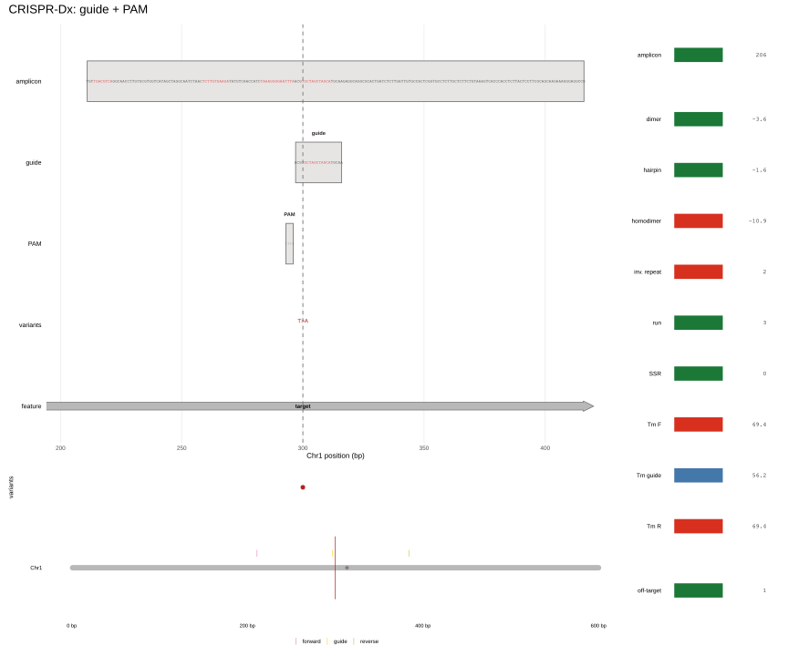
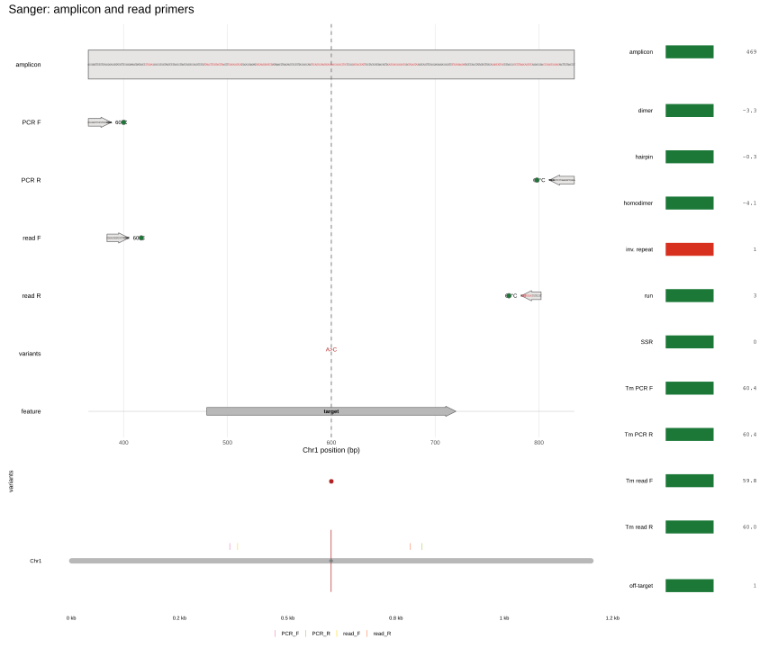
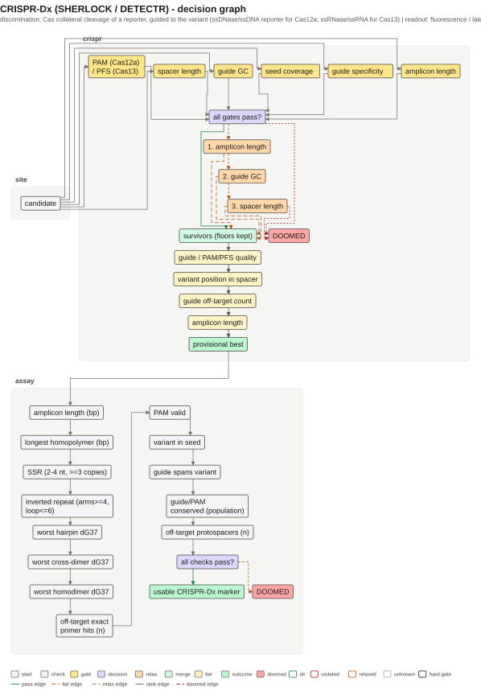
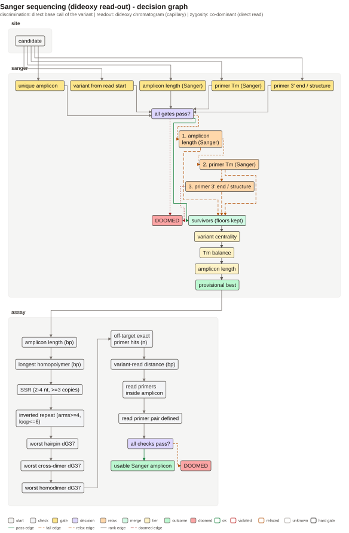

```{r setup, include = FALSE}
knitr::opts_chunk$set(collapse = TRUE, comment = "#>", fig.align = "center")
```

```{r}
library(tidymarkers)
library(knitr)
```

На каждом рисунке — буквы последовательностей (спейсер/PAM, праймеры и
ампликон), трек вариантов, геномная off-site панель и справа тот же tumbler,
что у KASP.
Две схемы на разных концах спектра: CRISPR-Dx даёт бинарный/флуоресцентный
сигнал через коллатеральное расщепление, Sanger — прямое прочтение основания.
Обе требуют уникальной мишени и аккуратной геометрии олиг.

## CRISPR-Dx: Cas12a и Cas13

Cas12a направляется спейсером ~20 nt и требует PAM (для Cas12a обычно TTTV)
рядом с протоспейсером. При совпадении активируется коллатеральная
ssDNase-активность, которая режет ssDNA-репортер — сигнал усиливается.
Cas13 работает по РНК-мишени; PAM не нужен, но есть PFS (Cas13a — избегать G
на 3′ фланге, Cas13b — 5′ D-PFS); специфичность задаёт спейсер.
[Chen et al. (2018)](https://doi.org/10.1126/science.aar6245),
[Gootenberg et al. (2017)](https://doi.org/10.1126/science.aam9321).

Пакет проверяет PAM/спейсер, GC, отсутствие точных off-target протоспейсеров и
преамплификацию (RPA). Коллатеральная кинетика не симулируется — это
записано в `marker_readout()`.

```{r crispr-fig, echo = FALSE, out.width = "100%", fig.cap = "CRISPR-Dx: спейсер, PAM и преампликон; кинетика расщепления не моделируется."}

```

```{r, eval = FALSE}
snp <- tibble::tibble(chrom = "Chr1", pos = 300L, ref = "T", alt = "A")
design_crispr_marker(genome, snp, flank = 200, cas = "cas12a")
```

## Sanger

Sanger-секвенирование читает вариант напрямую: фланкирующая пара даёт
ампликон 400–800 bp, а вложенные read-праймеры читают через вариант с обеих
сторон. Дискриминации «по праймеру» нет — есть качество прочтения.
[Sanger et al. (1977)](https://doi.org/10.1073/pnas.74.12.5463).

Ключевое: вариант должен быть достаточно далеко от концов прочтения (обычно
>= 50 bp), ампликон уникален, read-праймеры лежат внутри продукта и не
конфликтуют с амплификационными.

```{r sanger-fig, echo = FALSE, out.width = "100%", fig.cap = "Sanger: фланкирующий ампликон и вложенные read-праймеры."}

```

```{r, eval = FALSE}
design_sanger_marker(genome, snp, flank = 500)
```

## Неудачные маркеры и недостающие проверки

Дизайн может пройти все гейты и всё равно дать «пустой» маркер (dud marker):
нет сигнала, нет дискриминации или сигнал приходит не от той мишени. Часть
таких случаев видна сразу — `design_crispr_marker()`/`design_sanger_marker()`
возвращают `NULL`; часть проходит дизайн и проваливается только в лаборатории.
Ниже — конкретные случаи. **В пакете** — проверка реально вычисляется или
гейтится; **рекомендация** — этого в модели нет, проверять руками.

### CRISPR-Dx

- **Сохранение PAM/спейсера в популяции.** **В пакете:** поиск идёт по одной референсной
  последовательности; `design_crispr_marker()` не смотрит в VCF/популяционные
  данные. Частый SNP в спейсере, seed или PAM сломает связывание у части
  генотипов. **Рекомендация:** проверить популяционную изменчивость в
  спейсере/PAM/seed; PAM и seed — [Addgene CRISPR Guide](https://www.addgene.org/guides/crispr/),
  мисматчи в seed — [Kleinstiver et al. (2016)](https://doi.org/10.1038/nbt.3620).

PAM/PFS под конкретный вариант Cas.** **В пакете:** `cas12a` (5'-TTTV),
  `cas13`/`cas13a` (3′ non-G PFS) и `cas13b` (5′ D-PFS); для других
  ферментов/PAM (Cas12b/Cas12i/Cas12j, Cas9,
  Cas14, инженерные Cas12a с изменённым PAM) отдельной модели нет. Для
  инженерной Cas12a `cas = "cas12a"` применит TTTV, даже если у фермента другой
  PAM. **Рекомендация:** брать PAM из таблицы для реального фермента
  ([Addgene](https://www.addgene.org/guides/crispr/)); Cas13 режет РНК, а не ДНК
  (ДНК-мишень сначала преамплифицируют и транскрибируют через T7)
  ([Gootenberg et al. (2017)](https://doi.org/10.1126/science.aam9321),
  [2018](https://doi.org/10.1126/science.aaq0179)).

- **Off-target расщепление.** **В пакете:** `crispr_spacer_hits()` считает
  точные вхождения спейсера и его обратного комплемента, `off_target = hits - 1`;
  это жёсткий гейт (`specificity_max = 0`). Это не предсказание off-target:
  PAM у найденных копий не проверяется, мисматчи не оцениваются,
  коллатеральное расщепление в off-target не моделируется. **Рекомендация:**
  для сложных/повторных геномов — mismatch-aware поиск (seed/PAM) и
  валидация; специфичность Cpf1 — [Kleinstiver et al. (2016)](https://doi.org/10.1038/nbt.3620).

- **Преамплификация (RPA).** **В пакете:** RPA-пара фланкирует спейсер,
  проверяются RPA-окна длины/GC и ампликон 80–250 bp (мягкий гейт
  расширяется на 20 bp). Уникальность пары по геному не является гейтом
  дизайна; кинетика RPA и артефакты праймеров не моделируются; для Cas13
  T7-ориентация не валидируется.
  **Рекомендация:** прогнать in-silico PCR/уникальность преамплификационной
  пары и проверить RPA ([Piepenburg et al. (2006)](https://doi.org/10.1371/journal.pbio.0040204)).

- **Цепь-мишень.** **В пакете:** по умолчанию перебираются обе цепи,
  `strand = "+"`/`"-"` сужает поиск; для Cas13 это ответственность
  вызывающего — спейсер должен совпадать с транскрибируемой (T7) цепью,
  автоматической проверки T7 нет. **Рекомендация:** для Cas13 явно задать
  `strand` и сверить с T7-конструкцией ([Gootenberg et al. (2018)](https://doi.org/10.1126/science.aaq0179)).

- **Считывание репортера/пробы.** **В пакете:** репортер/проба не
  проектируются; `marker_readout()` возвращает `simulated = FALSE` и note
  «Cas collateral-cleavage kinetics not modelled». **Рекомендация:**
  калибровать «есть/нет» в лаборатории; механика коллатерального
  расщепления — [Chen et al. (2018)](https://doi.org/10.1126/science.aar6245).

- **Вторичная структура спейсера.** **В пакете:** спейсер виден в общих
  олиго-проверках (`plot(marker)`: шпилька, димер, инвертированный повтор,
  гомополимер, SSR), но `design_crispr_marker()` по ним не отбраковывает —
  это не гейт дизайна. Структура полной crRNA/scaffold не моделируется.
  **Рекомендация:** проверить структуру спейсера/crRNA внешним инструментом,
  особенно для GC-богатых спейсеров.

- **SNP под seed/PAM.** **В пакете:** целевой вариант ставится в seed (Cas12a,
  смещение < 8 nt) или в центральную половину спейсера (Cas13, приближение
  пакета), гайд подбирается под один аллель. Второй SNP под seed/PAM не
  учитывается. Если вариант попадает в PAM, в спейсере того же гайда его нет;
  при отсутствии альтернативной геометрии дизайн вернёт `NULL`.
  **Рекомендация:** проверять гаплотипы в seed/PAM и менять цепь/фермент, а
  не «дотягивать» гайд.

### Sanger

- **Вариант слишком близко к началу прочтения.** **В пакете:** жёсткий
  `gate_sanger_dist` требует >= 50 bp от варианта до каждого старта прочтения;
  иначе `design_sanger_marker()` возвращает `NULL`. Первые
  ~50 оснований прочтения традиционно низкого качества
  ([molbiologytools](https://molbiologytools.com/sanger_primer_designer_help);
  [Sanger et al. (1977)](https://doi.org/10.1073/pnas.74.12.5463)).

- **Плохое качество прочтения.** **В пакете:** качество не моделируется; 50 bp —
  фиксированная эвристика, не Phred. Гомополимеры/SSR проверяются у праймеров,
  а не у ампликона; GC-богатый участок может «провалиться» и дальше 50 bp.
  **Рекомендация:** смотреть реальную хроматограмму и обрезать
  низкокачественные концы.

- **Гетерозиготный индел/фаза.** **В пакете:** один `snp` (`ref`/`alt`), без
  гомо/гетерозиготности и фазирования; смешанные пики не моделируются.
  **Рекомендация:** для инделов и фазы — клонирование, аллель-специфичная ПЦР
  или другая схема; Sanger читает основание напрямую, но фазу сам по себе не
  даёт.

- **Отказ вложенного read-праймера.** **В пакете:** read-праймеры ищутся в
  окне до 40 bp от PCR-праймеров, с Tm/GC-скрином и предпочтением низкого
  3'-гомополимера (не жёсткий фильтр); при неудаче — fallback на фланкирующую
  пару (`nested = FALSE`). 3'-seed уникальность проверяется только для
  in-memory `DNAStringSet`; для индексированного `marker_genome` проверка
  пропускается (`NA`).
  **Рекомендация:** заказывать оба варианта; перекрытие/конкуренция read- и
  PCR-праймера не моделируется.

- **Контаминация ПЦР-продукта.** **В пакете:** `gate_sanger_unique` — это
  геномная специфичность (один in-silico продукт, без точных off-target
  попаданий), а не чистота реакции. Контаминация/carryover не моделируются.
  **Рекомендация:** NTC/отрицательные контроли, свежие реагенты, гель;
  контаминация даёт «гетерозиготную» картину, которую легко принять за
  реальную.

- **Вариант вне качественного окна прочтения.** **В пакете:** гейт держит
  только нижнюю границу (>= 50 bp) и предпочитает центральное положение
  (tier «variant centrality»), но длину чтения/верхнюю границу не проверяет.
  Вариант в дальней половине 800-bp ампликона может не попасть в прочтение.
  **Рекомендация:** сверить ожидаемую длину чтения с положением варианта;
  читать встречным праймером или укоротить ампликон.

- **Нет симуляции хроматограммы.** **В пакете:** `marker_readout()` для Sanger
  возвращает `simulated = FALSE` и note «read / peak model not simulated»;
  `design_sanger_marker()` отдаёт ампликон и праймеры, а не трек.
  **Рекомендация:** интерпретировать только реальную хроматограмму, дизайн
  считать геометрической проверкой.

Эти ограничения не делают дизайн бесполезным: они отделяют геометрию, которую
пакет проверил, от биологии, которую надо проверить в лаборатории.

### Аудит решений

`vignettes/figures/decision-crispr.txt` и `decision-sanger.txt` — описание схемы, а не трасса
запуска: `marker_decision_text()` собирает узлы из `marker_criteria()` и
`scheme_def_*()`. Ниже — сверка шаблона с тем, что реально исполняют
`design_crispr_marker()` / `design_sanger_marker()`, и с панелями
`vignettes/figures/crispr.svg` / `sanger.svg`. Пометки: **исполняется** — узел
реально вычисляется; **декларативно** — есть в шаблоне, но не в коде;
**на фигуре** — панель `plot()`, а не гейт.

```{r, echo = FALSE, out.width = "100%"}

```

```{r, echo = FALSE, out.width = "100%"}

```

**CRISPR-Dx: граф декларативнее кода.**
- **Декларативно.** PAM, seed и specificity нарисованы жёсткими, но на
  возвращённом маркере они почти не могут быть `FALSE`: PAM отфильтрован
  перебором (`TRUE` или `NA` для Cas13), seed — условие перебора (`TRUE`),
  specificity отбрасывает кандидатов до возврата. Рёбра `PAM → DOOMED` и
  `seed → DOOMED` поэтому диагностические: код возвращает один `NULL` с общим
  сообщением, а не `marker_doomed` с причиной. Узел PAM не параметризован
  ферментом (TTTV для Cas12a, `NA` для Cas13), отдельного узла цепи нет:
  `strand` перебирается, T7-ориентация не проверяется
  ([Gootenberg et al. (2017)](https://doi.org/10.1126/science.aam9321);
  PAM/seed — [Addgene](https://www.addgene.org/guides/crispr/)). Строка
  `readout` в заголовке — единственное место, где упомянут репортер; узла
  кинетики/порога в графе нет.
- **Декларативно.** Tiers не исполняются лексикографически. Граф: guide/PAM
  quality → variant position → off-target count → amplicon. Код сортирует
  кандидатов по `v_off` (Cas12a) или центральности (Cas13), затем по GC и берёт
  первого с подходящей RPA-парой; `off-target count` при `specificity_max = 0`
  всегда 0 (tier вырожден), а длина ампликона не максимизируется.
- **Исполняется частично.** RPA-узел — это `design_flanking_pair()`
  (длина/GC/продукт), а не `design_rpa_marker()`: структура, проба и
  уникальность преамплификации не гейтятся. Ideogram в `crispr.svg` может
  показать второй продукт, но дизайн его не отбраковывает; RPA как метод —
  [Piepenburg et al. (2006)](https://doi.org/10.1371/journal.pbio.0040204).
- **На фигуре.** Tumbler в `crispr.svg` — олиго-QC, а не гейты: он считает
  `run`/`SSR`/`inv. repeat`/`hairpin`/`dimer`/`homodimer` для guide и
  RPA-праймеров, но `design_crispr_marker()` по этим полям не отбраковывает.
  `Tm guide` намеренно `neutral` (окна нет), `off-target` — точные хиты
  каждого олиго (max <= 1), а не протоспейсеры с PAM.
- **Не моделируется.** Один мисматч в спейсере не оценивается: гайд выбран под
  референс, а положение мисматча (seed/distal) и его тип не считаются.
  Мисматч в seed может сохранять активность
  ([Kleinstiver et al. (2016)](https://doi.org/10.1038/nbt.3620)), а
  коллатеральный сигнал — [Chen et al. (2018)](https://doi.org/10.1126/science.aar6245).
  Уточнение к «вариант в PAM»: по построению вариант всегда лежит в спейсере,
  поэтому PAM возвращённого гайда его не содержит; вариант может только
  отсеять альтернативного кандидата.
- **Исполняется, но консервативно.** `crispr_spacer_hits()` вычитает 1 из
  суммы точных хитов обеих ориентаций: палиндромный спейсер может дать ложный
  `off_target`, хиты без PAM считаются, а мисматчи не ищутся вовсе. Это
  консервативный счёт, а не предсказание off-target.

**Sanger: граф ближе к коду.**
- **Исполняется.** `select_flanking_pair()` действительно применяет порядок
  gate/relax/tier, а `confirm()` добавляет `in_silico_pcr()` и
  `pair_structure_ok()`, поэтому `decision-sanger.txt` — не только декларация.
- **Исполняется, но узел неполон.** `gate_sanger_dist` (hard) считается по
  внутренним концам фланкирующей пары (`end_f`/`start_r`); вложенные
  read-праймеры получают свой `min_dist` позже и отдельного узла не имеют.
  `read F`/`read R` на фигуре — праймеры, не длина чтения; верхней границы
  чтения нет ни в графе, ни на фигуре.
- **Исполняется условно; уточнение.** Для `marker_genome` пропускается только
  дешёвый 3'-seed pre-screen (`m_unique = NA`); `gate_sanger_unique` всё равно
  закрывается `in_silico_pcr()` в `confirm()`. Уникальность не «пропущена».
  На фигуре in-silico продукта нет: `marker_ideogram()` ищет `forward`/
  `reverse`, а Sanger отдаёт `PCR_F`/`PCR_R`.
- **Исполняется частично.** `pair_structure_ok()` не проверяет cross-dimer и
  возвращает `TRUE` без OligoArrayAux; tumbler в `sanger.svg` cross-dimer
  показывает, то есть фигура строже гейта. Вложенные read-праймеры
  структурно не проверяются вовсе (только Tm/GC/3'-run/3'-seed).
- **Исполняется; уточнение.** Fallback вложенных праймеров по-сторонний: если
  найден только один, `nested = FALSE`, но вторая сторона остаётся вложенной;
  это не «пара целиком откатилась на фланкирующую».
- **Не моделируется / нет на фигуре.** Вход — один `snp`; фигура рисует один
  трек `T>A`, поэтому фаза, смешанные пики и контаминация по ней недоказуемы.
  `marker_readout()` уже помечает Sanger как `simulated = FALSE`; `read F`/
  `read R` показывают посадку праймеров, не хроматограмму.

## Как читать эти схемы

CRISPR-Dx отвечает «есть/нет» (или полуколичественно по скорости), Sanger —
«какое именно основание». Поэтому у них разные гейты: у CRISPR жёсткая
специфичность спейсера/PAM, у Sanger — размер и чистота ампликона плюс
положение read-праймеров. Общее — уникальность мишени и проверка структуры
олиг; `plot(marker)` показывает архитектуру, `marker_readout()` — что именно
не смоделировано.
