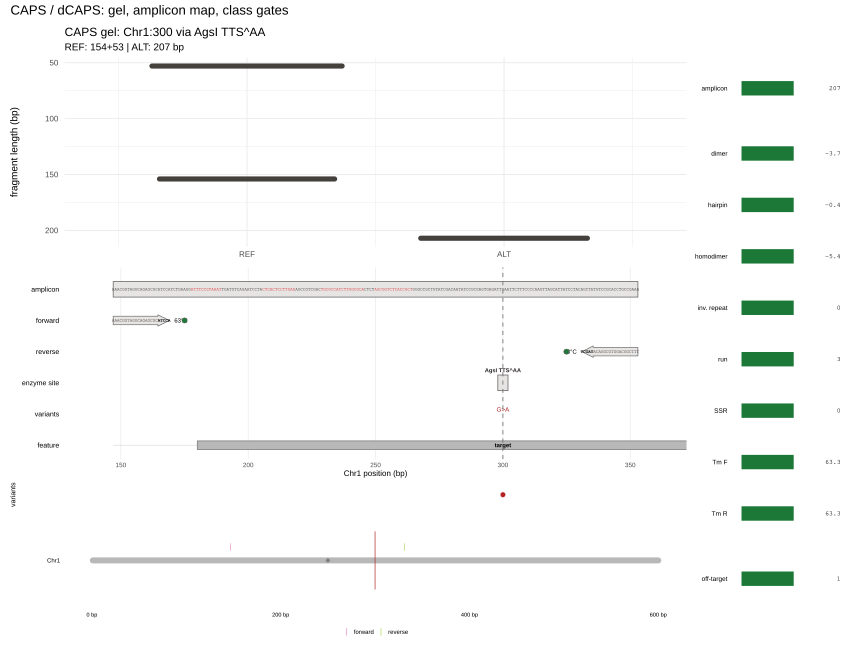
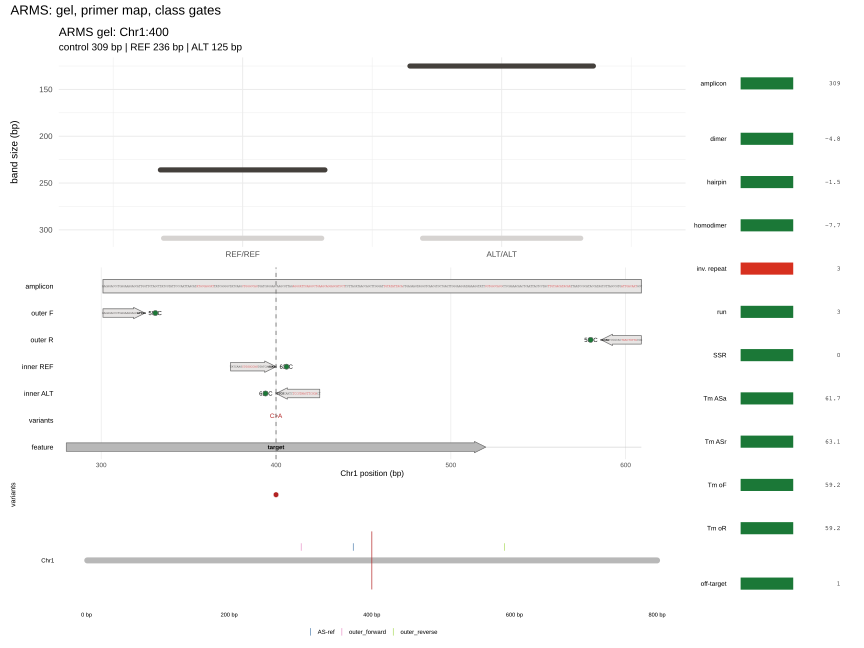
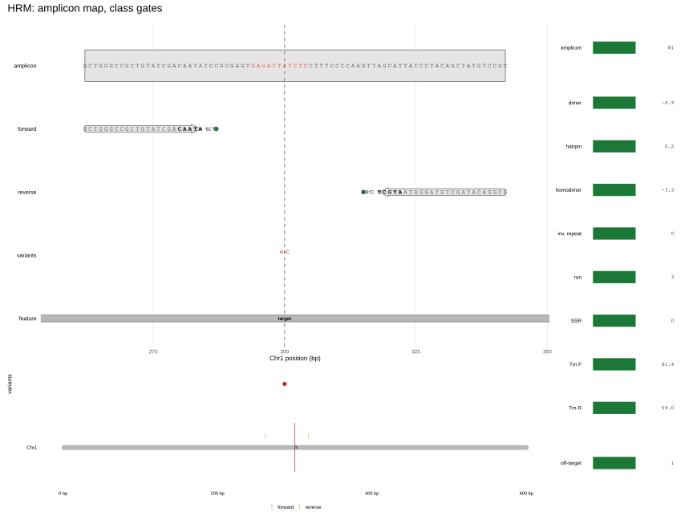
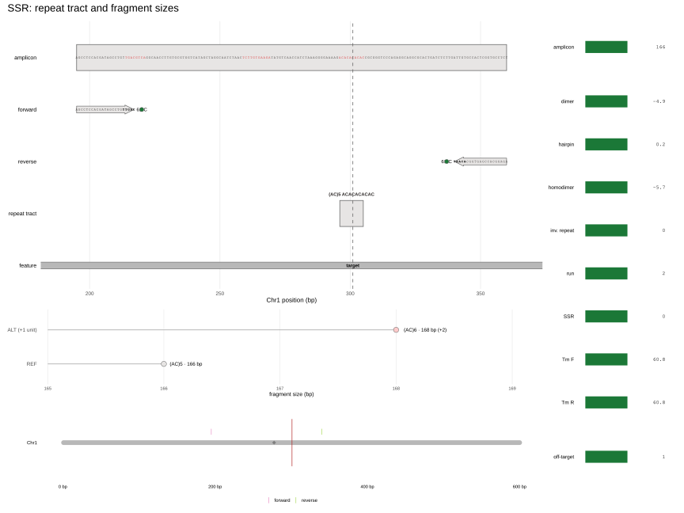
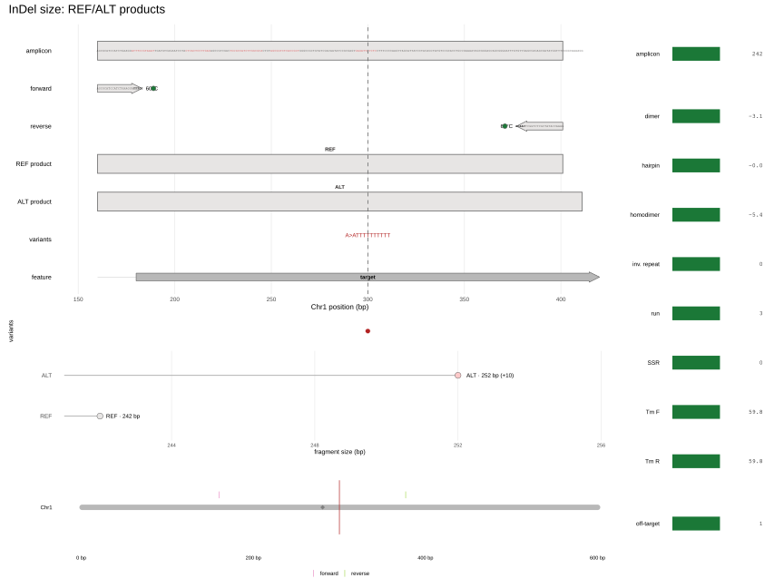
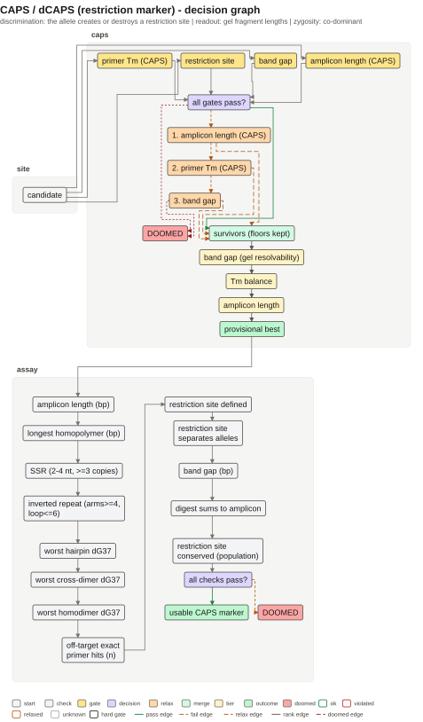
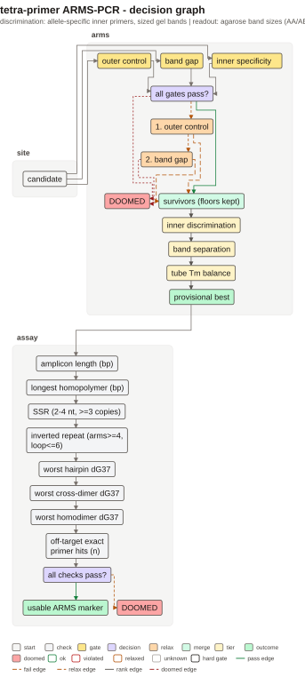
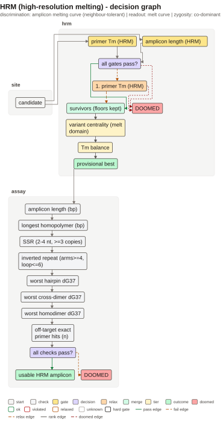
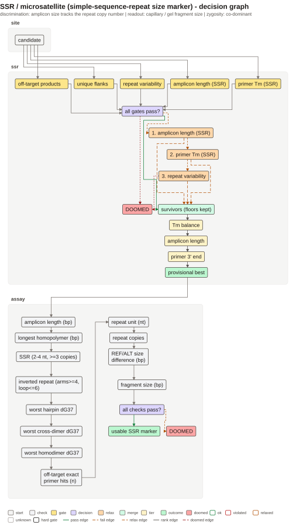
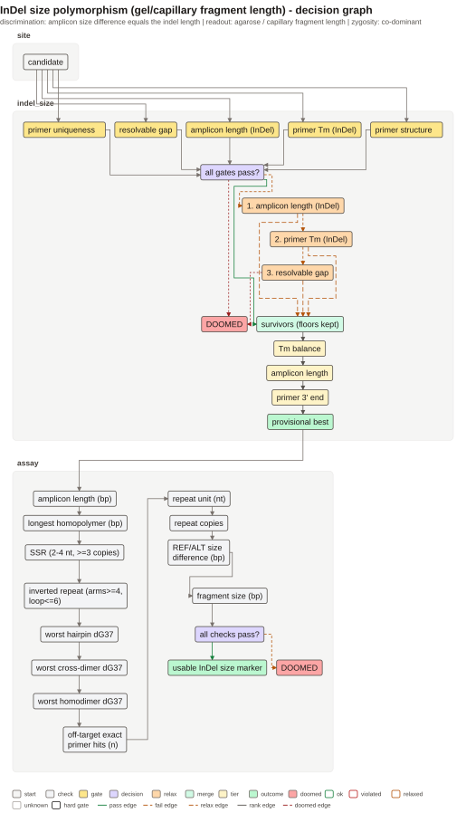

```{r setup, include = FALSE}
knitr::opts_chunk$set(collapse = TRUE, comment = "#>", fig.align = "center")
```

```{r}
library(tidymarkers)
library(knitr)
```

Every figure shows sequence letters (primers and amplicon), the variant track,
the genomic off-site panel and, on the right, the same tumbler as for KASP.
These schemes read **product size** or the **melting curve**, not real-time
fluorescence. The risk they share is therefore signal resolvability: bands/peaks
must be clearly distinguishable and the primers must not create side products.
The package designs the construct, but does not simulate the gel/melting
(`marker_readout()` says so explicitly).

## CAPS and dCAPS

CAPS: the variant creates/destroys a restriction site, and the PCR product is cut
into fragments of different lengths. dCAPS: there is no natural site, and the
primer introduces one mismatch that creates the site only in one allele.
[Konieczny & Ausubel (1993)](https://doi.org/10.1046/j.1365-313X.1993.04020403.x),
[Neff et al. (1998)](https://doi.org/10.1046/j.1365-313X.1998.00124.x).

The key point: the variant must change the restriction pattern, and the fragment
difference must be above the gel resolution; the dCAPS mismatch must not break
annealing.

```{r caps-fig, echo = FALSE, out.width = "100%", fig.cap = "CAPS/dCAPS: amplicon, restriction site and diagnostic bands."}

```

```{r, eval = FALSE}
snp <- tibble::tibble(chrom = "Chr1", pos = 300L, ref = "G", alt = "A")
design_caps_marker(genome, snp, flank = 250)
```

### Haplotypes as a shared population layer

The CAPS designer does not choose primers by haplotype, but any marker can be
given known haplotypes and frequencies: `marker_attach_haplotypes()` adds
`$population`, the map draws a haplotype track, and the right column holds
`ALT freq`, the number of haplotypes and the coverage. This is population
context, not haplotype-specific design; the latter is implemented for `lax`
KASP.

| haplotype | frequency | 300 | 310 | 320 |
|---|---:|---|---|---|
| H1 | 0.55 | A>G | C>T | — |
| H2 | 0.25 | A>G | — | — |
| H0 | 0.20 | REF | — | G>A |

```{r caps-known-hap, eval = FALSE}
hap <- tibble::tibble(
  haplotype = c("H1", "H1", "H2", "H0"),
  freq = c(0.55, 0.55, 0.25, 0.20),
  chrom = "Chr1", pos = c(300L, 310L, 300L, 320L),
  ref = c("A", "C", "A", "G"), alt = c("G", "T", "G", "A")
)
m <- marker_attach_haplotypes(
  design_caps_marker(genome, snp, flank = 250), hap, snp
)
m$population
plot(m, genome = genome)
```

## Tetra-primer ARMS

Two outer primers give the control band, two inner ones are allele-specific: the
3' base of the inner primer matches only one allele. The genotype is read from
the combination of three bands (AA/AB/BB).
[Newton et al. (1989)](https://doi.org/10.1093/nar/17.7.2503),
[Ye et al. (2001)](https://doi.org/10.1093/nar/29.17.e88).

The two inner products must differ in size, otherwise the gel is unreadable; the
Tm of the inner and outer primers is chosen so that all four work in one
reaction (in the package this is tier3, not a hard gate).

```{r arms-fig, echo = FALSE, out.width = "100%", fig.cap = "ARMS: outer control pair and two allele-specific inner primers."}

```

## HRM

HRM discriminates alleles by the shape of the melting curve. Requirements: a
**short single-domain amplicon** (usually 50–100 bp), the variant in the melting
domain and not under the primers, balanced primer Tm. The shorter and "cleaner"
the product, the easier it is to separate the homozygotes and the heterozygote.
[Wittwer et al. (2003)](https://doi.org/10.1373/49.6.853).

```{r hrm-fig, echo = FALSE, out.width = "100%", fig.cap = "HRM: short amplicon, variant inside the melting domain."}

```

## SSR / microsatellites

An SSR is a tandem repeat of 1–6 nt; alleles differ in the number of copies. The
primers must lie in unique flanks, and the product must be within the capillary/gel
resolution window. A repeat inside the primer itself is a source of instability,
so this is a hard filter.
[Tautz (1989)](https://doi.org/10.1093/nar/17.16.6463).

Here `snp$pos` is only an **anchor** for the repeat; the REF/ALT bases are not SSR
alleles. The fragment analysis panel shows the expected REF and ALT lengths (+1
repeat unit, an illustrative shift): this is what the capillary/gel reads, not the
SNP.

```{r ssr-fig, echo = FALSE, out.width = "100%", fig.cap = "SSR: repeat between the primers; product size follows the number of copies."}

```

## InDel-size

The insertion/deletion itself creates length polymorphism: one primer pair, two
products, and the difference equals the indel length. A minimum gap is required
(usually >= 5 bp) so that the bands are resolvable, plus unique amplification.
[Weber et al. (2002)](https://doi.org/10.1086/342727).

```{r indel-size-fig, echo = FALSE, out.width = "100%", fig.cap = "InDel-size: REF/ALT products differ by the indel length."}

```

```{r, eval = FALSE}
ins <- tibble::tibble(chrom = "Chr1", pos = 300L, ref = "G", alt = "GTTTTTTTTT")
design_indel_size_marker(genome, ins, flank = 250, min_gap = 5)
```

## Shared across the family

All five schemes pass the shared primer composition filters (Tm, GC,
homopolymers, repeats), but the set of checks is not the same: in-silico PCR and
amplification uniqueness are hard gates only for SSR and InDel-size; for
CAPS/ARMS/HRM the designer does not run them, and for ARMS dimers/hairpins are
only computed as a report (`$compatibility`), not as a gate. What counts as an
"allele" also differs: a restriction site, the 3' base of the inner primer, the
melting curve, the number of copies or the product length. `plot(marker)` shows
exactly this scheme and its gates, and `marker_readout()` states plainly that the
gel/melting is not simulated.

## Why these markers become doomed

For all five schemes `marker_readout()` returns `simulated = FALSE`: the package
checks the construct (site, band sizes, primers), not the reaction and not the
population. A marker that passed design can therefore be doomed for three
independent reasons: the diagnostic feature is not polymorphic in the target
population, the signal is physically unresolved on the gel or in the curve, or
the enzyme/polymerase behaves differently from the in-silico model. Below is what
is implemented and where the gap remains.

### CAPS/dCAPS

**Implemented.** The hard `gate_caps_site` requires the variant to change the
number of restriction sites, not merely the product length; the final digest is
computed on the *constructed product*, not on the scan window.
`gate_caps_resolvable` requires ≥ 20 bp between the nearest distinct bands (10 bp
after relaxation), `gate_caps_amplicon` keeps the product in 120–1200 bp,
`gate_caps_tm` the Tm of the flanking primers. The package thus catches both "the
enzyme does not cut the product" and "the bands have merged".

**Unchecked / weak.** The site is checked on one reference only: the designer
accepts no panels, MAF or population polymorphism. A site that is rare or absent
in the population (for example because of a second SNP inside the recognition
sequence) will pass design, and a failed digest will give an uncut product that
is read as a REF-like allele. Incomplete digest, methylation (Dam/Dcm/CpG),
star activity, buffer/temperature and enzyme efficiency are not modelled; the
catalogue is limited to palindromic Type II, and only the top strand is cut. The
threshold of 20 bp (10 bp after relaxation) is weaker than the ≥ 50 bp rule for
medium fragments on 1–2 % agarose that the code itself cites; for dCAPS the
difference is limited to the primer length anyway (~20–28 bp). An uncut-product
control is a recommendation: `plot_caps_gel()` draws only the REF and ALT lanes,
without an uncut control. Method:
[Konieczny & Ausubel (1993)](https://doi.org/10.1046/j.1365-313X.1993.04020403.x);
dCAPS: [Neff et al. (1998)](https://doi.org/10.1046/j.1365-313X.1998.00124.x).

### Tetra-primer ARMS

**Implemented.** The hard `gate_arms_disc` requires the 3' base of the inner
primer to match the allele, and scores discrimination ≥ 0.5 (DECIPHER, the
difference in on/off efficiencies). `gate_arms_bands` requires ≥ 20 bp between
REF and ALT and between each of them and the control (down to 10 bp),
`gate_arms_outer` keeps the control in 200–800 bp. The joint check of
dimers/hairpins for all four primers is computed (`$compatibility`), but it is a
report, not a gate.

**Unchecked / weak.** Discrimination is a thermodynamic difference in
efficiencies, not real extension: Taq extends some 3' mismatches, and a
"stabilising" second mismatch may either rescue or worsen discrimination.
Competition between outer and inner products is not modelled; the Tm spread of
the four primers is only tier3, so the inner band may be weak or disappear.
Resolution is checked by size, not by band intensity. Polymorphism under the
primers (and the null alleles associated with it) is invisible in the
population. In practice: tune the outer/inner primer ratio and test on reference
AA/AB/BB. Method:
[Newton et al. (1989)](https://doi.org/10.1093/nar/17.7.2503);
tetra-primer: [Ye et al. (2001)](https://doi.org/10.1093/nar/29.17.e88);
design rules:
[Medrano & de Oliveira (2014)](https://doi.org/10.1007/s12033-014-9734-4).

### HRM

**Implemented.** `gate_hrm_amplicon` is hard: 50–100 bp; `gate_hrm_tm` is soft
(58–63 °C, widened by 2 °C). The variant must lie inside the amplicon with a 1 bp
clearance from the 3' ends of the primers, and the "centrality" of the variant is
tier1. The melting curve is not simulated. The package catches a too-long
amplicon hard, the other listed failures not.

**Unchecked / weak.** The package does not compute melting domains: a
"single-domain" amplicon is an assumption from the length, not a calculation. A
GC-rich domain or a variant at a domain boundary may not give a resolvable curve
even though the length gate is passed. Low allele fraction (somatic mutation,
mosaic) is not checked: the package sets no detection threshold. Heteroduplex
discrimination is not modelled at all – the curve is not predicted, so "the
heterozygote will separate" remains a recommendation. Neighbouring SNPs in the
amplicon are not scanned. In practice: short amplicon, variant nearer the centre,
testing on dilutions and reference genotypes. Method:
[Wittwer et al. (2003)](https://doi.org/10.1373/49.6.853).

### SSR

**Implemented.** Hard `gate_ssr_flanks` (unique 3' ends) and
`gate_ssr_offtarget` (exactly one in-silico product); soft
`gate_ssr_polymorphic` (≥ 5 copies, floor 3), `gate_ssr_amplicon` (100–300 bp) and
`gate_ssr_tm`. The primers must lie outside the repeat and must not contain an SSR
or a homopolymer.

**Unchecked / weak.** The number of copies is a proxy for polymorphism: the
package does not know the allele distribution in the population, so a 5-copy
repeat may be monomorphic, and one of 3 copies accepted after relaxation almost
certainly is. Stutter is not modelled: long dinucleotides give a ladder that is
easily mistaken for alleles. Overlap of allele sizes and multiplexing are not
checked – there is one locus, and pooling is left to the caller. Flanking primers
are checked on the reference only, so null alleles caused by a SNP in the primer
site are invisible. Repeat search covers perfect tandems with period 2–4
(`units = 2:4`) only, so 1-nt and 5–6-nt repeats are not found without an explicit
`units`, and an interrupted repeat falls apart into short perfect blocks. In
practice: tetra-/pentanucleotides (for penta, `units = 5`), checking the allele
spectrum on a panel, a capillary with an internal standard.
Method: [Tautz (1989)](https://doi.org/10.1093/nar/17.16.6463); primer/product
windows: [Primer3 manual](https://primer3.org/manual.html).

### InDel-size

**Implemented.** `gate_indel_size_gap` (|Δ| ≥ 5 bp, soft, 3 bp floor for
capillary/PAGE), `gate_indel_size_amplicon` (80–300 bp for both alleles),
`gate_indel_size_tm`, hard `gate_indel_size_structure` (OligoArrayAux) and
`gate_indel_size_unique` (3'-seed + one in-silico product). Both primers lie
outside the whole REF block, so the product difference equals the indel length.

**Unchecked / weak.** The frequency of the indel in the population is not
checked: a rare indel will pass design although it is useless as a marker.
Amplification imbalance is not modelled: a long insertion (especially > 30 bp or
GC-rich) may amplify worse, and the short allele dominates – the heterozygote
looks like a homozygote. The 3 bp floor is capillary/PAGE resolution, not agarose:
after relaxation to 3–5 bp an ordinary agarose gel will not separate the bands. An
indel in a low-copy repeat or a complex region is not checked separately. In
practice: PAGE/capillary for 3–10 bp, > 30 bp for agarose, testing on
heterozygotes. Method: [Weber et al. (2002)](https://doi.org/10.1086/342727);
windows and resolution: [Adedze et al. (2021)](https://doi.org/10.1038/s41598-021-83313-x),
[Wang et al. (2026)](https://doi.org/10.3390/ijms27031406).

**Summary.** All five schemes check the *construct*: whether the diagnostic
feature exists, how large it is and whether the primers break the shared rules.
None of them checks (1) polymorphism in the target population, (2) the physics of
the gel/melting, or (3) the behaviour of the enzyme or polymerase in the reaction.
Those three steps remain wet validation. Separately: CAPS/ARMS/HRM have no
in-silico PCR and uniqueness in the designer – one more reason why an off-target
product is not filtered out for them.

### Decision audit

The graphs in `vignettes/figures/decision-{caps,arms,hrm,ssr,indel_size}.{svg,txt}`
are the **policy scheme, not a run trace**: `dev/render-decision.R` builds them
through `plot_decision_tree(scheme = sc)` without an `assay`, so
`marker_decision_graph()` leaves every node `neutral`; there is no annotated walk
(with `status`) here. The files `man/figures/decision-tree.svg` and
`decision-multiplex.svg` are the SNP/duplex ones, not this family. The figures in
`vignettes/figures/{caps,arms,hrm,ssr,indel_size}.svg` are `marker_figure()`
(gel/map + class tumbler), not a DAG. The graph therefore confirms the *order and
hardness* of the gates, but not their execution.

```{r, echo = FALSE, out.width = "100%"}

```

```{r, echo = FALSE, out.width = "100%"}

```

```{r, echo = FALSE, out.width = "100%"}

```

```{r, echo = FALSE, out.width = "100%"}

```

```{r, echo = FALSE, out.width = "100%"}

```

In `decision-*.txt` it is visible that `DOOMED` hangs only on the hard gates and
on an exhausted ladder, while the tiers (`band gap`, `Tm balance`, `amplicon
length`) are ranking, not checks. This matches the code, but adds not a single
step that is absent from the designer.

**Refinements to the first pass.** For CAPS the digest is computed on the
product (`caps_grade()`), yet the hard `gate_caps_site` for a natural site is
`site_change` computed on the scan window (`find_caps_enzymes()`), and for dCAPS
it is set to `TRUE` by construction; a candidate whose site does not cut the
product is discarded as `gap = Inf` rather than flagged as a gate failure. For
ARMS, `inner specificity` is
`DECIPHER::CalculateEfficiencyPCR(taqEfficiency = TRUE)`, i.e. hybridisation ×
extension efficiency, not kinetics; `disc = pmin(fwd, rev)`, and `tube Tm balance`
is only tier3. For HRM, `variant centrality (melt domain)` is the geometric
centrality of the amplicon (`|(start_f + end_r)/2 − centre|`), not the melting
domain; `hrm.svg` is a map, there is no melting curve. For SSR, `repeat
variability` is the number of copies (≥5, floor 3), not the allele spectrum;
`ssr.svg` gives `(AC)5 · 166 bp` versus `(AC)6 · 168 bp (+2)`, and there is no
separate gate for step resolution. For InDel the default `resolvable gap` is
5 bp (not only "after relaxation"), the 3 bp floor is capillary; `indel_size.svg`
shows a convenient +10 bp. The first pass's sentence about an indel in a repeat
should be narrowed: a multi-locus repeat is caught by the hard `primer
uniqueness` through `in_silico_pcr()`; the only unverified case is an indel lying
inside a longer repeat or next to it – the length of such a repeat can vary in
the population, and the product difference no longer equals the indel length.

**The graph is stronger than the implementation.** In the assay block of
CAPS/ARMS/HRM, `off-target exact primer hits (n)` is listed – this is the shared
`KASP_CHECK_PRIMER`, but `design_caps_marker()`, `design_arms_marker()` and
`design_hrm_marker()` do not compute it (no `in_silico_pcr()`/ideogram), and
`marker_design_checks()` is not designed for `marker_caps`/`marker_arms`/
`marker_hrm` objects. The node declares a policy, not a fact.

| Scheme | Implemented (visible in graph/code) | No node — recommendation |
|---|---|---|
| CAPS | site change, product digest, gap 20/10 bp, Tm/amplicon | panel/MAF, second SNP in the site, uncut control, incomplete digest |
| ARMS | DECIPHER efficiency, `pmin`, band gaps | extension kinetics, outer/inner competition, AB lane, intensity |
| HRM | length 50–100 bp, Tm, centrality | melting domain, heteroduplex, low allele fraction |
| SSR | number of copies, unique flanks, one product | allele spectrum/monomorphism, stutter, step resolution |
| InDel | gap 5/3 bp, structure, uniqueness | indel frequency, long-allele imbalance, repeat-embedded indel |

**Audit summary.** Every node of the graph is a *construct* check; the steps
listed on the right have no node and remain wet validation. The figures confirm
this: `caps.svg` shows only REF/ALT (53 bp gap), `arms.svg` only `REF/REF` and
`ALT/ALT`, `hrm.svg` a map without a curve, `ssr.svg` a 2 bp step, `indel_size.svg`
+10 bp.
