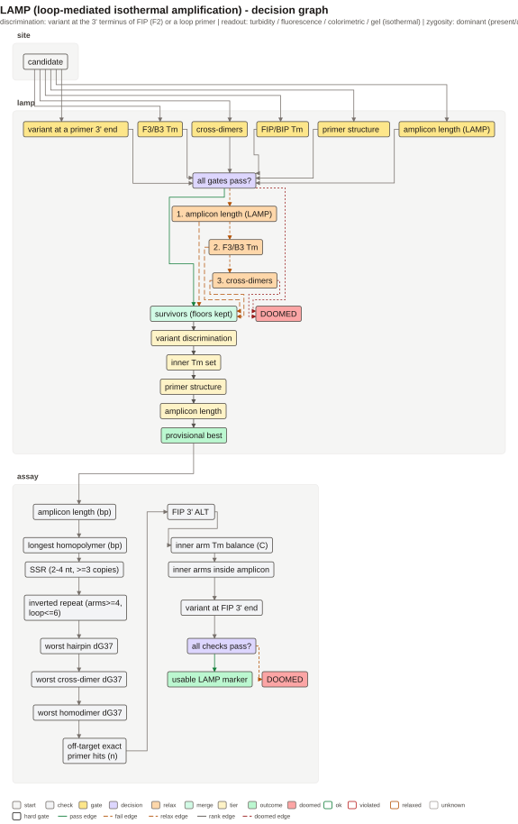
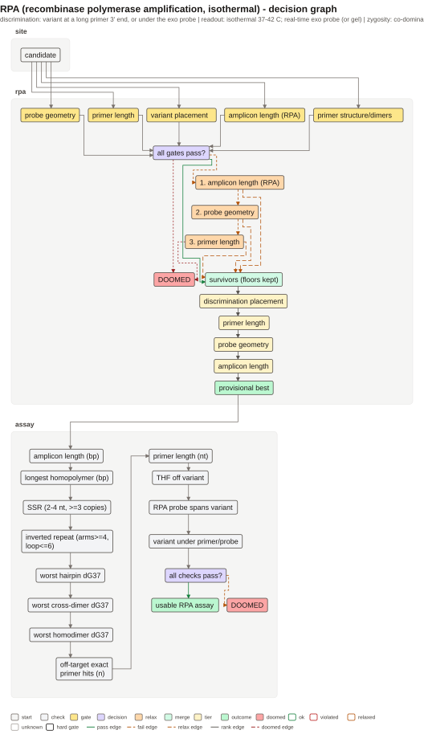

```{r setup, include = FALSE}
knitr::opts_chunk$set(collapse = TRUE, comment = "#>", fig.align = "center")
```

```{r}
library(tidymarkers)
library(knitr)
```

Every figure shows the sequence letters (primers and amplicon), the variant
track, the genomic off-site panel, and on the right the same tumbler as for
KASP. Isothermal schemes have no denaturation/annealing step: the reaction runs
at a constant temperature, and discrimination and primer geometry are built
differently from PCR. The package designs the construct; it does not simulate
reaction kinetics.

## LAMP

LAMP uses 4 obligatory primers: outer F3/B3 and inner FIP/BIP — chimeras of two
arms (F1c + F2, B1c + B2). The inner primers form loops, so the product
amplifies in a self-sustaining way. The temperature is usually 60–65 °C and the
enzyme is Bst polymerase with strand displacement.
[Notomi et al. (2000)](https://doi.org/10.1093/nar/28.12.e63).

For a marker the variant is placed at the **3' end of FIP (the F2 arm)**: that
is where extension starts, and a mismatch suppresses the reaction. B3 is built
on the minus strand, and FIP as F1c + F2; a swapped orientation breaks the
loop. Optional loop primers speed up the reaction but are not required.

```{r lamp-fig, echo = FALSE, out.width = "100%", fig.cap = "LAMP: F3/B3 outside, FIP/BIP inside, the variant at the 3' end of FIP."}
knitr::include_graphics("figures/lamp.svg")
```

```{r, eval = FALSE}
snp <- tibble::tibble(chrom = "Chr1", pos = 300L, ref = "G", alt = "A")
design_lamp_marker(genome, snp, flank = 150)
```

## RPA

RPA (recombinase polymerase amplification) runs at 37–42 °C: the recombinase
UvsX with ATP and SSB forms a filament, and the primers are longer than PCR
primers (usually 30–35 nt). The product is short (100–200 bp). Allelic
discrimination needs an exo probe: a THF site, a fluorophore and a quencher;
cleavage occurs only on a match.
[Piepenburg et al. (2006)](https://doi.org/10.1371/journal.pbio.0040204).

Key checks: primer length and Tm, a short amplicon, the position of the
probe/THF, and the absence of secondary structure. RPA is sensitive to buffer
composition (MgOAc, ATP), but the package checks only the construct.

```{r rpa-fig, echo = FALSE, out.width = "100%", fig.cap = "RPA: long primers, a short amplicon and an exo probe with THF."}
knitr::include_graphics("figures/rpa.svg")
```

```{r, eval = FALSE}
design_rpa_marker(genome, snp, flank = 200, design_probe = TRUE)
```

## What they have in common

Both schemes require unique amplification and the absence of side structures;
they differ in temperature, primer length and readout. LAMP discriminates
through the 3' end of FIP, RPA through the probe. `plot(marker)` draws the
architecture and the class gates, and `marker_readout()` reminds you that
isothermal kinetics are not modelled. Uniqueness is not gated here, however:
the designer checks structure and dimers, while off-target stays a separate
step (see below).

## Why isothermal markers "fail"

LAMP and RPA have no thermal cycling and no separate annealing step whose
temperature could be raised to suppress non-specificity: specificity is set by
primer/probe geometry and off-target screening. The package designs the
construct and evaluates it against the rules of the method, but does not model
kinetics; below is where such markers most often turn out **doomed** and which
checks are missing or relaxed
([Notomi et al. 2000](https://doi.org/10.1093/nar/28.12.e63);
[Piepenburg et al. 2006](https://doi.org/10.1371/journal.pbio.0040204);
[Li et al. 2019](https://doi.org/10.1039/c8an01621f)).

### LAMP

**What is checked.** FIP = F1c + F2 and BIP = B1c + B2; the variant sits
exactly on the 3' base of F2; F3/B3 lie outside the inner block; LF/LB (if any)
lie in the loops. Hard gates: the 3' end of FIP, Tm of the inner arms
[55, 65] °C, absence of inverted repeats; soft gates: Tm of F3/B3 [55, 62] °C,
cross dimers and an amplicon of 120–300 bp. GC, homopolymers and SSR are
already filtered out during candidate generation. The orientation is verified:
FIP = revcomp(F1) + F2, BIP = revcomp(B1) + revcomp(B2).

- **Geometry of the six primers.** There is no explicit upper bound on loop
  length (the shortest one found is chosen) and no requirement that F1c/B1c >
  F2/B2 in Tm: the literature disagrees on the direction of this rule, and the
  package does not enforce it. The scheme allows a variant on a loop primer,
  but the designer always places it on FIP; BIP-anchored markers are not
  designed. If the variant ends up in the loop between the arms, no 3' end
  reads it — it is not a marker but simply a stretch of the amplicon (the
  package avoids this by putting the FIP 3' end on the variant;
  [Shirshikov et al. 2019](https://doi.org/10.7717/peerj.6801)).
- **F3/B3.** The outer pair is placed outside the inner block (`end < lo`,
  `start > hi`) and passes the same composition filters, but uniqueness and the
  3' end are not gated separately. The Tm window is soft: under relaxation it
  widens by 3 °C.
- **FIP/BIP arms.** The orientation is correct, but the Tm of the inner primer
  at the gate is max(Tm of the two arms): the spread between arms (for example
  55 and 65 °C) is invisible, and the balance and ΔTm are not checked. The
  windows [55, 65]/[55, 62] °C are the package's assumption under PCR_COND,
  not a measured isothermal Tm at 60–65 °C. The 3' REF/ALT pair is not checked
  for G:T/A:C wobble (in KASP this is a separate soft gate), so such
  transitions may discriminate more weakly.
- **Loop primers.** LF/LB are optional; they pass Tm/GC/palindrome and enter
  the pooled dimer screen, but their 3' end does not carry the variant, and the
  acceleration of the reaction is not modelled. A set without LF/LB is formally
  valid but may give a late threshold
  ([Nagamine et al. 2002](https://doi.org/10.1006/mcpr.2002.0415)).
- **Dimers and non-specificity.** The pooled screen uses the length of the
  complementary stretch (self ≤ 6, cross < 8 bp) rather than dG at 60–65 °C;
  dG37 is computed (when OligoArrayAux is available) but does not enter
  pass/fail. The gate is soft: under relaxation the threshold moves to cross <
  10 bp (self ≤ 8). For 4–6 primers in one tube this is not enough; NTC and an
  early window (for example the first 15 min) remain obligatory. LAMP is prone
  to non-specific amplification and false positives
  ([Wang et al. 2015](https://doi.org/10.3390/molecules20046048);
  [Soroka et al. 2021](https://doi.org/10.3390/cells10081931)).
- **Threshold and contamination.** `marker_readout()` states plainly that
  kinetics are not modelled: the package does not predict time to threshold,
  plateau or efficiency. Turbidimetry/fluorescence require a fixed threshold
  and standards ([Mori et al. 2001](https://doi.org/10.1006/bbrc.2001.5921);
  [Tomita et al. 2008](https://doi.org/10.1038/nprot.2008.57)). The high
  productivity of LAMP and open detection create a risk of contamination
  (carry-over); the recommendation is UNG/dUTP, zone separation, aliquots and
  negative controls
  ([Tomita et al. 2008](https://doi.org/10.1038/nprot.2008.57)).
- **Off-target.** In the DAG the check `off-target exact primer hits (n)` is
  listed as an acceptance check, but the designer does not compute it. The row
  appears only if `genome` is passed to `plot()`/`marker_primer_checks()`, and
  it is an exact match, not an in-silico LAMP. For a field marker this is the
  main open gate.

### RPA

**What is checked.** Primer length 30–35 nt by default (soft gate, relaxed to
27–38), a hard 3' end of the primer or the variant under the exo probe, pair
structure by dG37 (if OligoArrayAux is available), probe geometry 46–52 nt /
THF ≥ 30 nt from 5' / ≥ 15 nt from 3' / FQ gap ≤ 4, amplicon 100–200 bp
(soft).

- **Length 30–35 nt.** This is the default value, not a hard requirement:
  `gate_rpa_primer_len` compares lengths against the supplied `primer_len`, so
  `primer_len = 20:25` passes the gate (while the limit in the DAG stays
  [30, 35] nt). For RPA this is a risk: a short primer forms a recombinase
  filament poorly
  ([Lobato & O'Sullivan 2018](https://doi.org/10.1016/j.trac.2017.10.015);
  [Li et al. 2019](https://doi.org/10.1039/c8an01621f)).
- **Tm and temperature stringency.** `RPA_NO_TM = c(0, 200)`: Tm is not gated
  at all, only the ΔTm of the pair is ranked. There is no absolute window and
  no balance requirement; at 37–42 °C there is no temperature stringency
  either, so specificity rests on design and off-target screening
  ([Piepenburg et al. 2006](https://doi.org/10.1371/journal.pbio.0040204);
  [Daher et al. 2016](https://doi.org/10.1373/clinchem.2015.245829)).
- **Probe.** The variant must lie under the probe, but not necessarily at the
  THF: the code moves the THF towards the variant only where the geometry
  allows it, and the position of the mismatch relative to the THF is not gated.
  The probe is plus-strand only; the 3' block is flagged via `blocked_3p`, but
  the returned sequence carries no 3' modification — you need to add it when
  ordering. The probe does not enter the hard structure gate (only
  `compatibility`, which is not gated), so a poor probe dimer can pass. The
  exo probe geometry is inherited from the abasic/nfo probe — this is the
  package's assumption
  ([Lobato & O'Sullivan 2018](https://doi.org/10.1016/j.trac.2017.10.015)).
- **Reverse primer and off-target.** The pair is obligatory, and in probe mode
  the primers flank the variant, but the uniqueness of the reverse primer and
  in-silico PCR are not checked; off-target is not gated.
- **Recombinase artefacts.** Without a temperature step, non-specific products
  and primer dimers are not suppressed as they are in PCR; false positives and
  non-specific amplification have been described for RPA
  ([Li et al. 2019](https://doi.org/10.1039/c8an01621f)). NTC, gel/probe and a
  genome-wide screen of both primers and the probe are needed.
- **Amplicon.** 100–200 bp is the optimum; longer works more slowly and less
  evenly ([Lobato & O'Sullivan 2018](https://doi.org/10.1016/j.trac.2017.10.015)).
  This is not a "dud" in itself, but a late threshold.

### What is implemented and what is missing

| Check | LAMP | RPA |
|---|---|---|
| Variant at the 3' end / under the probe | yes, by construction (the gate is the constant `TRUE`) | yes, by construction (the gate is the constant `TRUE`) |
| Length and composition | arm Tm windows, GC/run/SSR at generation | 30–35 by default, GC 30–70%, length can be overridden |
| Structure and dimers | palindrome (hard), run-length (soft) | pair dG37 (hard; skipped without OligoArrayAux), the probe is not gated |
| Amplicon | 120–300 bp (soft) | 100–200 bp (soft) |
| Off-target / in-silico | not computed by the designer | not computed by the designer |
| Threshold, kinetics, contamination | not modelled | not modelled |

**Bottom line.** `design_lamp_marker()` and `design_rpa_marker()` return a
well-formed construct, not a proof of specificity. Before field validation you
need a genome-wide off-target screen, NTC, a standard curve/threshold, and for
LAMP an independent check of the set (for example PrimerExplorer or an
equivalent tool; [PrimerExplorer](https://primerexplorer.jp/e/)).

### Decision audit

The previous section lists the rules of the method; this one covers only the
discrepancies between the DAG (`vignettes/figures/decision-lamp.txt`,
`decision-rpa.txt`), the smoke figures (`vignettes/figures/lamp.svg`,
`rpa.svg`) and the code. The DAG is `marker_decision_schema()`: hard gates are
not relaxed, soft ones follow the ladder, and `check:` nodes sit after `best`
and are not gates.

```{r, echo = FALSE, out.width = "100%"}

```

```{r, echo = FALSE, out.width = "100%"}

```

**Implemented and verified.** In LAMP the FIP/BIP orientation is correct:
`FIP = revcomp(F1) + F2`, `BIP = revcomp(B1) + revcomp(B2)`; F3 is on the plus
strand, B3 on the minus; the variant sits at the 3' end of F2. In RPA the pair
is obligatory (the reverse primer is on the minus strand), and the probe
geometry 46–52 nt / THF >= 30 nt from 5' / >= 15 nt from 3' / FQ <= 4 is
implemented. None of this needs reworking.

| Node / check | What executes | What the figure shows | Weak spot |
|---|---|---|---|
| LAMP `gate_lamp_variant` | constant `TRUE`; FIP 3' = REF base | FIP 3' ends on the variant | ALT is not read; REF/ALT are not compared |
| LAMP inner Tm | `pmax` of the two arm Tms in [55, 65] | Tm of FIP 73.6, BIP 74.9 (red) | this is the Tm of the whole 40–48 nt fusion, not of an arm; the arm ΔTm is not gated, and with an equal loop `pmax` ranking may prefer 55/60 over the pair 59/61 |
| LAMP outer Tm | soft [55, 62], relaxation +3 °C | Tm of F3 57.2, B3 57.3 (red) | `marker_tm_window()` colours them by [58, 65] |
| LAMP structure / dimers | `has_palindrome()` (hard) + pooled `primer_set_compatibility()`: cross < 8 bp, self <= 6 | inv. repeat 0; dimer -5.6, homodimer -5.4 (green) | dG37 at 37 °C, not at 60–65 °C; the 3' end is not checked separately; the amplicon is not checked |
| LAMP loop | loop between arms >= 16 nt; LF/LB 15–24 nt; optional | no LF/LB in the figure | six-primer geometry is not gated; the loop may abut an arm |
| RPA primer length | gated on the caller's `primer_len` | the DAG states [30, 35] | `primer_len = 20:25` passes; relaxation is ±3 around the input (17–28), not 27–38 (for the default 30–35) |
| RPA `gate_rpa_variant` | constant `TRUE`; in probe mode the primers flank the variant | variant under the probe | a hard node cannot fire; ALT is not read |
| RPA Tm | `RPA_NO_TM`; Tm only ranks the pair ΔTm | Tm of F/R 69.5 (blue, neutral) | no absolute window and no ΔTm threshold; the probe Tm is neither gated nor shown |
| RPA probe | 46–52 nt; THF >= 30/>= 15; FQ <= 4; THF = clamp(variant, [31, len-15]) | X about 11 nt from the variant | if the THF lands on the variant, the base is replaced by X — there is no allele contrast; the mismatch–THF distance is not gated; the probe may abut a primer |
| RPA structure | `rpa_structure_ok(pair)`: dG37 of the pair only | dimer -4.8, hairpin 0.0, homodimer -4.8 (pair) | the probe with `X` is excluded from `marker_primer_checks()`; without OligoArrayAux the gate is `NA` and the DAG has no "unknown" status |
| Off-target | exact hits of each primer, `max(table(primer))` | off-target 1 | no paired/in-silico product; for RPA the probe is not searched |

Both smoke examples pass the composition checks (run 3 < 4, SSR 0, inverted
repeat 0, off-target 1), but these are checks of the construct, not of the
reaction. The ladder order in the DAG matches the code: LAMP —
`amplicon` -> `outer Tm` -> `cross-dimers`, RPA — `amplicon` -> `probe` ->
`primer length`; the hard `variant`/`inner Tm`/`structure` (LAMP) and
`variant`/`structure` (RPA) lead to `DOOMED`.

**Corrections to the previous section.**

- LAMP places the FIP 3' end on the **REF** base, and `alt` takes no part in
  the design: the construct is REF-specific by design, and ALT is read only as
  the absence of a signal. The phrase about "the 3' REF/ALT pair and G:T/A:C
  wobble" therefore does not apply to LAMP: there is no REF/ALT primer pair
  here, and `gate_lamp_variant` is the constant `TRUE`.
- RPA is also built on REF. If the THF lands on the variant, the code replaces
  that base with `X`; then the variant is not paired at all and there is no
  allele contrast in the probe. The phrase "mismatch under the probe" is true
  only when the variant has remained in the probe; in the smoke example `X`
  sits about 11 nt 5' of the variant.
- The `Tm FIP/BIP` numbers in the figure are the Tm of the whole fusion, while
  the hard gate uses the `pmax` of the arm Tms; `Tm F3/B3` in the figure are
  coloured by the window [58, 65], although the designer gates them by
  [55, 62]. Red Tm tiles in `lamp.svg` therefore do not mean that the gate was
  not passed.
- The `dimer`/`hairpin`/`homodimer` rows in `rpa.svg` are computed over the
  pair: the probe with `X` is filtered out, and its dimers enter only
  `compatibility`, which is not gated.

**Recommendations (not implemented).**

- **LAMP.** Gate the six-primer geometry: a minimum F3–F1c and B3–B2 spacing,
  the spacing from a loop primer to an arm, ΔTm(F1c,F2)/ΔTm(B1c,B2) and the
  arm direction; check the 3'-terminal base of FIP against REF *and* ALT; for
  dimers, a 3'-end screen at 60–65 °C rather than only run >= 8; add a check of
  the amplicon secondary structure. NTC/early window, UNG/dUTP, zone
  separation, threshold/standard curve — outside the designer
  ([Tomita et al. 2008](https://doi.org/10.1038/nprot.2008.57);
  [Mori et al. 2001](https://doi.org/10.1006/bbrc.2001.5921)).
- **RPA.** Make 30–35 nt a hard limit regardless of `primer_len`; add an
  absolute Tm window and a ΔTm threshold (or explicitly leave Tm as
  informational); do not place the THF on the variant, gate the mismatch–THF
  distance, return the 3' block in the sequence, include the probe in the
  structural/dimer gate and in off-target; search for a paired product/in-silico
  PCR rather than only exact primer hits; when OligoArrayAux is absent, show
  `NA` rather than "passed". NTC/gel are obligatory
  ([Lobato & O'Sullivan 2018](https://doi.org/10.1016/j.trac.2017.10.015);
  [Li et al. 2019](https://doi.org/10.1039/c8an01621f)).
- **Both.** The terminal node "usable …" is a verdict on the construct, not on
  amplification: without NTC, threshold and a contamination check it should
  not be read as validation.
