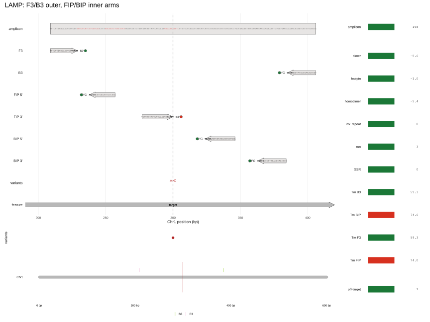
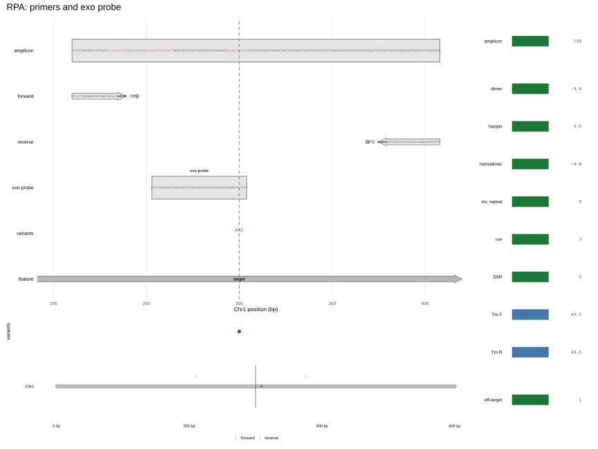

```{r setup, include = FALSE}
knitr::opts_chunk$set(collapse = TRUE, comment = "#>", fig.align = "center")
```

```{r}
library(tidymarkers)
library(knitr)
```

На каждом рисунке — буквы последовательностей (праймеры и ампликон), трек
вариантов, геномная off-site панель и справа тот же tumbler, что у KASP.
Изотермические схемы не имеют шага денатурации/отжига: реакция идёт при
постоянной температуре, а дискриминация и геометрия праймеров устроены иначе,
чем в ПЦР. Пакет проектирует конструкт; кинетика реакции не симулируется.

## LAMP

LAMP использует 4 обязательных праймера: внешние F3/B3 и внутренние
FIP/BIP — химеры из двух плеч (F1c + F2, B1c + B2). Внутренние праймеры
формируют петли, поэтому продукт амплифицируется самоподдерживающе.
Температура обычно 60–65 °C, фермент — Bst-полимераза с strand-displacement.
[Notomi et al. (2000)](https://doi.org/10.1093/nar/28.12.e63).

Для маркера вариант ставят на **3'-конец FIP (плечо F2)**: именно оттуда
начинается достройка, и мисматч подавляет реакцию. B3 строится по
минус-цепи, а FIP — как F1c + F2; перепутанная ориентация ломает петлю.
Опциональные loop-праймеры ускоряют реакцию, но не обязательны.

```{r lamp-fig, echo = FALSE, out.width = "100%", fig.cap = "LAMP: F3/B3 снаружи, FIP/BIP внутри, вариант на 3'-конце FIP."}

```

```{r, eval = FALSE}
snp <- tibble::tibble(chrom = "Chr1", pos = 300L, ref = "G", alt = "A")
design_lamp_marker(genome, snp, flank = 150)
```

## RPA

RPA (recombinase polymerase amplification) идёт при 37–42 °C: рекомбиназа
UvsX с ATP и SSB формирует нить, а праймеры длиннее ПЦР-ных (обычно 30–35 nt).
Продукт короткий (100–200 bp). Для аллельной дискриминации нужен exo-пробой:
THF-сайт, флуорофор и гаситель; расщепление только при совпадении.
[Piepenburg et al. (2006)](https://doi.org/10.1371/journal.pbio.0040204).

Ключевые проверки: длина и Tm праймеров, короткий ампликон, положение
пробы/THF и отсутствие вторичной структуры. RPA чувствителен к составу
буфера (MgOAc, ATP), но пакет проверяет только конструкт.

```{r rpa-fig, echo = FALSE, out.width = "100%", fig.cap = "RPA: длинные праймеры, короткий ампликон и exo-проба с THF."}

```

```{r, eval = FALSE}
design_rpa_marker(genome, snp, flank = 200, design_probe = TRUE)
```

## Что общего

Обе схемы требуют уникальной амплификации и отсутствия побочных структур;
различаются температура, длина праймеров и способ считывания. LAMP
дискриминирует через 3'-конец FIP, RPA — через пробу. `plot(marker)` рисует
архитектуру и гейты класса, а `marker_readout()` напоминает, что
изотермическая кинетика не моделируется. Уникальность при этом не гейтится:
дизайнер проверяет структуру и димеры, а off-target остаётся отдельным шагом
(см. ниже).

## Почему изотермические маркеры «садятся»

У LAMP и RPA нет циклического отжига и отдельного шага отжига, температуру
которого можно поднять, чтобы задавить неспецифику: специфичность задают
геометрия праймеров/пробы и off-target скрининг. Пакет проектирует конструкт и
оценивает его по правилам метода, но не моделирует кинетику; ниже — где такие
маркеры чаще всего оказываются «дудами» и какие проверки отсутствуют или
ослаблены ([Notomi et al. 2000](https://doi.org/10.1093/nar/28.12.e63);
[Piepenburg et al. 2006](https://doi.org/10.1371/journal.pbio.0040204);
[Li et al. 2019](https://doi.org/10.1039/c8an01621f)).

### LAMP

**Что проверяется.** FIP = F1c + F2 и BIP = B1c + B2; вариант стоит ровно на
3'-основании F2; F3/B3 лежат снаружи внутреннего блока; LF/LB (если есть) — в
петлях. Жёсткие гейты: 3'-конец FIP, Tm внутренних плеч [55, 65] °C,
отсутствие инвертированных повторов; мягкие: Tm F3/B3 [55, 62] °C,
кросс-димеры и ампликон 120–300 bp. GC, гомополимеры и SSR отсекаются ещё при
генерации кандидатов. Ориентация проверена: FIP = revcomp(F1) + F2,
BIP = revcomp(B1) + revcomp(B2).

- **Геометрия шести праймеров.** Нет явной верхней границы длины петли
  (выбирается самая короткая из найденных) и нет требования F1c/B1c > F2/B2 по
  Tm: в литературе направление этого правила расходится, и пакет его не
  форсирует. Схема допускает вариант и на loop-праймере, но дизайнер всегда
  ставит его на FIP; BIP-якорные маркеры не проектируются. Если вариант
  оказался в петле между плечами, его не читает ни один 3'-конец — это не
  маркер, а просто участок ампликона (пакет обходит это, ставя FIP 3' на
  вариант; [Shirshikov et al. 2019](https://doi.org/10.7717/peerj.6801)).
- **F3/B3.** Внешняя пара ставится снаружи внутреннего блока (`end < lo`,
  `start > hi`) и проходит те же композиционные фильтры, но уникальность и
  3'-конец отдельно не гейтятся. Tm-окно мягкое: при релаксации расширяется на
  3 °C.
- **Плечи FIP/BIP.** Ориентация верная, но Tm внутреннего праймера в гейте —
  это max(Tm двух плеч): разброс между плечами (например, 55 и 65 °C) не
  виден, баланс и ΔTm не проверяются. Окна [55, 65]/[55, 62] °C — допущение
  пакета под PCR_COND, а не измеренная изотермическая Tm при 60–65 °C.
  3'-пара REF/ALT не проверяется на G:T/A:C wobble (в KASP это отдельный
  мягкий гейт), поэтому такие переходы могут дискриминировать слабее.
- **Loop-праймеры.** LF/LB опциональны; они проходят Tm/GC/палиндром и входят
  в общий димерный скрин, но их 3'-конец не несёт вариант, а ускорение реакции
  не моделируется. Набор без LF/LB формально валиден, но может дать поздний
  порог ([Nagamine et al. 2002](https://doi.org/10.1006/mcpr.2002.0415)).
- **Димеры и неспецифика.** Совместный скрин — по длине комплементарного
  участка (self ≤ 6, cross < 8 bp), а не по dG при 60–65 °C; dG37 считается
  (при наличии OligoArrayAux), но в pass/fail не входит. Гейт мягкий: при
  релаксации порог сдвигается до cross < 10 bp (self ≤ 8). Для 4–6 праймеров в
  одной пробирке этого мало; NTC и раннее окно (например, первые 15 мин)
  остаются обязательными. LAMP склонен к неспецифической амплификации и ложным
  положительным ([Wang et al. 2015](https://doi.org/10.3390/molecules20046048);
  [Soroka et al. 2021](https://doi.org/10.3390/cells10081931)).
- **Порог и контаминация.** `marker_readout()` прямо говорит, что кинетика не
  моделируется: пакет не предсказывает время до порога, плато и эффективность.
  Турбидиметрия/флуоресценция требуют фиксированного порога и стандартов
  ([Mori et al. 2001](https://doi.org/10.1006/bbrc.2001.5921);
  [Tomita et al. 2008](https://doi.org/10.1038/nprot.2008.57)). Высокая
  продуктивность LAMP и открытая детекция создают риск контаминации
  (carry-over); рекомендация — UNG/dUTP, разделение зон, аликвоты,
  отрицательные контроли
  ([Tomita et al. 2008](https://doi.org/10.1038/nprot.2008.57)).
- **Off-target.** В DAG проверка `off-target exact primer hits (n)` стоит как
  приёмочная, но дизайнер её не считает. Строка появляется только если передать
  `genome` в `plot()`/`marker_primer_checks()`, и это точное совпадение, а не
  in-silico LAMP. Для полевого маркера это главный незакрытый гейт.

### RPA

**Что проверяется.** Длина праймеров по умолчанию 30–35 nt (мягкий гейт,
релаксация до 27–38), жёсткий 3'-конец праймера или вариант под exo-пробой,
структура пары по dG37 (если есть OligoArrayAux), геометрия пробы 46–52 nt /
THF ≥ 30 nt от 5' / ≥ 15 nt от 3' / FQ-gap ≤ 4, ампликон 100–200 bp (мягко).

- **Длина 30–35 nt.** Это значение по умолчанию, а не жёсткое требование:
  `gate_rpa_primer_len` сравнивает длины с переданным `primer_len`, поэтому
  `primer_len = 20:25` пройдёт гейт (а предел в DAG останется [30, 35] nt). Для
  RPA это риск: короткий праймер плохо образует филамент рекомбиназы
  ([Lobato & O'Sullivan 2018](https://doi.org/10.1016/j.trac.2017.10.015);
  [Li et al. 2019](https://doi.org/10.1039/c8an01621f)).
- **Tm и температурная строгость.** `RPA_NO_TM = c(0, 200)`: Tm не гейтится
  вообще, только ранжируется ΔTm пары. Абсолютного окна и требования баланса
  нет; при 37–42 °C температурной строгости тоже нет, поэтому специфичность
  держится на дизайне и off-target скрининге
  ([Piepenburg et al. 2006](https://doi.org/10.1371/journal.pbio.0040204);
  [Daher et al. 2016](https://doi.org/10.1373/clinchem.2015.245829)).
- **Проба.** Вариант обязан лежать под пробой, но не обязательно у THF: код
  сдвигает THF к варианту, только если это допускает геометрия, а позиция
  мисматча относительно THF не гейтится. Проба только плюс-цепь; 3'-блокировка
  помечена флагом `blocked_3p`, но в возвращаемой последовательности
  3'-модификации нет — её нужно добавить при заказе. Проба не входит в жёсткий
  структурный гейт (только в `compatibility`, который не гейтится), поэтому
  плохая проба-димер может пройти. Геометрия exo-пробы перенесена с
  abasic/nfo-пробы — это допущение пакета
  ([Lobato & O'Sullivan 2018](https://doi.org/10.1016/j.trac.2017.10.015)).
- **Обратный праймер и off-target.** Пара обязательна, и в режиме пробы
  праймеры фланкируют вариант, но уникальность обратного праймера и in-silico
  PCR не проверяются; off-target не гейтится.
- **Рекомбиназные артефакты.** Без температурного шага неспецифические
  продукты и праймер-димеры не отсекаются так, как в ПЦР; для RPA описаны
  ложные положительные и неспецифическая амплификация
  ([Li et al. 2019](https://doi.org/10.1039/c8an01621f)). Нужны NTC, гель/проба
  и genome-wide скрин обоих праймеров и пробы.
- **Ампликон.** 100–200 bp — оптимум; длиннее работает медленнее и менее ровно
  ([Lobato & O'Sullivan 2018](https://doi.org/10.1016/j.trac.2017.10.015)). Это
  не «дуд» само по себе, но поздний порог.

### Реализовано и чего не хватает

| Проверка | LAMP | RPA |
|---|---|---|
| Вариант на 3'-конце / под пробой | да, конструкцией (гейт — константа `TRUE`) | да, конструкцией (гейт — константа `TRUE`) |
| Длина и композиция | Tm-окна плеч, GC/run/SSR при генерации | 30–35 по умолчанию, GC 30–70%, длина переопределяется |
| Структура и димеры | палиндром (жёстко), run-length (мягко) | dG37 пары (жёстко; без OligoArrayAux пропускается), проба не в гейте |
| Ампликон | 120–300 bp (мягко) | 100–200 bp (мягко) |
| Off-target / in-silico | не считается дизайнером | не считается дизайнером |
| Порог, кинетика, контаминация | не моделируются | не моделируются |

**Итог.** `design_lamp_marker()` и `design_rpa_marker()` возвращают хорошо
сформированный конструкт, а не доказательство специфичности. Перед полевой
валидацией нужны genome-wide off-target скрин, NTC, стандартная кривая/порог,
а для LAMP — независимая проверка набора (например, PrimerExplorer или
эквивалентный инструмент; [PrimerExplorer](https://primerexplorer.jp/e/)).

### Аудит решений

Предыдущий раздел перечисляет правила метода; здесь — только расхождения между
DAG (`results/plot-smoke/decision-lamp.txt`, `decision-rpa.txt`), smoke-рисунками
(`vignettes/figures/lamp.svg`, `rpa.svg`) и кодом. DAG — это
`marker_decision_schema()`: жёсткие гейты не релаксируются, мягкие идут по
лестнице, а `check:`-узлы стоят после `best` и гейтами не являются.

**Реализовано и проверено.** У LAMP ориентация FIP/BIP верна:
`FIP = revcomp(F1) + F2`, `BIP = revcomp(B1) + revcomp(B2)`; F3 — плюс-цепь,
B3 — минус; вариант стоит на 3'-конце F2. У RPA пара обязательна (обратный
праймер — минус-цепь), а геометрия пробы 46–52 nt / THF >= 30 nt от 5' /
>= 15 nt от 3' / FQ <= 4 реализована. Это переделывать не нужно.

| Узел / проверка | Что исполняется | Что видно в фигуре | Слабое место |
|---|---|---|---|
| LAMP `gate_lamp_variant` | константа `TRUE`; FIP 3' = основание REF | FIP 3' заканчивается на варианте | ALT не читается; REF/ALT не сравниваются |
| LAMP inner Tm | `pmax` Tm двух плеч в [55, 65] | Tm FIP 73.6, BIP 74.9 (красные) | это Tm целого 40–48-nt фьюжна, а не плеча; ΔTm плеч не гейтится, а при равной петле `pmax`-ранжирование может предпочесть 55/60 паре 59/61 |
| LAMP outer Tm | мягкий [55, 62], релаксация +3 °C | Tm F3 57.2, B3 57.3 (красные) | `marker_tm_window()` красит их по [58, 65] |
| LAMP structure / dimers | `has_palindrome()` (жёстко) + pooled `primer_set_compatibility()`: cross < 8 bp, self <= 6 | inv. repeat 0; dimer -5.6, homodimer -5.4 (зелёные) | dG37 при 37 °C, а не при 60–65 °C; 3'-конец отдельно не проверяется; ампликон не проверяется |
| LAMP loop | петля между плечами >= 16 nt; LF/LB 15–24 nt; опциональны | LF/LB на рисунке нет | six-primer геометрия не гейтится; loop может примыкать к плечу |
| RPA primer length | гейт по `primer_len` вызывающего | DAG пишет [30, 35] | `primer_len = 20:25` проходит; релаксация ±3 вокруг входа (17–28), а не 27–38 (для 30–35 по умолчанию) |
| RPA `gate_rpa_variant` | константа `TRUE`; в режиме пробы праймеры фланкируют вариант | вариант под пробой | жёсткий узел не может сработать; ALT не читается |
| RPA Tm | `RPA_NO_TM`; Tm только ранжирует ΔTm пары | Tm F/R 69.5 (синие, neutral) | нет абсолютного окна и ΔTm-порога; Tm пробы не гейтится и не показывается |
| RPA probe | 46–52 nt; THF >= 30/>= 15; FQ <= 4; THF = clamp(вариант, [31, len-15]) | X примерно в 11 nt от варианта | если THF попадает на вариант, основание заменяется на X — контраста аллелей нет; расстояние мисматч–THF не гейтится; проба может примыкать к праймеру |
| RPA structure | `rpa_structure_ok(pair)`: dG37 только пары | dimer -4.8, hairpin 0.0, homodimer -4.8 (пара) | проба с `X` исключена из `marker_primer_checks()`; без OligoArrayAux гейт `NA`, а в DAG нет статуса «неизвестно» |
| Off-target | точные хиты каждого праймера, `max(table(primer))` | off-target 1 | нет парного/in-silico продукта; для RPA проба не ищется |

Оба smoke-примера проходят композиционные проверки (run 3 < 4, SSR 0,
inverted repeat 0, off-target 1), но это проверки конструкции, а не реакции.
Порядок лестницы в DAG совпадает с кодом: LAMP — `amplicon` -> `outer Tm` ->
`cross-dimers`, RPA — `amplicon` -> `probe` -> `primer length`; жёсткие
`variant`/`inner Tm`/`structure` (LAMP) и `variant`/`structure` (RPA) ведут в
`DOOMED`.

**Уточнения к предыдущему разделу.**

- LAMP ставит FIP 3' на основание **REF**, а `alt` в дизайне не участвует:
  конструкт REF-специфичен по замыслу, ALT читается только как отсутствие
  сигнала. Поэтому фраза про «3'-пару REF/ALT и G:T/A:C wobble» к LAMP не
  применима: пары праймеров REF/ALT здесь нет, а `gate_lamp_variant` —
  константа `TRUE`.
- RPA тоже строится по REF. Если THF попадает на вариант, код заменяет это
  основание на `X`; тогда вариант вообще не спаривается и аллельного контраста
  в пробе нет. Фраза «мисматч под пробой» верна только когда вариант остался
  в пробе; в smoke-примере `X` стоит примерно в 11 nt 5' от варианта.
- Числа `Tm FIP/BIP` на рисунке — это Tm целого фьюжна, а жёсткий гейт
  использует `pmax` Tm плеч; `Tm F3/B3` на рисунке окрашены по окну [58, 65],
  хотя дизайнер гейтит их по [55, 62]. Поэтому красные Tm-плитки на `lamp.svg`
  не означают, что гейт не пройден.
- Строки `dimer`/`hairpin`/`homodimer` на `rpa.svg` считаются по паре: проба с
  `X` отфильтрована, а её димеры входят только в `compatibility`, который не
  гейтится.

**Рекомендации (не реализовано).**

- **LAMP.** Гейтить six-primer геометрию: минимальный зазор F3–F1c и B3–B2,
  зазор loop-праймера до плеча, ΔTm(F1c,F2)/ΔTm(B1c,B2) и направление плеч;
  проверять 3'-концевое основание FIP против REF *и* ALT; для димеров —
  3'-концевой скрин при 60–65 °C, а не только run >= 8; добавить проверку
  вторичной структуры ампликона. NTC/раннее окно, UNG/dUTP, разделение зон,
  порог/стандартная кривая — вне дизайнера
  ([Tomita et al. 2008](https://doi.org/10.1038/nprot.2008.57);
  [Mori et al. 2001](https://doi.org/10.1006/bbrc.2001.5921)).
- **RPA.** Сделать 30–35 nt жёстким пределом независимо от `primer_len`;
  добавить абсолютное Tm-окно и ΔTm-порог (или явно оставить Tm
  информационным); не ставить THF на вариант, гейтить расстояние
  мисматч–THF, вернуть 3'-блокировку в последовательность, включить пробу в
  структурный/димерный гейт и в off-target; искать парный продукт/in-silico
  PCR, а не только точные хиты праймеров; при отсутствии OligoArrayAux
  показывать `NA`, а не «пройдено». NTC/гель обязательны
  ([Lobato & O'Sullivan 2018](https://doi.org/10.1016/j.trac.2017.10.015);
  [Li et al. 2019](https://doi.org/10.1039/c8an01621f)).
- **Оба.** Терминальный узел «usable …» — это вердикт конструкции, а не
  амплификации: без NTC, порога и проверки контаминации он не должен
  читаться как валидация.
