```{r setup, include = FALSE}
knitr::opts_chunk$set(collapse = TRUE, comment = "#>", fig.align = "center")
```

```{r}
library(tidymarkers)
library(knitr)
```

KASP (Kompetitive Allele-Specific PCR) — a homogeneous endpoint assay: two
allele-specific primers (AS-ref / AS-alt) with different fluorophores and one
common primer (COM). Discrimination rests on **a single 3' base** of the AS
primer: Taq does not extend a primer with a 3' mismatch, so a weak 3' end
matters more than a strong one. Method overview and design rules:
[He et al. (2014)](https://doi.org/10.1007/978-1-4939-0446-4_7),
[Semagn et al. (2014)](https://doi.org/10.1007/s11032-013-9917-x).
General primer rules (Tm, GC, 3' complementarity, specificity):
[Dieffenbach et al. (1993)](https://doi.org/10.1101/gr.3.3.S30).

The figures below are drawn by `plot(marker)`; they were produced by
`dev/render-gallery.R` on a synthetic 600–800 bp matrix, so the coordinates are
arbitrary. Each one shows sequence letters (primers and amplicon), a variant
track, the genome-wide off-site panel and, on the right, the same tumbler as
KASP: short names, ok/broken colours, formatted observed values.

## SNP KASP

The two AS primers differ only in the 3' base; COM lies opposite, so the
amplicon is short (usually 50–100 bp). Gates: discrimination (DECIPHER,
hybridisation + Taq efficiency), no variant in the AS 3' window, structure
(hairpins/dimers), Tm/GC. An additional online screen (BLAST/FM) checks for
off-target.

```{r snp-fig, echo = FALSE, out.width = "100%", fig.cap = "SNP KASP: AS-ref, AS-alt, COM, amplicon, variant track and off-target."}
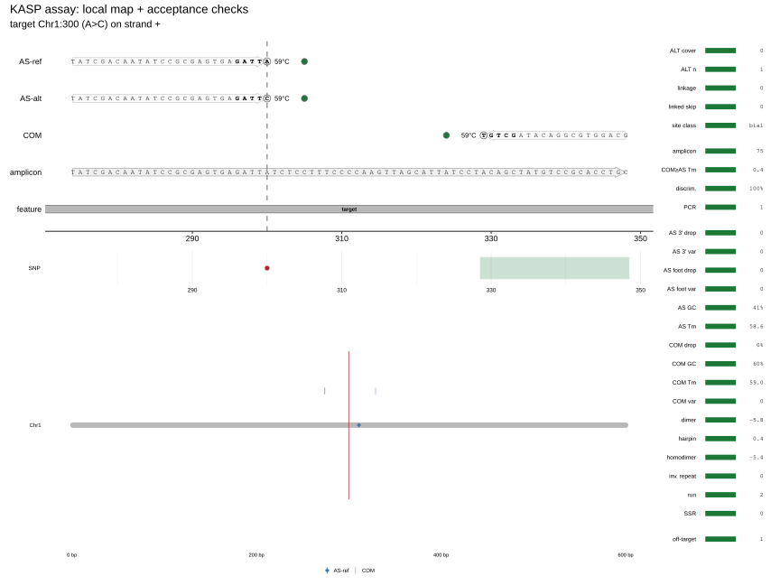
```

```{r, eval = FALSE}
snp <- tibble::tibble(chrom = "Chr1", pos = 300L, ref = "G", alt = "A")
assay <- assemble_kasp_assay(genome, snp, flank = 150)
plot(assay)
```

## Indel KASP

For an indel the 3' end of the AS primer sits on the **junction** of the
allele; the ALT primer carries the insertion/deletion, so the REF and ALT
alleles differ in length and sequence. The VCF record is normalised (anchor
base), and the amplicon is computed from the worst (longest) product.

```{r indel-fig, echo = FALSE, out.width = "100%", fig.cap = "Indel KASP: the AS primer sits on the insertion junction."}
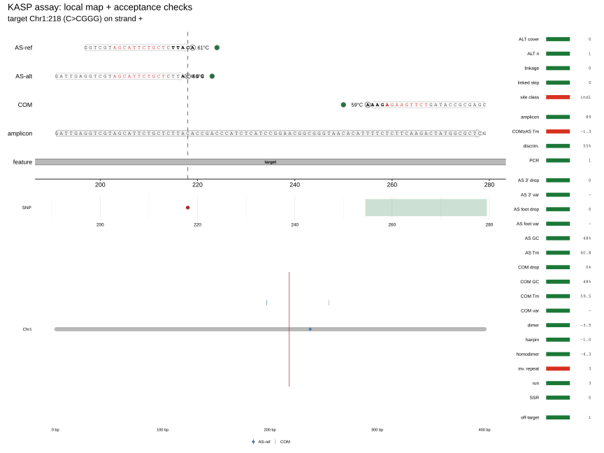
```

```{r, eval = FALSE}
ins <- tibble::tibble(chrom = "Chr1", pos = 300L, ref = "G", alt = "GTTTTTTTTT")
assay <- assemble_kasp_assay(genome, ins, flank = 150)
```

## Multiallelic (degenerate) KASP

If the site has several ALTs, one ALT primer must cover all ALTs but not REF.
An IUPAC code is placed at the 3' end (for example, `S` = G/C); such a primer
discriminates REF vs non-REF, but not the ALTs from one another. This is
recorded in `marker_snp_alts()`; the gate "ALT primer covers all ALTs" is hard.

```{r multi-fig, echo = FALSE, out.width = "100%", fig.cap = "Multiallelic KASP: a degenerate 3' code in the ALT primer."}
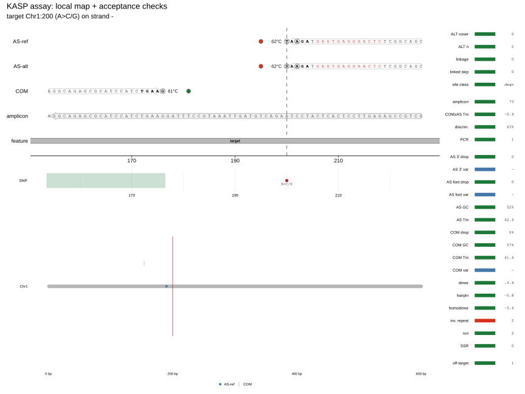
```

## Duplex / multiplex KASP

Two loci in one tube: two independent pairs plus a shared compatibility check
of all oligos in one pool (dimers, homodimers, hairpins, SSR/run). The scheme
adds a `duplex` stage; the hard gates of each locus are retained.

```{r duplex-fig, echo = FALSE, out.width = "100%", fig.cap = "Duplex KASP: two pairs in one reaction."}
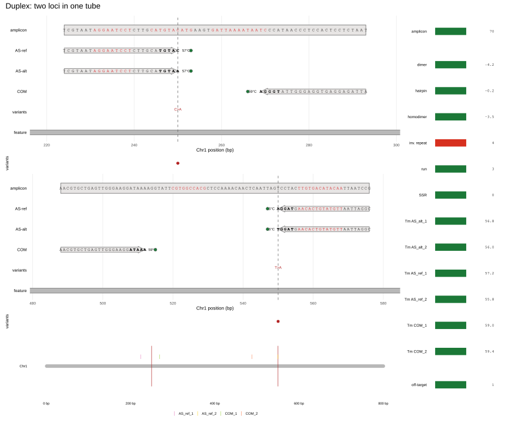
```

```{r, eval = FALSE}
loci <- tibble::tibble(chrom = c("Chr1", "Chr1"), pos = c(250L, 550L),
                       ref = c("A", "G"), alt = c("G", "A"))
design_duplex(genome, loci, flank = 150)
```

## Haplotype (lax) KASP

When the ALT allele is given by a set of haplotypes, a separate AS primer is
needed for each haplotype group, while the shared REF/COM are one per tube.
Linked variants are "baked" into the ALT primer so as not to pick up a false
REF. The `lax` scheme assesses coverage, ALT specificity and cross-priming;
coverage is a hard gate. This is an extension of KASP for haplotype sets; the
basic description of KASP is
[He et al. (2014)](https://doi.org/10.1007/978-1-4939-0446-4_7).

```{r lax-fig, echo = FALSE, out.width = "100%", fig.cap = "Lax KASP: an AS primer per haplotype group, shared REF/COM."}
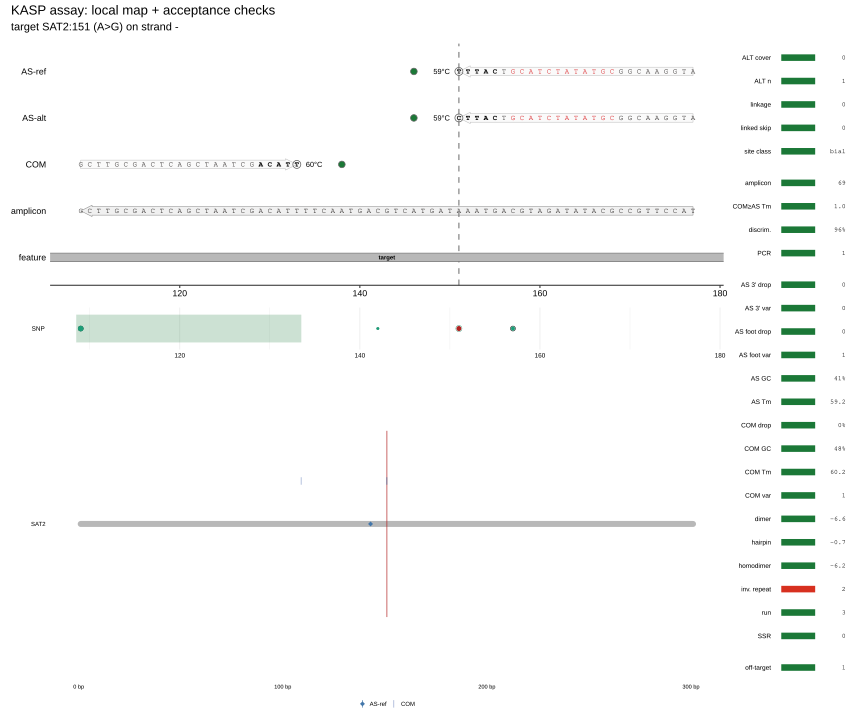
```

### Example with known haplotypes and frequencies

The table defines three haplotypes with explicit frequencies. `H1` and `H2`
carry the ALT at the target, but `H1` additionally carries a linked variant at
310; `H0` is REF. `marker_attach_haplotypes()` (or `design_lax_marker()` for a
real haplotype design) adds `$population`, and the map draws a haplotype track
and the rows `ALT freq / haplotypes / ALT haplotypes / hap covered`.

| haplotype | frequency | 300 | 310 | 320 |
|---|---:|---|---|---|
| H1 | 0.55 | A>G | C>T | — |
| H2 | 0.25 | A>G | — | — |
| H0 | 0.20 | REF | — | G>A |

```{r known-haplotypes, eval = FALSE}
hap <- tibble::tibble(
  haplotype = c("H1", "H1", "H2", "H0"),
  freq = c(0.55, 0.55, 0.25, 0.20),
  chrom = "Chr1", pos = c(300L, 310L, 300L, 320L),
  ref = c("A", "C", "A", "G"), alt = c("G", "T", "G", "A")
)
snp <- tibble::tibble(chrom = "Chr1", pos = 300L, ref = "A", alt = "G")
m <- design_lax_marker(genome, snp, haplotypes = hap)
m$population
plot(m)
```

## ASQ / PACE

ASQ/PACE is an allele-specific quantitative reaction with extension readout;
the primer anatomy is the same as in KASP (AS + common), but the package has no
separate engine for it yet. The scheme is registered as documentation-only:
the gates of the class are visible, and the design does not claim more than it
is. Overview of allele-specific PCR:
[Gaudet et al. (2009)](https://doi.org/10.1007/978-1-60327-411-1_26).

```{r asq-fig, echo = FALSE, out.width = "100%", fig.cap = "ASQ: KASP-like AS + COM anatomy; no separate design is claimed."}
knitr::include_graphics("figures/asq.svg")
```

## The marker-agnostic primer core

The `primer` scheme is not a chemistry but a reusable core: any two primers
without allelic discrimination. Composition, structure, repeats, off-target and
product size are checked. This is the same code that KASP and the other
schemes use.

```{r primer-fig, echo = FALSE, out.width = "100%", fig.cap = "Primer core: a primer pair without an allelic claim."}
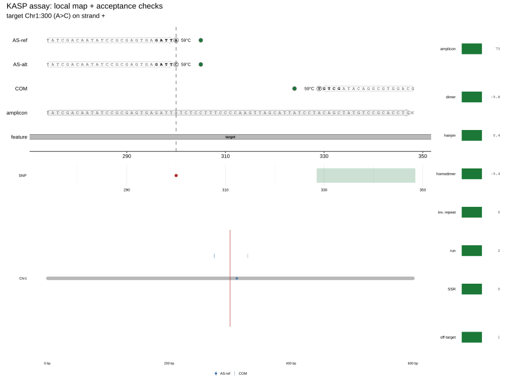
```

## Why a KASP marker can be "empty"

Design checks the sequence, the thermodynamics and (partly) the genome, but not
the population, not the phasing of haplotypes and not the reaction kinetics.
"All checks passed" means "the construct is plausible", not "the assay will
give clusters on your panel". Below are the typical reasons; for each one it
is stated explicitly what the package does itself and what remains a
recommendation.

### The ALT is rare or absent in the population

**Implemented.** `pick_target_snp()` uses **MAF**
(`pmin(pop_freq, 1 - pop_freq)`) only as a tie-break: if the variant table has
`pop_freq`, it sorts by `desc(maf)` after `n_3p`, consequence severity and
transition. `variant_load_in()` weights the variants under the primer by their
`pop_freq`, so a common variant in the footprint "sits" more heavily on the
efficiency. But the frequency of the target ALT itself is not a gate:
`marker_criteria()` has no MAF or monomorphism check, and the hard
`target site class` checks only the class of the site (`biallelic`/`degenerate`/
`indel`/`none`). The Ensembl Plants REST for 1001 Genomes does not return MAF
(field `null`), so in practice sorting by frequency is often off; README §5
advises adding your own MAF-QC.

**Recommendation.** Before design, check the ALT frequency and the call rate in
your own panel (1001 Genomes or your own VCF). For a monomorphic or ultra-rare
ALT on your panel there will be no ALT carriers, and the assay has nothing to
discriminate. This is a population-level step, not a property of the sequence
[Alonso-Blanco et al. (2016)](https://doi.org/10.1016/j.cell.2016.05.063).

### The AS 3' end does not discriminate the alleles

**Implemented.** `gate_discrimination` is a hard gate: `DECIPHER` computes the
on/off efficiency from hybridisation and Taq extension, threshold
`min_disc = 0.5`. `wobble_mismatch()` catches the worst case G:T / A:C, and
`gate_wobble` is soft: the ladder allows one weak pair. For a multiallelic site
`marker_snp_alts()`/`marker_site_class()` build an IUPAC consensus of all ALTs,
and `marker_degenerate_alt_gate()` rejects candidates if the 3' code does not
cover the whole set or includes REF.

**Weak spot.** DECIPHER is a model, not wet kinetics; 0.5 is a proxy. Wobble
can be lifted by the ladder. For a degenerate site one primer discriminates
REF vs non-REF and does **not** discriminate the ALTs from one another — this
is a property of the scheme. For an indel, wobble is checked only when the REF
and ALT primers are of the same length (substitution-like junction);
length-changing bulges are not flagged. Finally, in the registry
`ALT primer covers all ALTs` is a `check`, not a hard gate: with a mixed ALT
set (SNP + indel) the primer is built on the first ALT, the rest are not
covered, and this is a warning, not doom. Separately, it is worth remembering
that `pick_target_snp()` prefers transitions (A>G / C>T), and these give the
worst G:T / A:C; the soft `gate_wobble` can admit such a warning through the
ladder.

**Recommendation.** Three controls (REF/ALT/heterozygote) + NTC; for a
multiallelic site, orthogonal typing if ALT identity matters; for an indel in a
repeat, make sure the junction does not "float". The worst substitution type is
the transition A>G / C>T (G:T / A:C); A/T and C/G, by contrast, give a strong
same-base mismatch
[He et al. (2014)](https://doi.org/10.1007/978-1-4939-0446-4_7),
[Kwok et al. (1990)](https://doi.org/10.1093/nar/18.4.999),
[Newton et al. (1989)](https://doi.org/10.1093/nar/17.7.2503).

### Linkage and haplotypes: the primer does not cover all carriers

**Implemented.** In plain `snp`/`indel`/`multi` the linked variants in the
3' window and under the primer are excluded (`linked`), and
`marker_as_warnings()` sets `linked_dependent` and warns that the ALT primer is
valid only in carriers of the linked haplotype. `lax` goes further: the hard
`haplotype coverage` (every ALT haplotype has a primer), the soft
`linked alleles ALT-specific` (leakage into wild type ≤ 0.1) and
`haplotype cross-priming`, and the tier `resolvable ALT haplotype frequency`.

**Weak spot.** All three metrics are computed from the **supplied** haplotype
table. If it lacks a rare group or the frequencies are approximate,
coverage/leakage/cross-priming look better than they are in the population. For
`design_lax_marker(haplotypes = NULL)` the gates are vacuous altogether: no set,
no uncovered haplotypes, no leakage and no cross-priming. In `snp`/`multi`
there is no coverage gate, and `linked_dependent` is only a warning.

**Recommendation.** Supply phased haplotypes with frequencies from a
representative panel (1001 Genomes for Arabidopsis, see above), including all
ALT groups, and check each haplotype with a separate control. The basic
description of KASP and linked variants is
[Semagn et al. (2014)](https://doi.org/10.1007/s11032-013-9917-x).

### Duplex: cross-dimers and shared amplicon

**Implemented.** The `duplex` stage checks the topology (`duplex targets`),
inter-primer complementarity (`inter-pair complementarity`: continuous run
< 6 bp), a shared Tm window for all primers of 59–65 °C and self-complementarity
(≤ 5 bp, no ≥ 4 bp 3' fold). Within each locus dimers are computed
thermodynamically (`dimer_thermo`, ΔG37 ≥ −9 for the worst pair).

**Weak spot.** The cross-locus check is the **length of the continuous
complementary stretch**, not ΔG. A stable cross-dimer of scattered pairs may
have no run ≥ 6 bp and pass. The amplicon budget of 150 bp is a tier, not a
gate (the per-locus 50–100 bp window is stricter). There is no separate check
that the two amplicons do not overlap or share sequence, or that a pair of one
locus does not amplify the other: in-silico PCR and off-target are computed per
locus. Finally, `design_duplex()` defaults to `homologous = NA`, and with
`readout = "co-dominant"` the `duplex targets` gate passes (`isFALSE(NA)` gives
`FALSE`), even though `detail` marks "homology undeclared". Without an explicit
`homologous` the topology check is vacuous.

**Recommendation.** Run multiplex in-silico PCR/BLAST over all pairs at once
and test the pool in a wet experiment; where possible separate the amplicons by
size or channel
[Wang et al. (2025)](https://doi.org/10.1186/s12870-025-07005-8),
[Jiang et al. (2023)](https://doi.org/10.1186/s12870-023-04116-y),
[Meilink et al. (2025)](https://doi.org/10.1002/ece3.71642).

### Off-target, paralogues and homoeologues

**Implemented.** `specificity_seed()` scans the 3' seed (15 nt, 1 mismatch),
`primer_hits()` counts exact primer matches, `in_silico_pcr()` checks
REF = 1 / ALT = 0, and optionally `run_blast = TRUE` (BLAST/FM). Specificity
policy: `multicopy` (the default) warns and keeps the leader,
`unique`/`homeolog-aware` make a failure fatal. For
`snp`/`indel`/`multi`/`lax`/`duplex`/`asq` the `in-silico PCR` and
`off-target exact primer hits` checks are **ungated** (`KASP_UNGATED_CHECKS`):
after selection they give a warning, not doom.

**Weak spot.** An exact hit does not see a paralogue with 1–2 mismatches; the
3' seed is only 15 nt, not the whole primer or amplicon; `in_silico_pcr()`
defaults to `max_mismatch = 0`. `run_blast = FALSE` by default. Under
`multicopy` a second product or an off-target does not cancel the marker.
`homeolog-aware` is a mode, not knowledge of homoeologues: it needs an
index/database.

**Recommendation.** For polyploids, switch on the strict policy explicitly:
`on_offtarget = "doom"` in `assemble_kasp_assay()` or
`specificity = "homeolog-aware"` in `marker_technology()`; check BLAST and
in-silico PCR, and look at the 3' end, not just the counter
[Dieffenbach et al. (1993)](https://doi.org/10.1101/gr.3.3.S30),
[Primer-BLAST, Ye et al. (2012)](https://doi.org/10.1186/1471-2105-13-134).

### Amplicon and Tm: necessary but not sufficient

**Implemented.** `marker_design_checks()` checks the amplicon window
(50–100 bp for the KASP family), AS Tm 55–65 °C, COM 58–63 °C,
`COM Tm ≥ AS Tm`, GC 40–60 %, homopolymers < 4, SSR, inverted repeat,
hairpin/cross-dimer/homodimer ΔG37. Some of these are selection gates, some are
acceptance checks; `KASP_UNGATED_CHECKS` lists outright what selection does not
gate.

**Weak spot.** Tm is computed by an NN model in a single buffer (`PCR_COND`:
Na 50 mM, Mg 1.5 mM, dNTP 0.6 mM, DMSO 0), and DECIPHER at a fixed
60 °C, 4e-7 M and ions 0.2. Neither Mg/DMSO/buffer, nor matrix secondary
structure, nor polymerase kinetics are varied. The 5' universal tails
(`KASP_TAIL_FAM`/`KASP_TAIL_HEX`) are added at synthesis and are **not included**
in `assay$thermo`/`assay$complementarity`, so their hairpins/dimers and the real
Tm of the tailed oligo are not checked. "All checks pass" is a design prior, not
a genotyping guarantee. For `asq` there is no separate engine: the checks are
the KASP core only, extension/readout is not modelled; for `primer` there is no
allelic discrimination at all.

**Recommendation.** Check the tailed oligo in the real buffer/instrument, run
three controls + NTC, and for ASQ/PACE do not read the KASP verdict as a kinetic
prediction
[Dieffenbach et al. (1993)](https://doi.org/10.1101/gr.3.3.S30),
[He et al. (2014)](https://doi.org/10.1007/978-1-4939-0446-4_7),
[EasyKASP, Zhang et al. (2025)](https://doi.org/10.1186/s12859-025-06322-x),
[Gaudet et al. (2009)](https://doi.org/10.1007/978-1-60327-411-1_26).

### Auditing decisions

The previous subsections name the reasons correctly; below are only the missing
links visible from the decision graph and the figures, plus a few corrections.
References are to repository files.

The selection schemes of this family are
`vignettes/figures/decision-{snp,indel,multi,duplex,lax,asq,primer}.svg` (their
text twins are the same names with `.txt`): gates are applied in parallel to one
set of candidates, soft ones go through the relaxation ladder, tiers only rank.

```{r, echo = FALSE, out.width = "100%"}

```

```{r, echo = FALSE, out.width = "100%"}
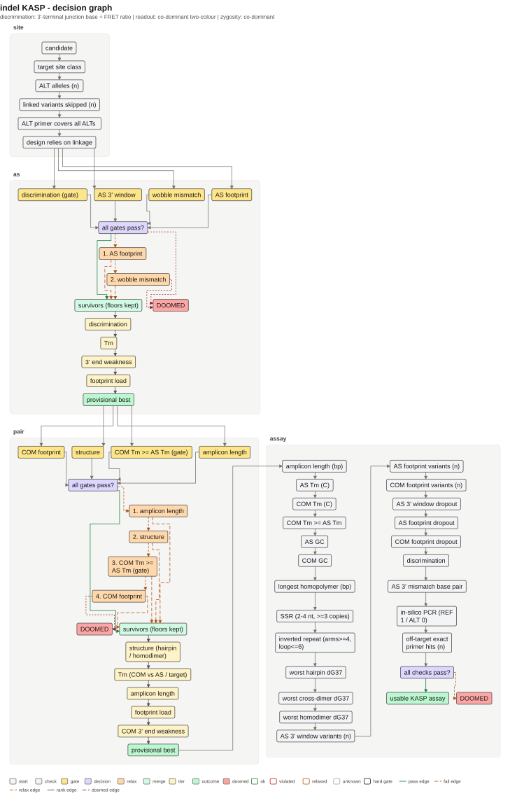
```

```{r, echo = FALSE, out.width = "100%"}
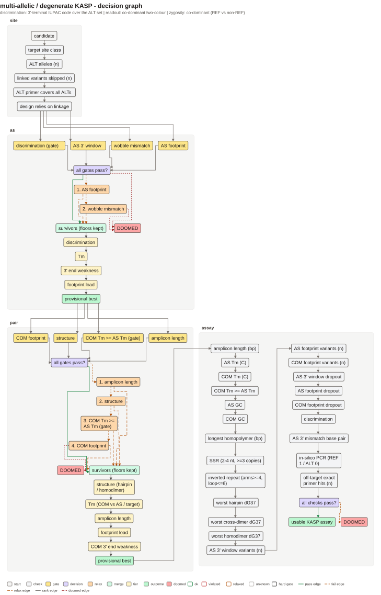
```

```{r, echo = FALSE, out.width = "100%"}
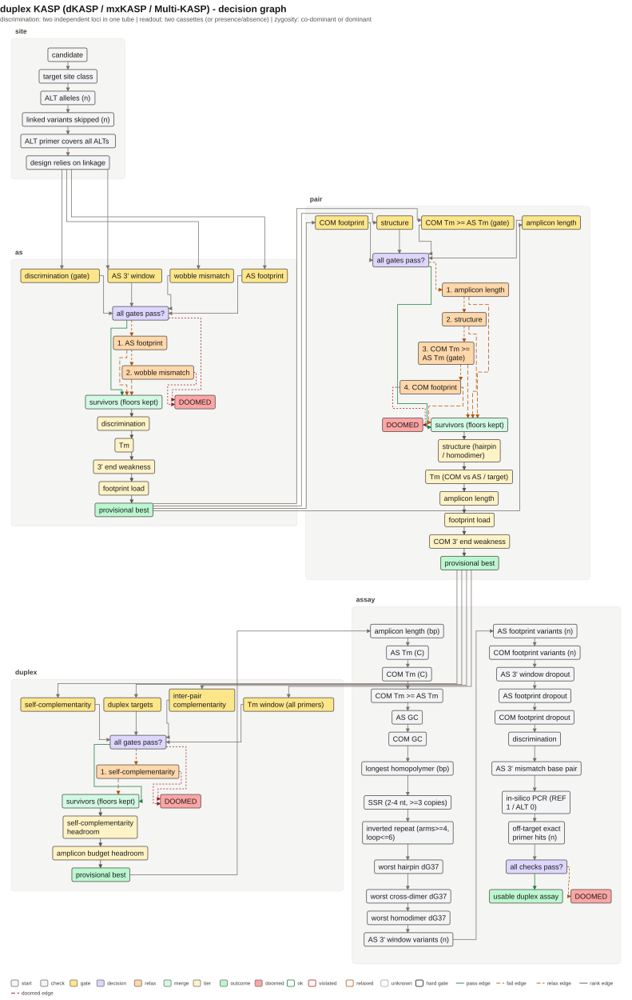
```

```{r, echo = FALSE, out.width = "100%"}
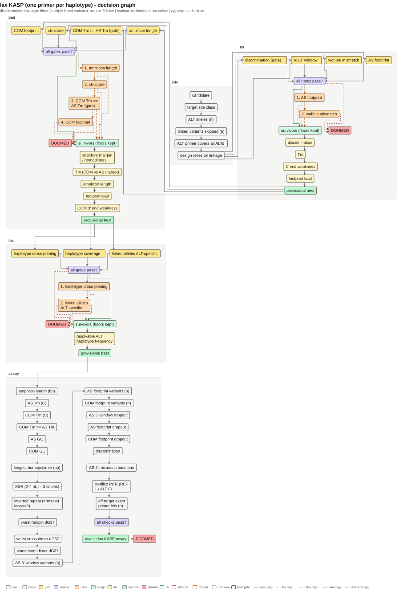
```

```{r, echo = FALSE, out.width = "100%"}
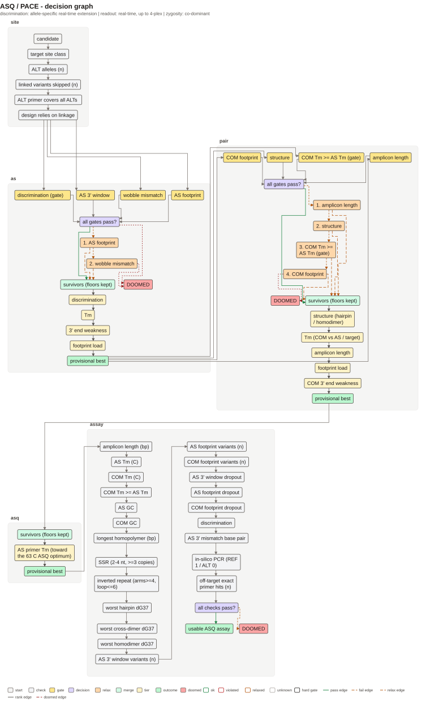
```

```{r, echo = FALSE, out.width = "100%"}
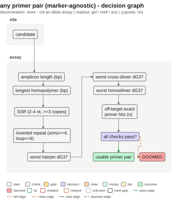
```

**"HARD" on a site check is a colour, not a gate.** In `marker_decision_schema()`
site checks are created as `kind = "check"` (`R/marker_decision.R`), and edges
into `DOOMED` are added only from stage gates, decision nodes and refine nodes.
In `vignettes/figures/decision-snp.svg` the `check:target_site_class` node is
drawn as hard (bold border), but it has no edge into `DOOMED`: edges into
`DOOMED` come only from `as:gate:*`, `pair:gate:*` and refine. So
`target site class` can be FAIL and the path will still carry on down the tree.
For the `indel` scheme this is not theory: `marker_site_class()` returns
`disc = FALSE` for any substitution with a length change
(`R/marker_alleles.R`), and `marker_design_checks()` counts pass as
`isTRUE(site$disc)` (`R/marker_checks.R`). That is, a valid indel gets a red
site check; `tests/testthat/test-indel.R` checks only the column types of the
table, not `pass`. This looks like a bug, not by design: a comment in the same
test calls indel the same 3' mechanism as SNP.

**Acceptance checks converge on one verdict.** `marker_decision_schema()` strings
all check nodes into one chain and connects the last to `assay:decision` ("all
checks pass?"), from which two edges leave: `pass` to `assay:verdict` and `fail`
to `DOOMED`. `evaluation_verdict()` counts the same way
(`R/marker_checks.R`): any `status == "fail"` gives `"doomed"`.
`marker_decision_graph()` only recolours the nodes by `evaluation`. In a single
design `assemble_kasp_assay()` warns only about `KASP_UNGATED_CHECKS`, so a
failure of, say, `AS GC`, `worst hairpin` or `worst cross-dimer` passes
silently; in the batch `design_kasp_markers()` any FAIL gives `warn`, but not
`fail`. That is, "all checks passed" is the condition for the verdict in the
graph and in `evaluation_verdict()`, but not in `assemble_kasp_assay()` itself.

**NA is a pass in selection and a green circle in acceptance.**
`select_with_ladder()` skips an unknown margin: `is.na(m) | m >= bar`
(`R/marker_select.R`) — for example, `m_structure` without OligoArrayAux.
`marker_design_checks()` treats dropout the same way (`is.na(obs) | obs <= tol`)
and off-target the same way (`is.na(o) || o <= 1`). But with `use_eff = FALSE`
(`R/marker_assemble.R`) the layers diverge: `marker_dropout_batch()` gives all
NA, so the acceptance dropout checks pass, while the gates `gate_as_window` /
`gate_as_footprint` / `gate_com_footprint` fall back to the raw counter
(`use_drop` / `use_foot_drop` = FALSE), i.e. to `n_3p` / `n_var`. In the figure,
`plot_checks()` draws `status` straight from `pass` (`R/marker_plots.R`): an
NA-pass is a green circle with a dash `-` instead of a value, and "measured and
good" cannot be told from "not measured". This generalises the duplex case
`homologous = NA` discussed above.

**A counting check does not count, and the gate and the acceptance check measure
different things.** Three "variants (n)" checks have `limit = "0"`, but
pass = `!is.na(dropout) | n == 0` (`R/marker_checks.R`). With a computed dropout
the "n" row is green even at `n > 0`; with an NA dropout it is red at `n > 0`,
even though the dropout row is green at the same time (`is.na(obs) | …`). That
is, the two rows contradict each other, and the "0" in the limit does not match
the test. In addition, selection is laxer than acceptance: the design GC default
is 0.35–0.70 (`R/marker_assemble.R`), while the check is 0.40–0.60
(`KASP_LIMITS$gc`, `R/marker_core.R`); the structure gate looks only at COM
hairpin/homodimer (`grade_assay_pairs()`), while the check covers all three
oligos and the cross-dimer. In a single `assemble_kasp_assay()` such a failure
gives no warning; it is visible only in `assay$evaluation`.

**Frequencies: a missing `pop_freq` is encoded as 1, not as "unknown".**
`marker_variant_alleles()` and `zone_dropout()` take a weight of 1 when there
are no frequencies; `as_variant_table()` does the same (`R/marker_chunk.R`). So
"dropout" is an upper bound, not an estimate for the panel, and the same marker
can change the outcome of the gate depending on whether the `pop_freq` column is
present. The frequency of the target ALT itself does not enter the graph at all:
the MAF tie-break is described correctly above, but in Ensembl Plants MAF =
`null` (`INVENTORY.md`, §H). The population step stays outside.

**The specificity 3' seed is only a tie-break, not a check.** `specificity_seed()`
(15 nt, 1 mismatch) is called in `pick_target_snp()` and `marker_pick_as()` and
stored as `assay$specificity`; `marker_design_checks()` uses exact `ideogram`
hits and allows ≤1 (`ot_pass`). `run_blast = FALSE` by default. A paralogue with
one mismatch has neither a gate nor a check node; the 15 nt point is made
correctly above, but not the fact that the seed is not assessed at acceptance
at all.

**Lax and duplex: an empty set passes the gate, and the figure does not show
it.** `design_lax_marker(haplotypes = NULL)` calls `lax_stage_pick()` with
zeros, `lax_ref_leakage()` returns 0 when there are no REF haplotypes and
`lax_cross_priming_pairs()` returns 0 at <2 designs (`R/marker_lax.R`). In
duplex `isFALSE(NA)` gives `tgt_pass = TRUE`, so the HARD node
`duplex targets` is green at `observed = NA` (`duplex_metrics()`), and
`duplex_selection()` has exactly one candidate, so neither tier can rank
anything. The vacuous gates are noted above; the consequence for the figures is
new: `vignettes/figures/duplex.svg` shows a per-primer checklist but not the
four compatibility gates, and `lax.svg` is captioned "KASP assay" and has no
`haplotype coverage` node. These stages are absent from the figures themselves:
they are visible only in `vignettes/figures/decision-*.txt` and
`man/figures/decision-*.svg`; the graph is built in `marker_decision_schema()`.

**How to read it.** If `assay$evaluation` contains `pass == FALSE`, treat the
marker as a candidate, not a pass, regardless of a green `assay:verdict`; look
separately at `selection$relaxed/violated` and at `(relaxed)` in the `limit`
column; for a hard decision call `passes_all()` and do not let it replace wet
validation.

## What the package does not promise

`marker_readout()` says explicitly that the KASP signal (FRET/melt) is not
simulated: what is designed is the construct, not the kinetics. This guards
against reading a design as a prediction of real genotyping.
