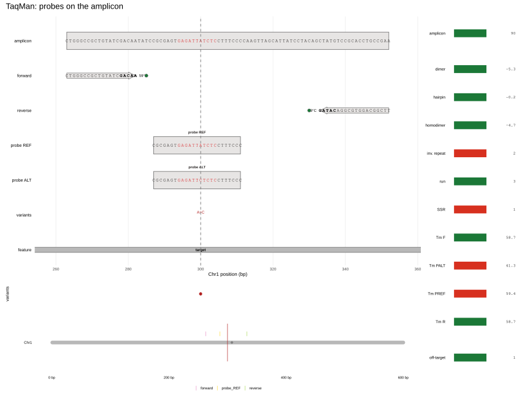
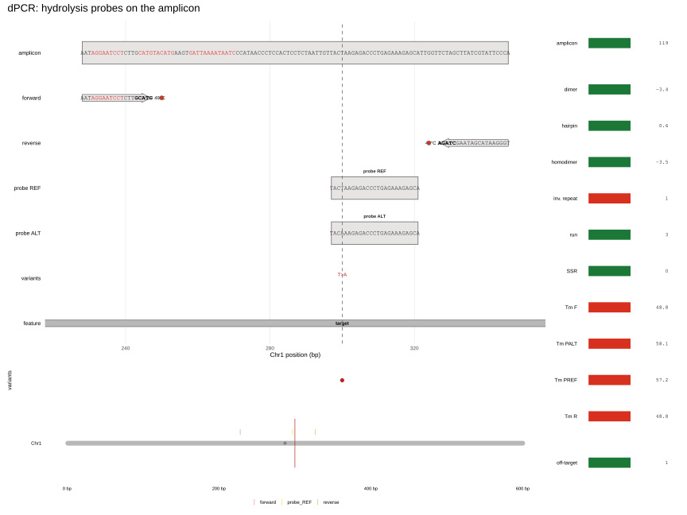
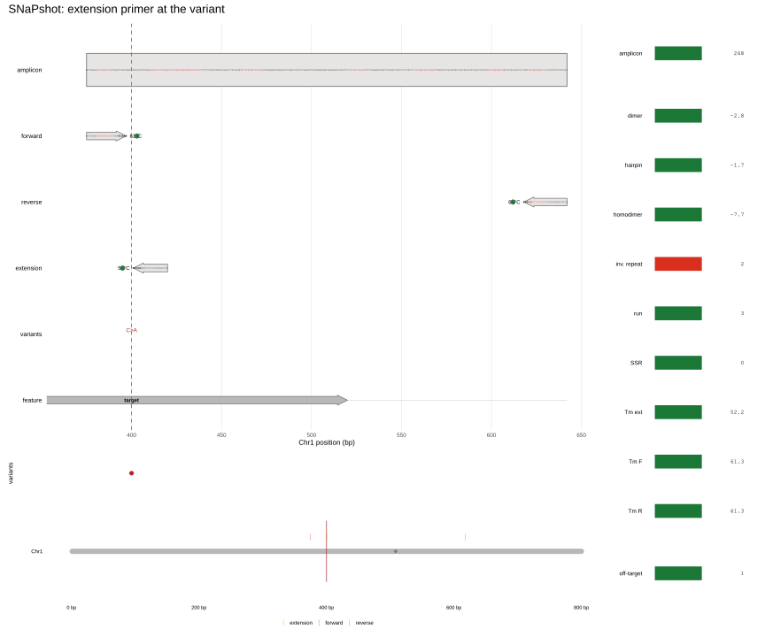
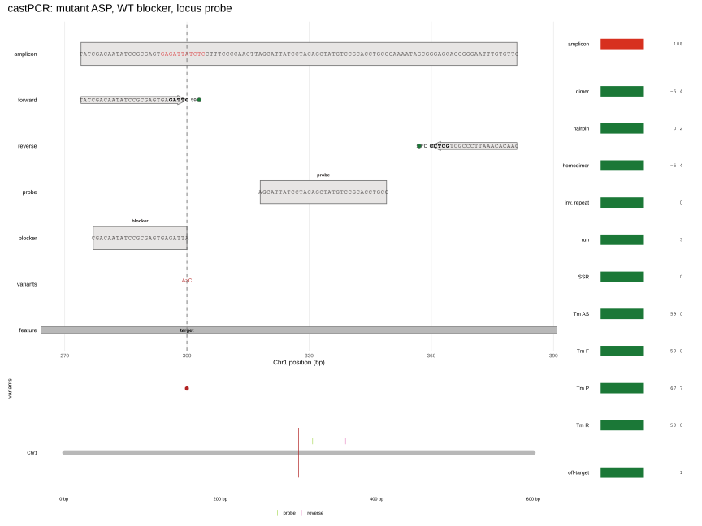
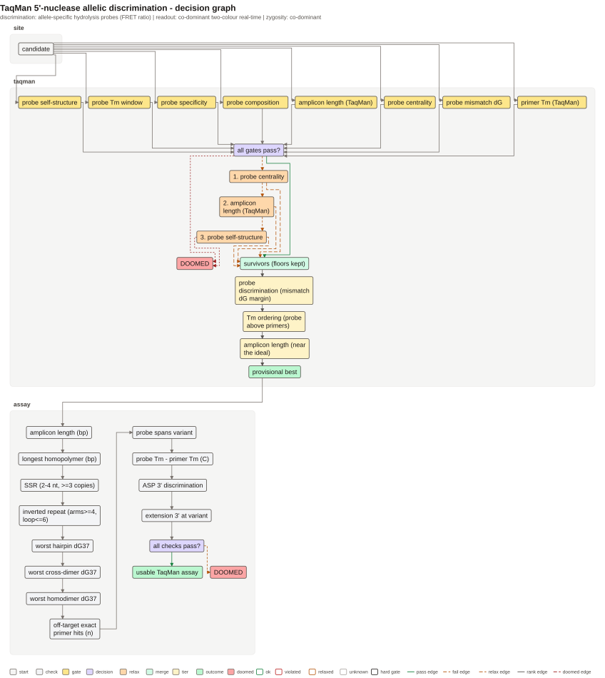
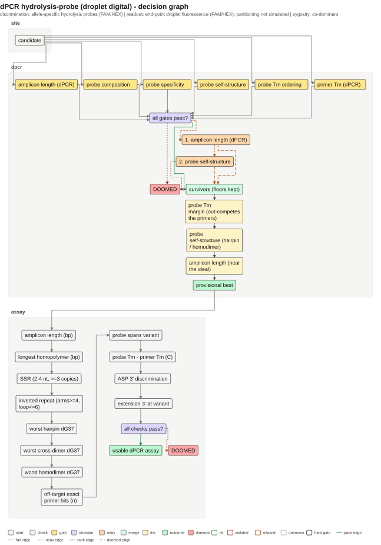
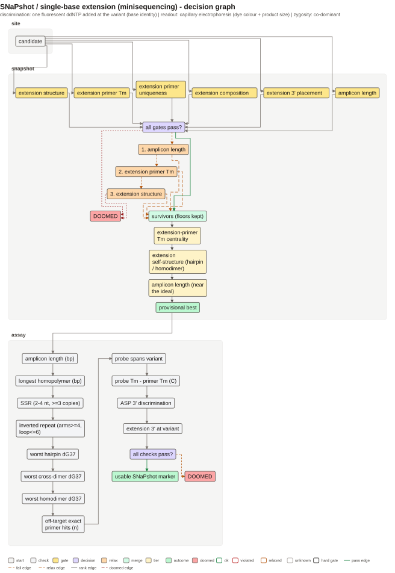
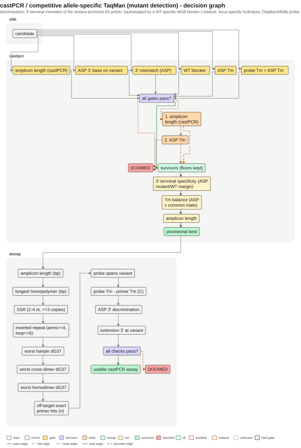

```{r setup, include = FALSE}
knitr::opts_chunk$set(collapse = TRUE, comment = "#>", fig.align = "center")
```

```{r}
library(tidymarkers)
library(knitr)
```

На каждом рисунке — буквы последовательностей (праймеры, проба, ампликон),
трек вариантов, геномная off-site панель и справа тот же tumbler, что у KASP.
Общий принцип этого семейства: дискриминация живёт **на зонде** или на
однонуклеотидной достройке, а не только на 3'-конце праймера. Поэтому
критичны положение зонда, его Tm относительно праймеров и отсутствие
вторичной структуры.

## TaqMan

Две аллель-специфичные пробы (FAM/HEX) лежат между 3'-концами праймеров и
различаются одним основанием. 5'-экзонуклеазная активность Taq расщепляет
пробу только при совпадении, освобождая репортер. Правила: проба не должна
начинаться с G, Tm пробы обычно на 5–10 °C выше праймеров, вариант — в
центральной части пробы.
[Holland et al. (1991)](https://doi.org/10.1073/pnas.88.16.7276).

```{r taqman-fig, echo = FALSE, out.width = "100%", fig.cap = "TaqMan: пара праймеров, две аллель-специфичные пробы, вариант в центре пробы."}

```

```{r, eval = FALSE}
snp <- tibble::tibble(chrom = "Chr1", pos = 300L, ref = "G", alt = "A")
design_taqman_marker(genome, snp, flank = 150)
```

## dPCR

В цифровой ПЦР реакция разбивается на тысячи капель; число положительных
капель переводится в концентрацию по Пуассону. Дизайн конструкта тот же, что
у TaqMan (короткий ампликон, проба между праймерами), но количественная
модель требует независимых капель и минимальной конкуренции.
[Hindson et al. (2011)](https://doi.org/10.1021/ac202028g),
[Huggett et al. (2013)](https://doi.org/10.1373/clinchem.2013.206375).

Пакет проектирует конструкт; разбиение на капли и пуассоновский пересчет
**не симулируются** — это явно записано в `marker_readout()`.

```{r dpcr-fig, echo = FALSE, out.width = "100%", fig.cap = "dPCR: короткий ампликон и гидролизные пробы; модель капель не симулируется."}

```

## SNaPshot (минисеквенирование)

Один фланкирующий ампликон, затем extension-праймер, чей 3'-конец упирается в
основание перед вариантом. Полимераза добавляет один флуоресцентно меченый
ddNTP; цвет и размер продукта говорят, какое основание стоит в варианте.
Праймер удлинения должен лежать внутри ампликона и не перекрывать праймеры.
[Pastinen et al. (1997)](https://doi.org/10.1101/gr.7.6.606).

```{r snapshot-fig, echo = FALSE, out.width = "100%", fig.cap = "SNaPshot: ампликон, extension-праймер, 3'-конец перед вариантом."}

```

## castPCR

castPCR — allele-specific TaqMan для низкой доли мутантного аллеля: ASP читает
**мутантное** основание, WT-специфичный MGB-блокер подавляет дикий тип, а
локус-специфичная проба регистрирует продукт. Ключевые требования: ASP строго
мутант-специфичен, блокер не мешает мутанту, проба не перекрывает вариант ASP.
Механика allele-specific PCR: [Gaudet et al. (2009)](https://doi.org/10.1007/978-1-60327-411-1_26).

```{r castpcr-fig, echo = FALSE, out.width = "100%", fig.cap = "castPCR: мутант-специфичный ASP, WT-блокер и локус-специфичная проба."}

```

## Что проверяется

Для всех четырёх схем общие проверки — состав олиг, отсутствие
гомодимеров/шпилек и Tm/GC. Уникальность по совершенным сайтам считается
для проб TaqMan/dPCR и extension-праймера SNaPshot; у castPCR её заменяют
3'-якорь ASP и WT-блокер. `marker_readout()` отмечает, какая часть сигнала
действительно смоделирована.

## Неудачные маркеры: что пакет ловит, а что нет

«Неудачный» (dud) маркер проходит сухой дизайн, но в пробирке не даёт
сигнала, дискриминации или нужного предела обнаружения. Ниже — конкретные
механизмы отказа; для каждого явно сказано, что пакет **проверяет**
(гейт/acceptance), а что остаётся **рекомендацией** для экспериментальной
валидации. Общая оговорка: термодинамические проверки (шпильки, гомодимеры,
mismatch dG) считаются только при доступном OligoArrayAux; без него маржин
равен `NA` и гейт формально проходит (`grade_one_marker()`), поэтому
«зелёный» граф сам по себе не доказывает устойчивость олиг.

### TaqMan

**Проверяется:** состав пробы (GC 40–60 %, нет 5'-G, нет run/SSR), ровно один
совершенный сайт каждой пробы в геноме, самоструктура, окно Tm [56, 72] °C,
Tm праймеров [58, 63] °C, цена мисматча пробы ≥ 1.5 ккал/моль, центральность
варианта и ампликон 60–150 bp; при OligoArrayAux дополнительно считается
per-allele дискриминация пробы (`probe_discrimination()`).

- **Tm пробы не на 8–10 °C выше праймеров.** Каноническое правило qPCR
  [MacLeod et al. (2021)](https://pmc.ncbi.nlm.nih.gov/articles/PMC7892852/)
  здесь **не гейт**: из-за сжатой Tm-шкалы пакета порядок «проба горячее
  праймеров» — только tier2-ранжирование, а жёсткое окно — абсолютное
  [56, 72] °C. Дизайн может пройти, но в реальной смеси пробе не хватит
  конкуренции за матрицу — проверять на своём буфере/приборе.
- **Слишком короткая или GC-бедная проба.** Отдельного минимума длины нет:
  кандидаты перебираются в 18–25 nt, а крайний GC отсекается окном 40–60 %.
  Это фильтр кандидатов, а не гарантия сигнала; короткую пробу нужно
  тестировать экспериментально.
- **SNP под пробой, но слабая дискриминация.** Гейт требует mismatch
  dG ≥ 1.5 ккал/моль на REF-пробе; это термодинамический прокси, а не
  измеренная экзонуклеазная дискриминация. При отсутствии OligoArrayAux
  гейт проходит с `NA`. Проверять разведениями аллелей и кластерами
  endpoint-флуоресценции; механика —
  [Holland et al. (1991)](https://doi.org/10.1073/pnas.88.16.7276).
- **Малая доля аллеля и фон WT.** Endpoint-отношение не моделируется, как и
  вклад дикого типа и кросс-ток между красителями. Для субпроцентных фракций
  TaqMan не заменяет dPCR; нужны WT-контроли, NTC и серия разведений.

### dPCR

**Проверяется:** те же состав/специфичность/структура пробы, жёсткое условие
Tm пробы ≥ Tm праймеров + 8 °C, Tm праймеров [44, 50] °C и ампликон
60–150 bp. `probe_discrimination()` считает on/off-эффективность (при
OligoArrayAux), но в гейты она не входит.

- **Состав пробы.** Кандидаты 18–25 nt, GC 40–60 %, без 5'-G; как и в
  TaqMan, это фильтр, а не доказательство эффективности.
- **Слабая дискриминация при варианте под пробой.** В отличие от TaqMan,
  отдельного гейта на mismatch dG нет — таблица readout информационная.
  Аллельную дискриминацию нужно подтверждать кластерами капель, а не только
  dG.
- **Доля аллеля ниже доверительного предела.** Пуассоновский пересчёт и
  предел обнаружения **не симулируются** (`marker_readout()`): пакет не
  отвечает, различима ли фракция мутанта. Отчитываться по dMIQE
  [Huggett et al. (2013)](https://doi.org/10.1373/clinchem.2013.206375) с
  доверительным интервалом и контролем числа положительных капель.
- **Допущения партиционирования.** Независимость капель, одинаковый объём,
  отсутствие конкуренции/ингибирования и корректность порога — не
  проверяются; обзор ограничений —
  [Quan et al. (2018)](https://doi.org/10.3390/s18041271), платформа —
  [Hindson et al. (2011)](https://doi.org/10.1021/ac202028g).
- **Фон WT.** Учитывается только совершенный сайт пробы; вклад WT-ДНК,
  ложноположительные капли и кросс-реактивность не моделируются — нужны
  WT-генотипы, NTC и отрицательные капли.

### SNaPshot

**Проверяется:** 3'-конец extension-праймера ровно на одно основание 5' от
варианта, состав (GC 30–70 %, нет run/SSR), уникальность совершенного сайта,
структура, Tm [50, 55] °C и ампликон 100–300 bp.

- **Праймер слишком далеко или слишком близко.** «Далеко» отбрасывается
  конструкцией: кандидат обязан упираться в вариант. «Близко» = ровно
  вплотную, это и есть требование метода
  [Pastinen et al. (1997)](https://doi.org/10.1101/gr.7.6.606); положение
  фиксировано, поэтому свободы для «слишком близко» нет.
- **Плохой 3'-дизайн и неполная достройка.** Идентичность 3'-основания не
  оценивается (любое основание допустимо), а эффективность однонуклеотидной
  достройки, включение ddNTP и высоты пиков **не симулируются**
  (`marker_readout()`). Нужны положительные контроли и оптимизация времени
  достройки; примеры дизайна —
  [Fanis et al. (2014)](https://doi.org/10.1186/1471-2164-15-108),
  [Namdar Aligoodarzi et al. (2023)](https://doi.org/10.52547/ibj.3856).
- **Dye/mobility.** Цвет канала и подвижность продукта в капилляре не
  моделируются; мультиплекс и размерный стандарт проверяются только
  экспериментально.
- **Off-target.** Проверяется только совершенный сайт extension-праймера;
  прайминг с 1–2 мисматчами не считается.

### castPCR

**Проверяется:** 3'-основание ASP на варианте и его предпочтение мутанту,
наличие WT-специфичного блокера (3'-основание = WT), Tm ASP [55, 65] °C,
Tm пробы ≥ Tm ASP + 8 °C, ампликон 50–100 bp и состав блокера; совместная
структура олиг считается в `compatibility`, но не входит в жёсткие гейты.

- **Баланс ASP и WT-блокера.** Пакет выбирает самый длинный «чистый»
  WT-блокер и размещает ASP, но их конкуренцию и соотношение концентраций
  не моделирует. Подбирать эмпирически; механизм —
  [Barbano et al. (2015)](https://pmc.ncbi.nlm.nih.gov/articles/PMC4686972/),
  [Roma et al. (2013)](https://pmc.ncbi.nlm.nih.gov/articles/PMC3864078/).
- **Блокер не подавляет WT.** Проверяются только WT-якорь и состав, а
  эффективность подавления и вклад MGB (подъём эффективной Tm) не
  симулируются. Нужны WT-only контроли и ΔCt; клинический формат —
  [Husain et al. (2023)](https://pmc.ncbi.nlm.nih.gov/articles/PMC10334107/).
- **Локус-проба.** Реализованы положение внутри ампликона без перекрытия с
  ASP и Tm > ASP + 8 °C, но геномная уникальность пробы/блокера/ASP не
  гейтится дизайнером (в отличие от TaqMan/dPCR), и MGB не моделируется.
  Проверять BLAST/primer-BLAST.
- **Низкая мутантная фракция.** Предел 0.1–1 % из статей не предсказывается:
  `marker_readout()` прямо говорит, что ΔCt не симулируется. Нужна серия
  разведений мутанта в WT-ДНК.

### Off-target и перекрёстная реакция

Во всех четырёх схемах уникальность считается по **совершенному** сайту
(`max.mismatch = 0`, обе ориентации); 1–2 мисматча, 3'-затравочный прайминг
и перекрёстная реакция проба/блокер остаются вне проверки. Для
диагностических маркеров это обязательный внешний шаг: primer-BLAST/BLAST,
in-silico PCR с мисматчами и отрицательные контроли. Общие правила
специфичности qPCR —
[MacLeod et al. (2021)](https://pmc.ncbi.nlm.nih.gov/articles/PMC7892852/).

### Аудит решений

`vignettes/figures/decision-{taqman,dpcr,snapshot,castpcr}.{svg,txt}` — это **схема**
(`plot_decision_tree(scheme = <id>)` без `assay`), а не трассировка конкретного
кандидата: узлы нейтральны, а блок `assay acceptance checks` только перечисляет
критерии. SVG-рисунки — карта конструкта плюс панель проверок; ни один из них
не показывает endpoint-кластеры, капли, электрофореграммы или ΔCt. Поэтому
«граф прошёл» и «рисунок зелёный» — разные утверждения.

```{r, echo = FALSE, out.width = "100%"}

```

```{r, echo = FALSE, out.width = "100%"}

```

```{r, echo = FALSE, out.width = "100%"}

```

```{r, echo = FALSE, out.width = "100%"}

```

- **Tm пробы vs праймеров.** *Видно:* у TaqMan порядок «проба выше праймеров»
  остаётся tier2 (не гейт), у dPCR/castPCR — жёсткий +8 °C. SVG: TaqMan-пробы
  59.4/61.3 °C при праймерах 58.7 (+0.7/+2.6), dPCR — 57.2/58.1 при 48.8
  (+8.4/+9.3), castPCR — 67.7 при ASP 59.0 (+8.7). *Слабое место:* в
  `probes$tm[1L]` лежит одна Tm на обе аллельные пробы; ALT-проба не
  пересчитывается — добавить её Tm в гейт/tier.

- **Положение пробы.** *Видно:* жёсткий узел placement есть только у SNaPshot;
  у TaqMan положение задаёт мягкий гейт centrality, у dPCR узла нет, у castPCR
  ASP-якорь жёсткий, а локус-проба — фильтр кандидатов. *Слабое место:* граф
  не различает «вплотную» и «с зазором» и не показывает, какая граница отсеяла
  кандидата; при провале дизайнер возвращает `NULL`. Добавить узел зазора и
  причину отказа.

- **Дискриминация мисматча.** *Видно:* TaqMan — жёсткий ΔG ≥ 1.5 ккал/моль,
  но только для REF-пробы; dPCR — гейта нет, `probe_discrimination()` остаётся
  информационной (DECIPHER: гибридизация × Taq, не расщепление); SNaPshot —
  дискриминация по основанию, не по ΔG; castPCR — `alt_on − alt_off > 0`
  (предсказанный DECIPHER запас), т.е. только знак. *Слабое место:* ALT-проба
  TaqMan не оценена, у castPCR проходит и 0.001, а на SVG нет строки
  discrimination/ΔG; проверять обе аллели с порогом эффекта, затем ΔCt/разведения.

- **Низкая доля аллеля и фон WT.** *Видно:* ни в одном DAG нет узла «доля
  аллеля», «фон WT» или «LOD»; castPCR tier1 — предсказанный запас, не LOD.
  *Слабое место:* LOD и ΔCt не моделируются; не выводить LOD из tier1, задавать
  его явным внешним параметром.

- **Пуассон/партиционирование.** *Видно:* у dPCR нет узла капель; при наличии
  OligoArrayAux `marker_readout()` возвращает `simulated = TRUE` только потому,
  что есть таблица гибридизации проб, а `readout_assumption("dpcr")` и
  `scheme$readout` прямо говорят, что партиционирование/Пуассон не
  моделируются. *Слабое место:* в отчёте нельзя смешивать probe-таблицу с
  пуассоновским шагом; копии/мкл с CI и числом положительных капель остаются
  внешними.

- **SNaPshot: достройка, ddNTP, красители.** *Видно:* placement/состав/
  уникальность extension — жёсткие, а Tm, ампликон и structure — **мягкие**
  (лестница может расширить до [45, 60] °C и [50, 350] bp), хотя первый проход
  перечисляет их как фиксированные. *Слабое место:* в графе нет 3'-концевого
  основания, локального контекста, эффективности ddNTP, канала красителя и
  высоты пиков; SVG — карта, не электрофореграмма. Добавить узел 3'-контекста
  и не выдавать мягкие окна за жёсткие.

- **castPCR: ASP/блокер.** *Видно:* ASP Tm и ампликон — мягкие (±2 °C/±10 bp);
  блокер проверяется только на наличие, 3'-основание (не mutant) и состав,
  `selection` не хранит маржи гейтов, а в панели проверок рисунка блокера нет
  вовсе (`marker_primers.marker_castpcr()` возвращает ASP, праймеры и пробу, но
  не blocker). *Слабое место:* нет Tm/ΔG, MGB, non-extendable, соотношения
  ASP:blocker и эффективности подавления; блокер должен быть отдельным узлом
  графа и строкой панели, а не только записью в `compatibility`.

- **Off-target / cross-reactivity.** *Видно:* exact perfect-site гейты есть
  только для проб TaqMan/dPCR и extension SNaPshot; у castPCR их нет. Строка
  `off-target exact primer hits` в графе декларативна, а панель SVG считает
  exact hits для всех олиг из `marker_primers()` — но у castPCR без блокера.
  *Слабое место:* 1–2 мисматча, 3'-seed и cross-reactivity пробы/блокера не
  считаются; перевести эту строку в исполняемый гейт или убрать из графа, а
  mismatch-tolerant проверку оставить внешней.

Отдельно о свидетельстве рисунка: панель Tm оценивается по
`marker_tm_window()` (для dPCR-праймеров 58–62 °C, для проб 65–72 °C), а не по
гейтам (dPCR-праймеры 44–50 °C; TaqMan-проба 56–72 °C). Поэтому в SVG красные
строки: dPCR-праймеры 48.8 °C и пробы 57.2/58.1 °C получают `broken`, хотя
гейты их пропускают; у TaqMan пробы 59.4/61.3 °C тоже `broken` при гейте
[56, 72]. Исправить таблицу отображения или подписать цвет как эвристику.

Уточнение к первому проходу: мягкие окна — TaqMan centrality/ампликон/
структура, dPCR ампликон/структура, SNaPshot ампликон/Tm/структура, castPCR
ампликон/ASP Tm; лестница сдвигает их, так что это идеальные пороги, а не
жёсткие границы. Ссылки на механизмы — те же, что выше (Holland 1991;
Pastinen 1997; Hindson 2011; Huggett 2013; Barbano 2015; Roma 2013;
MacLeod 2021).
